# Portal Oracle — gestão de espaço

Portal web em Python (Flask + Gunicorn + Nginx) organizado em **módulos**, com **utilizadores e perfis**. O primeiro módulo é o **Oracle** (tablespaces e shrink); o portal está preparado para receber outros módulos, cada um com o seu menu, as suas permissões e a possibilidade de ser ativado ou desativado.

Instala-se **num servidor** (script `instalar.sh`, ver [Instalação num servidor](#instalação-num-servidor-sem-docker)) ou num **contentor único em Ubuntu 26.04 LTS** com Nginx, Gunicorn, **OpenSSH** (para o VS Code Remote-SSH), **cron**, **git** e as ferramentas habituais (`ping`, `ip`, `vim`, `nano`).

---

## Funcionalidades

| Menu | Conteúdo |
|---|---|
| **Home** | Painel de cartões dos módulos a que o utilizador tem acesso (Oracle, Sistema, SMTP, notificações e o estado do portal), atualizado de x em x segundos; botão **Editar** para adicionar, esconder e reordenar cartões |
| **Oracle → Bases de dados** | Estado de cada BD (verde/laranja/vermelho), versão, SID, service name, Data Guard; janela com ASM, Data Guard, jobs, recyclebin por schema, schemas, backups RMAN e Data Pump |
| **Oracle → Tablespaces** | Tamanho, usado e livre, do maior para o mais pequeno (sem SYSTEM, SYSAUX, UNDO e TEMP) |
| **Oracle → Shrink** | Um tablespace ou TODOS, em ANÁLISE ou EXECUTAR, corre em segundo plano |
| **Oracle → Execuções** | Tabela dinâmica com filtros (sucesso, avisos, erros, falhadas, em curso; tablespace; BD; modo; texto também no output), janela com o output a saltar para os erros, apagar (uma, selecionadas, falhadas); andamento em direto (barra, passos, tempo, output linha a linha), log e cancelamento |
| **Sistema** | Servidor onde o portal corre: CPU, RAM, discos, serviços (Nginx, portal, agente, ...) com start/stop/restart, em cartões que se podem esconder e reordenar (**Editar**), atualizados a cada 2 s pelo agente; abas **Agentes** (estado, parâmetros, recursos, processos e gráficos de cada agente) e **Análise** (recursos usados pelo portal por componente) |
| **Oracle → Definições** | Bases de dados Oracle: host, porta, SID ou Service Name, PDB, utilizador, password cifrada, Normal ou SYSDBA |
| **Configuração** | **Geral**, **Aparência** (Geral: título, textos, ícone e tema; **Linguagem**: línguas e traduções, exportar/importar XML), **Manutenção** (modo de manutenção com editor HTML), **Módulos** (abas Ativos/Inativos, interruptor e **Editar**: nome, perfis com acesso, agendamentos e notificações), **Agendamento** (tarefas dos módulos), **Setup** (resumo da instalação, ficheiros, permissões e comandos), **Armazenamento**, **Utilizadores**, **Perfis** e **Backups** |
| **Língua** (bandeiras ao lado do sininho) | Português ou inglês (e outras que se acrescentem), por utilizador; também na página de entrada |
| **Agente do portal** (serviço `<nome>-agente`) | Corre as execuções Oracle (continuam se o portal reiniciar), publica as métricas do servidor e executa as ações sobre serviços |
| **Minha área** (nome no canto superior direito) | Dados do utilizador, permissões e alteração da password |

### Home: painel de cartões

| Cartão | Módulo | Conteúdo |
|---|---|---|
| Oracle | Oracle | Bases de dados, em curso (com barra de cada execução), execuções e erros nas últimas 24 h |
| Bases de dados | Oracle | As BDs visíveis, com os botões Tablespaces e Shrink |
| Últimas execuções | Oracle | As 6 últimas, com o estado |
| Monitor de recursos | Sistema | CPU, memória e disco `/`, com barras |
| Servidor | Sistema | Saudável / Sob pressão (> 90 %) / Atenção (serviço parado), servidor, sistema, ligado há, agente |
| Serviços | Sistema | Estado de cada serviço |
| Sistemas de ficheiros | Sistema | Todos os discos (escondido por omissão) |
| Email (SMTP) | SMTP | Estado do envio, enviados e com erro nas últimas 24 h, fila, última validação |
| Notificações | — | As últimas notificações do sininho |
| Portal | — | Manutenção, agente, último backup, armazenamento, módulos e utilizadores (só para quem tem `config.portal`) |

- **Atualizar:** manual, 10 s, 30 s (omissão), 1 min ou 5 min, mais o botão ↻. A escolha fica no browser; não atualiza com o separador escondido.
- **Editar** (ícone do lápis): os cartões ficam com ✕ (esconder) e podem ser arrastados; a barra de edição mostra os cartões escondidos com **+** para os voltar a pôr, **Repor** (disposição original) e **Concluir**. A disposição fica guardada por utilizador (na tabela `settings`, `layout.home.<utilizador>`), por isso é a mesma em qualquer browser.

| Home | Editar painel |
|---|---|
| 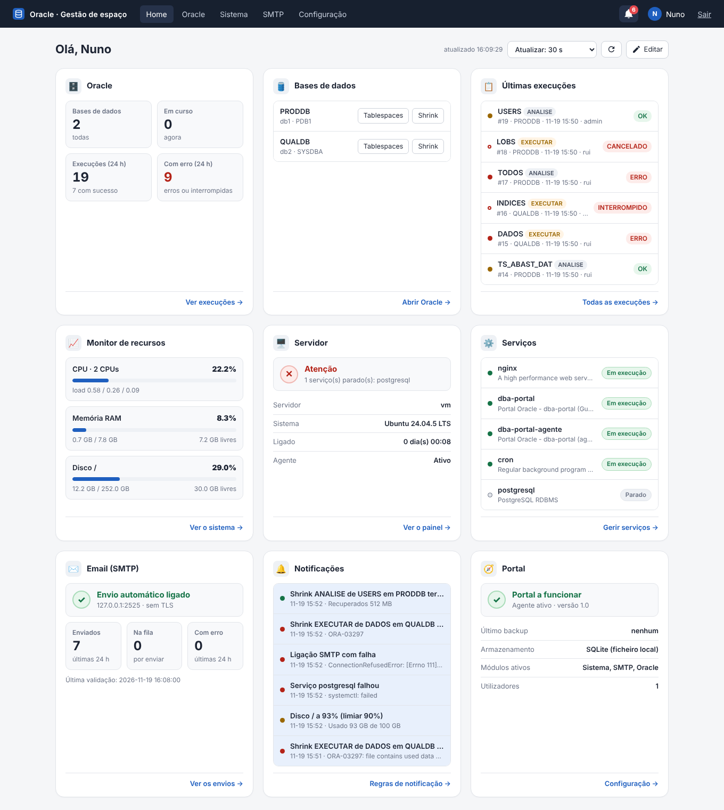 | 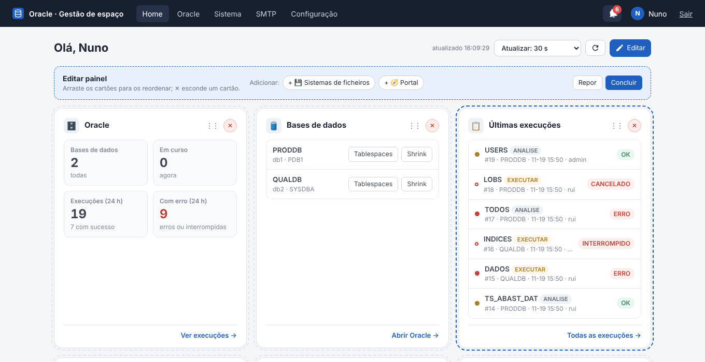 |

### Shrink em segundo plano, agendado e cancelamento

| Opção (em Shrink → Quando) | O que acontece |
|---|---|
| **Agora, em segundo plano** | Corre no agente do portal (ou numa thread do portal, sem agente). O portal volta para **Execuções** com a execução destacada: pode continuar a usar o portal e acompanhar lá, na página da execução ou no cartão **Tarefas** da Home |
| **Agendar** | Data e hora (atalhos: hoje às 22:00, esta madrugada às 02:00, sábado às 01:00; até 60 dias). Fica **AGENDADO** e o agente corre-o à hora marcada (precisa do agente ativo). Em Execuções há o filtro **Agendadas**; cancela-se na página da execução até começar |

**Cancelar** uma execução em curso faz `ALTER SYSTEM KILL SESSION ... IMMEDIATE`. Se o Oracle responder **ORA-00031** (sessão marcada para terminar, por vezes com `DPY-4011` porque a ligação cai), o cancelamento foi aceite: o Oracle termina a sessão depois de desfazer a operação em curso (num MOVE/REBUILD grande pode demorar) e a execução fica CANCELADO.

O cartão **Tarefas** da Home mostra execuções em curso, na fila e agendadas, as atualizações em segundo plano e as próximas tarefas de Configuração → Agendamento.

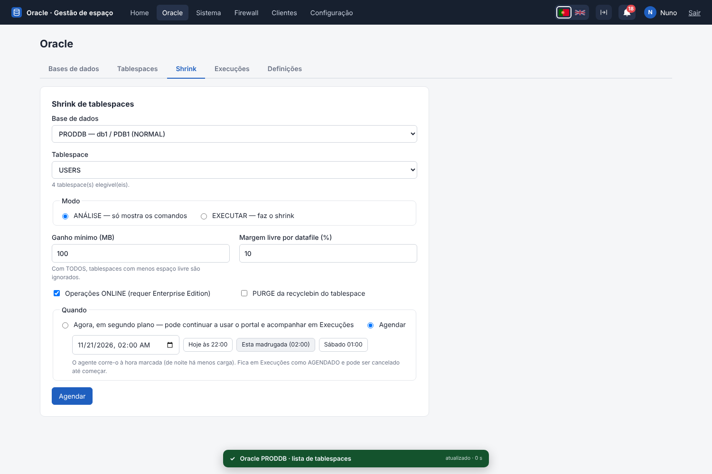
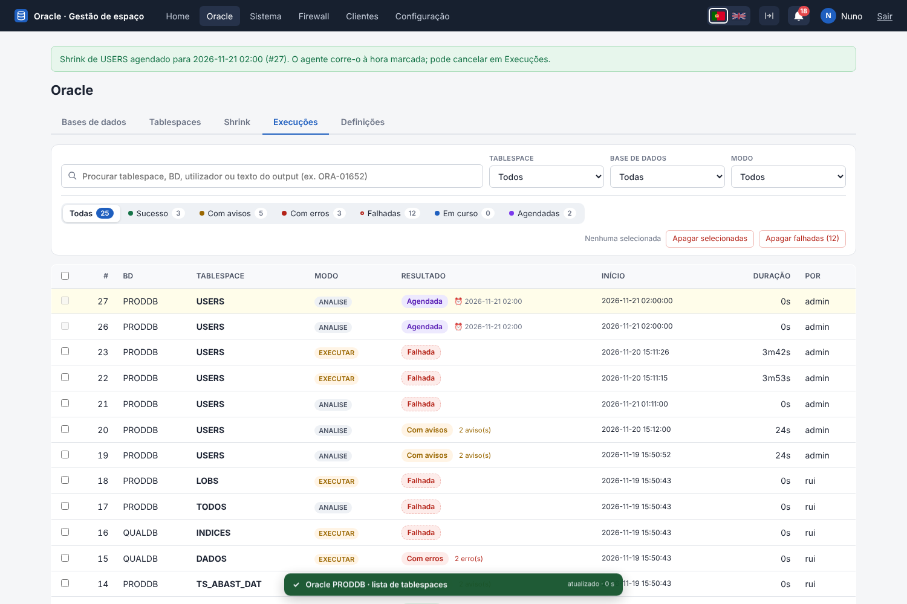
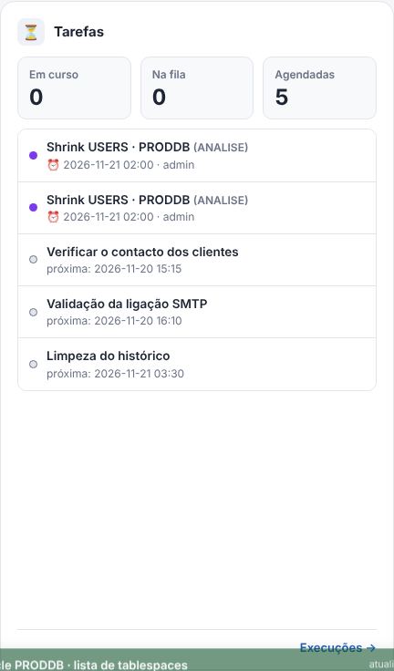

### Oracle → Bases de dados

Permissão `oracle.bds`. Uma tabela com todas as BDs visíveis no perfil, verificadas em paralelo (botão **Atualizar**):

| Coluna | Origem |
|---|---|
| Estado (bola) | 🟢 aberta (`OPEN`, com o `OPEN_MODE`), 🟠 `MOUNT`/`NOMOUNT` ou a abrir/fechar (ORA-01033), 🔴 fechada (ORA-01034, serviço não registado) ou sem ligação. Passar o rato mostra o texto |
| Base de dados, contentor, CDB | `V$DATABASE`, `SYS_CONTEXT('USERENV', 'CON_NAME')` |
| Versão, instância (SID), servidor | `V$INSTANCE`, `V$VERSION` |
| Service name | O da ligação, e os outros de `V$SERVICES` |
| Papel / Data Guard | `DATABASE_ROLE`; **Data Guard** se for standby, tiver destino `STANDBY` válido ou o broker ligado |
| Log | `ARCHIVELOG`/`NOARCHIVELOG`, `FLASHBACK` |
| Ligação | Utilizador usado; `portal` se foi criado pelo portal |

Filtros: Todas / Abertas / Montadas / Fechadas e pesquisa. **Clicar numa BD** abre a janela com o detalhe (cada aba é lida quando se abre):

| Aba | Conteúdo |
|---|---|
| **Geral** | Estado, versão, plataforma, arranque, papel, proteção, log mode, flashback, force logging, serviços; tamanho (datafiles, temp, segmentos), tablespaces, sessões, SGA/PGA, character set, redo, FRA; as 5 tablespaces mais ocupadas |
| **ASM** | Diskgroups (`V$ASM_DISKGROUP`): estado, redundância, total, livre, utilizável, % ocupado, discos offline |
| **Data Guard** | Papel, proteção, switchover, broker, fast-start failover; destinos (`V$ARCHIVE_DEST_STATUS`: estado, modo, recuperação, gap, erro); atraso no standby (`V$DATAGUARD_STATS`) |
| **Jobs** | `DBA_SCHEDULER_JOBS` (sem os do SYS): ativo, estado, última/próxima, execuções, falhas; falhas dos últimos 7 dias; `DBA_JOBS` |
| **Recyclebin** | Total e por schema (objetos, espaço, mais antigo); clicar num schema mostra os objetos e o comando `PURGE` |
| **Schemas** | `DBA_USERS` não mantidos pela Oracle: estado, tablespace, tamanho, segmentos, criado, último login. Os **criados pelo portal** aparecem a roxo, com filtro |
| **Backups RMAN** | Últimos 30 dias (`V$RMAN_BACKUP_JOB_DETAILS`): tipo, estado, lido/escrito, destino, duração; último DB FULL, DB INCR e ARCHIVELOG concluídos |
| **Data Pump** | Jobs em curso ou parados (`DBA_DATAPUMP_JOBS`) e diretórios. O histórico dos expdp/impdp terminados não fica no dicionário (está nos `.log`) |

Tudo é só leitura (`SELECT ANY DICTIONARY` chega). Cada consulta tem o comentário `/* portal:<aba> */`, para se encontrar no `V$SQL`.

| Bases de dados | Detalhe (Geral) | Recyclebin por schema |
|---|---|---|
| 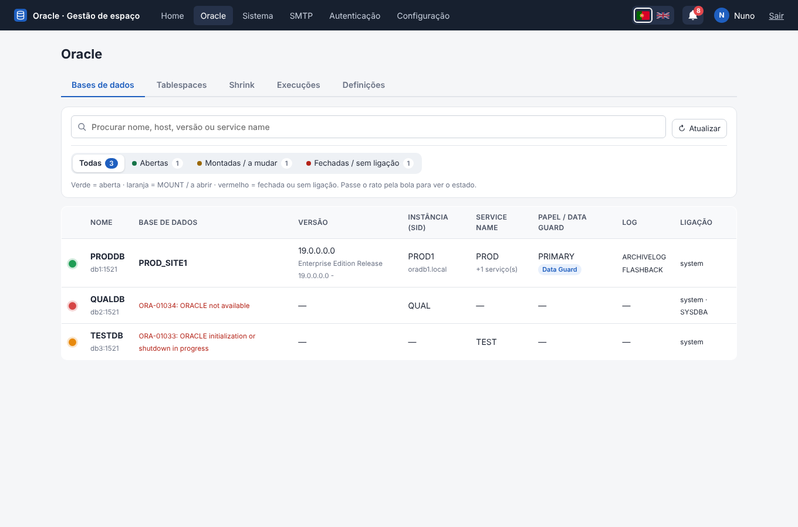 | 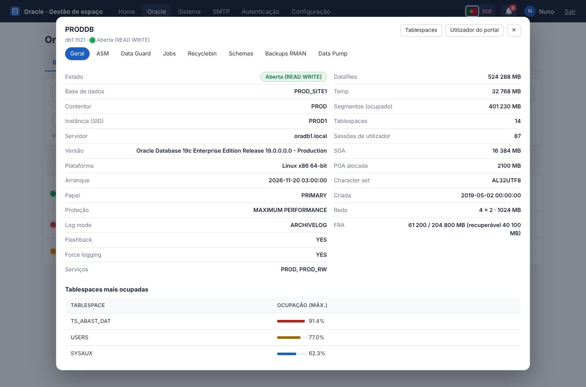 | 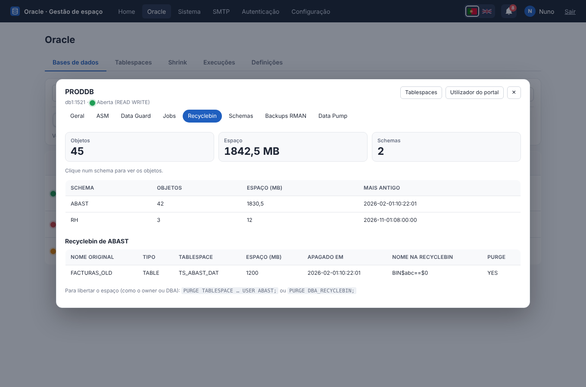 |

#### Cache e atualização em segundo plano

As consultas às bases de dados (estado, janela de cada BD, Tablespaces e a lista de tablespaces do Shrink) ficam **em cache** no portal (tabela `cache_dados`):

| Situação | O que acontece |
|---|---|
| Há dados em cache | Aparecem logo, com "Dados de HH:MM:SS (há N s)". Se tiverem mais de 30 s (60 s nas janelas e Tablespaces), o portal atualiza-os em segundo plano |
| Não há dados | "Oracle a carregar…" com uma barra; a consulta corre em segundo plano |
| Atualização terminada | A vista aberta (janela da BD, linha da tabela, página de Tablespaces, lista do Shrink) atualiza-se sozinha |
| Erro | Ficam os dados anteriores e a mensagem "Última atualização falhou" |
| **↻ Atualizar** | Força a leitura (ignora a idade da cache) |

A **caixa de processos** (canto inferior direito) junta numa só caixa tudo o que está a correr: as atualizações de dados em segundo plano do utilizador, as **execuções Oracle** (shrink em curso ou na fila, com o passo e a %) e os **pedidos aos agentes** dos clientes. Fechada mostra só o número em execução (⟳ 3 em execução); ao clicar estende-se para o lado com a lista por grupo (título, passo, tempo decorrido, quem pediu, barra de progresso) e clicar num item abre a execução ou o pedido. Ao acabar mostra ✓ ou ✕ uns segundos e desaparece. Fica aberta ou fechada como a deixou, continua noutras páginas (o estado está no servidor) e só mostra os módulos a que o utilizador tem acesso; `Esc` recolhe.

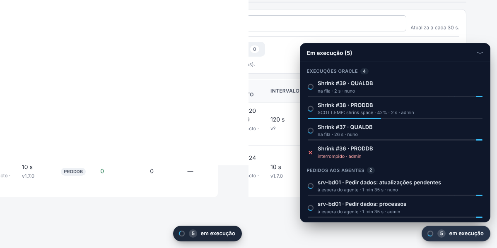

Se a BD responder em menos de ~1 s, os dados vêm logo no mesmo pedido. A cache de uma BD é apagada quando a sua definição é alterada; as entradas com mais de 7 dias saem com a tarefa **Limpeza do histórico**.

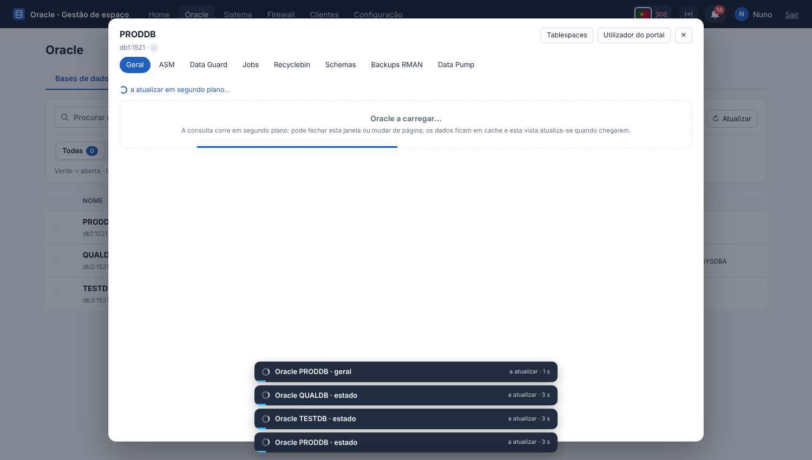
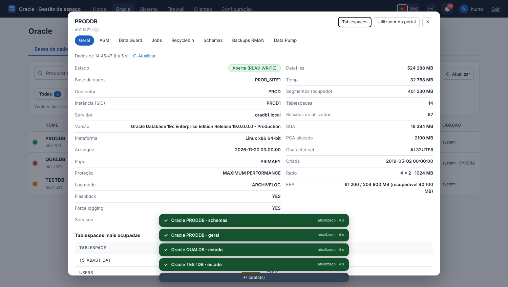

### Histórico de execuções (Oracle → Execuções)

| Elemento | Descrição |
|---|---|
| **Pesquisa** | Tablespace, BD, utilizador ou **texto no output** (ex. `ORA-01652`), feita no servidor |
| **Filtros** | Num só bloco: pesquisa, listas de tablespace, BD e modo, e por baixo os resultados (Todas, Sucesso, Com avisos, Com erros, Falhadas, Em curso) com as contagens. **Limpar filtros** volta ao início |
| **Tabela** | Ordena ao clicar no cabeçalho, 50 por página, atualiza sozinha enquanto houver execuções em curso ou na fila |
| **Janela** (clicar numa linha) | Parâmetros, duração, erro (se a execução falhou) e output com cores. Salta para a 1.ª linha com erro/aviso; ↑/↓ (ou Alt+↑/↓) percorre-as; "Só linhas com erro/aviso" mostra só essas, com o número da linha. Botões Abrir página, Descarregar log e Apagar |
| **Apagar** | Uma (janela ou página da execução), as selecionadas, ou todas as falhadas. Permissão `oracle.execucoes.apagar`. As que estão em curso ou na fila não se apagam |

| Resultado | Quando |
|---|---|
| Sucesso | Terminou sem linhas de erro nem de aviso |
| Com avisos | Terminou com `-- AVISO`, `-- MANUAL` ou `IGNORADO` no output |
| Com erros | Terminou, mas com `-- ERRO` ou `ORA-nnnnn` no output (ex. um resize ou MOVE que falhou) |
| Falhada | Não chegou ao fim: INTERROMPIDO, CANCELADO ou erro de ligação/execução |

| Pesquisa e filtros | Janela com o output |
|---|---|
| 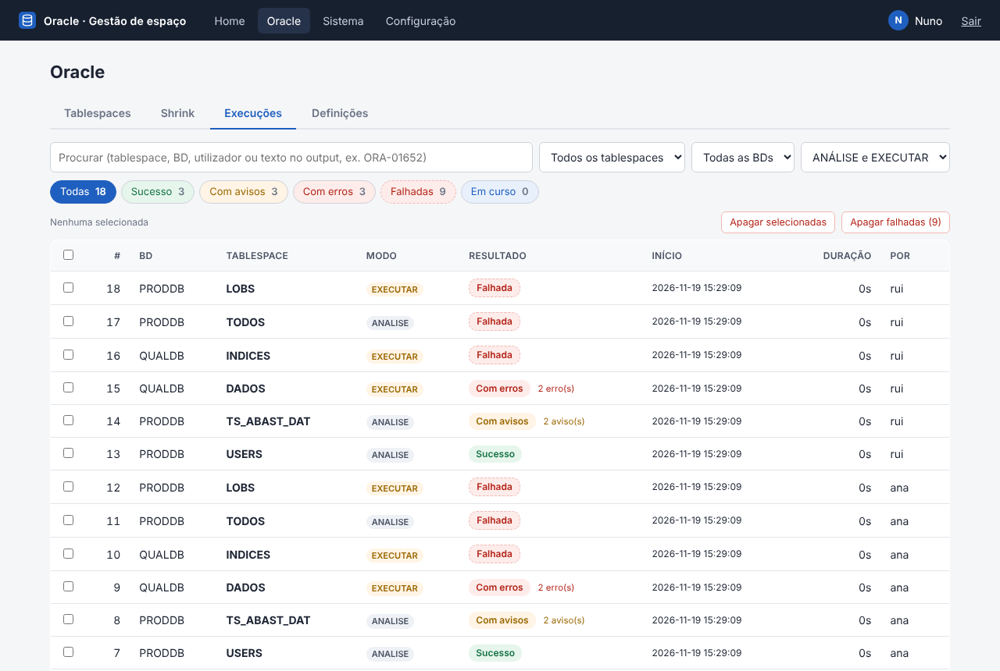 | 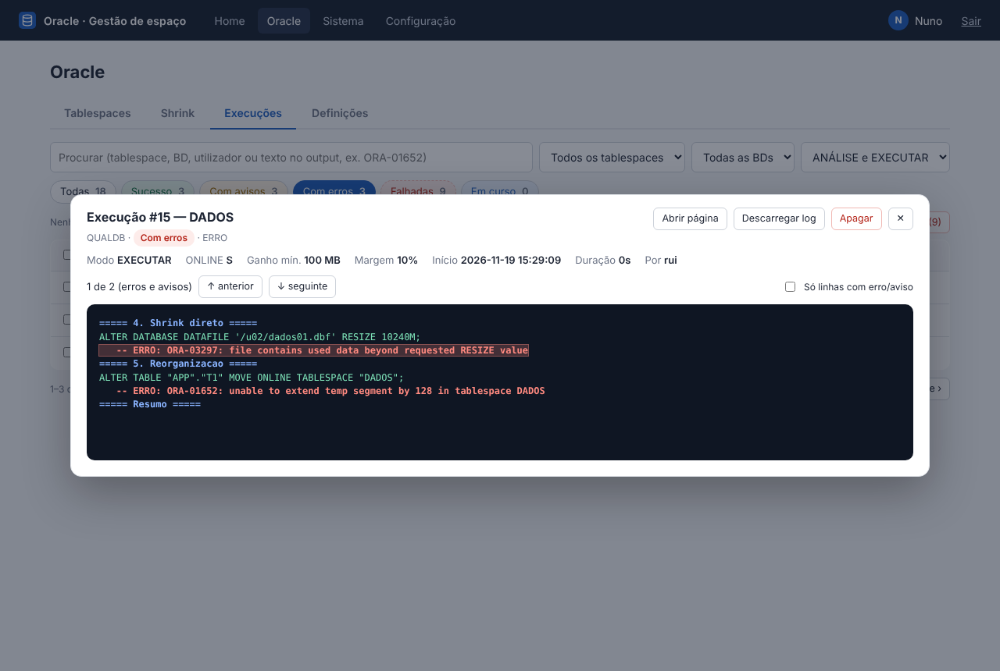 |

### Retomar execuções e repetir pedidos

| Onde | Como |
|---|---|
| **Oracle → Execuções** | Numa execução **interrompida, cancelada ou com erro** (shrink ou recyclebin, análise ou executar), o botão **↻ Retomar** (na página da execução e na janela do output) cria uma nova execução com os mesmos parâmetros e modo. No shrink EXECUTAR o que já foi feito fica e o bloco recalcula o que falta. A página indica "Retoma da execução #N" e, na original, "Retomada em: #M". Exige a mesma permissão que lançar (análise/executar) |
| **Clientes → Pedidos** | Num pedido que **falhou** (dados, abrir ficheiro, atualizar o agente, firewall), **↻ Repetir** na tabela ou no output faz o mesmo pedido de novo e mostra logo o output do novo. Atualizar exige `clientes.gerir`; alterações de firewall exigem `clientes.firewall` |

### Oracle → Tablespaces: gráficos de fatias

Por cima da tabela de tablespaces, dois gráficos de fatias (donut): **Espaço usado por tablespace** (quem ocupa mais) e **Espaço livre por tablespace** (alocado mas livre: candidatos a shrink). Mostram os 8 maiores e o resto em "Outros", com legenda (valor e %); passar o rato numa fatia ou na legenda realça-a e mostra a % no centro; no gráfico do livre, clicar abre o Shrink já com o tablespace escolhido. Sem bibliotecas externas (`PortalGrafico.fatias` em `static/graficos.js`).

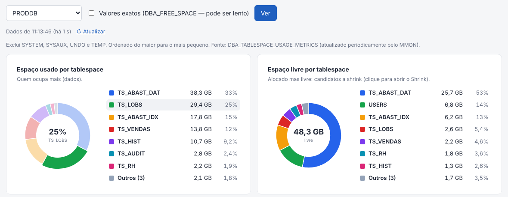

### Oracle → Recyclebin

Nova aba **Recyclebin**: escolhe-se a base de dados e vê-se a recyclebin de **todos os schemas** (DBA_RECYCLEBIN): espaço total, objetos, schemas e o mais antigo; por schema, objetos, tabelas, **espaço** (com barra), tablespaces, mais antigo/recente e **Objetos ▾** (lista dos objetos: nome original, tipo, tablespace, data do DROP, espaço). Linha de **total** no fim.

Como no shrink: selecionam-se **um, dois ou mais schemas** (ou **Todos os schemas…**), o modo **ANÁLISE** (mostra os comandos e o espaço a libertar) ou **EXECUTAR** (faz o PURGE, com confirmação) e **agora** ou **agendado**. Corre como uma execução (output em direto, histórico em Execuções com ♻ recyclebin, notificação no fim) e o cartão mostra o **ganho estimado** / **espaço libertado** por schema; da análise pode-se **🗑 Limpar agora** com os mesmos schemas.

Por schema: `PURGE TABLESPACE "<ts>" USER "<schema>"` em cada tablespace; o que ficar (sem privilégio para o purge por tablespace, objetos sem tablespace) é limpo objeto a objeto (`PURGE TABLE` e depois `PURGE INDEX`). O bloco está em `app/modules/oracle/sql/recyclebin_block.sql`. Permissões: `oracle.recyclebin` (ver e analisar) e `oracle.recyclebin.limpar` (EXECUTAR). O utilizador Oracle precisa de `DROP ANY TABLE` (ou SYSDBA) para limpar a recyclebin de outros schemas.

| | |
|---|---|
| 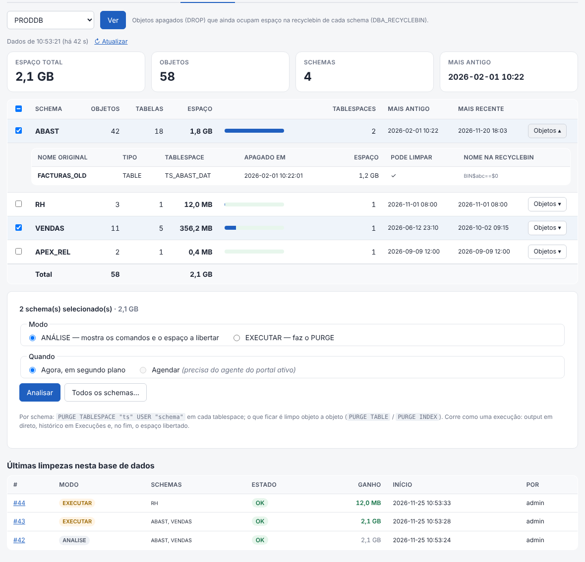 | 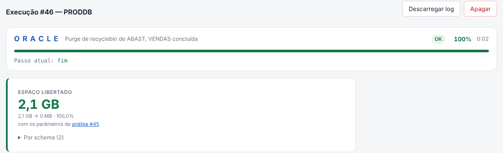 |

### Da análise à execução e espaço libertado

No fim de cada execução, o portal lê o **RESUMO GLOBAL** do output e mostra um cartão por cima dos detalhes:

| Modo | Cartão |
|---|---|
| **ANÁLISE** | **Ganho estimado** (ex. 21,8 GB; tamanho antes → depois estimado e %) e os botões **▶ Executar agora** (mesmos parâmetros: tablespace, ONLINE, ganho mínimo, margem, paralelismo, purge — sem preencher o formulário de novo), **Agendar…** (com o agente ativo) e **Ajustar parâmetros** (abre o Shrink já preenchido em modo EXECUTAR). Mostra também as execuções já feitas a partir desta análise, com o espaço libertado |
| **EXECUTAR** | **Espaço libertado** (tamanho antes → depois e %), com ligação à análise de origem |

Com vários tablespaces (TODOS), o detalhe por tablespace fica em **Por tablespace**. Em **Execuções** há a coluna **Ganho** (estimado na análise, a verde o libertado na execução) e, na janela do output de uma análise, **▶ Executar com estes parâmetros…**. O e-mail/notificação de fim de execução inclui o ganho. Executar exige a permissão `oracle.shrink.executar` e a confirmação.

| | |
|---|---|
| 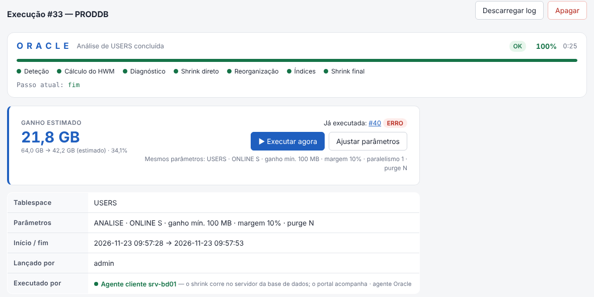 | 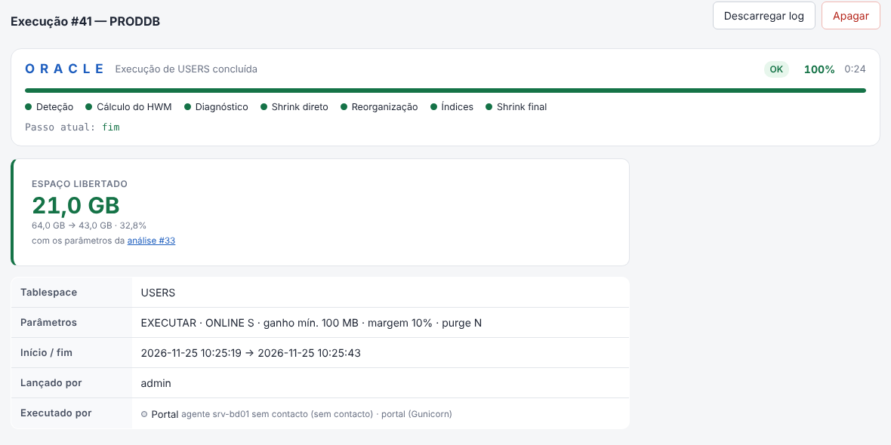 |

### Execução em direto

Ao lançar um shrink (ANÁLISE ou EXECUTAR), a página da execução mostra um painel ao estilo do "TESLA a carregar…" do portal:

| Elemento | De onde vem |
|---|---|
| **ORACLE** animado, percentagem e barra | `V$SESSION_LONGOPS` (`OPNAME = 'SHRINK_TS'`): o bloco PL/SQL regista o avanço de cada passo com `DBMS_APPLICATION_INFO.SET_SESSION_LONGOPS`. Em TODOS, cada tablespace tem a sua parte da barra |
| **Passos** (Deteção, Cálculo do HWM, Diagnóstico, Shrink direto, Reorganização, Índices, Shrink final) e **passo atual** | `V$SESSION.ACTION` e o evento de espera (ex. `db file sequential read`) |
| **Tempo decorrido** | Calculado no servidor |
| **Output em direto**, com cores (erros, avisos, títulos, comandos) e "Acompanhar o fim" | Cada linha do PL/SQL também é enviada por `DBMS_PIPE`. Uma segunda ligação lê-a a cada 2 s e grava-a na execução. Sem `EXECUTE` em `DBMS_PIPE`, o output aparece no fim |

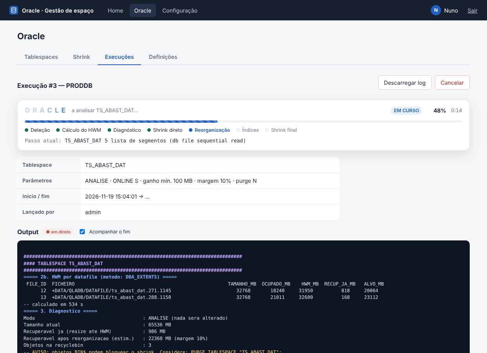

No fim, o output completo vem do `DBMS_OUTPUT`, como antes, e substitui o que chegou em direto. A lista de execuções mostra uma mini barra nas que estão em curso. O output em direto também aparece no **Oracle → Execuções** de quem abrir a página a meio.

> A **percentagem** é por passo: o cálculo do HWM (5 % → 40 %) não tem avanço interno. Com SYSDBA (`X$KTFBUE`) ou com a vista `SYS.X_$KTFBUE` é rápido; sem elas é estimado por `DBA_FREE_SPACE` (ver "Bases de dados Oracle: privilégios").

### Situações que o shrink trata automaticamente

| Situação | O que o script faz |
|---|---|
| O `MOVE ONLINE` deixa o segmento novo **no fim do ficheiro**, porque o antigo e o novo coexistem durante o MOVE | **2.ª passagem**: se o HWM continuar acima do alvo, volta a mover esses segmentos, que vão então para o espaço libertado no início |
| Segmentos **`TEMPORARY`** órfãos, restos de MOVE/REBUILD que o SMON ainda não limpou | Lista-os. Em EXECUTAR, se não houver MOVE/REBUILD/CREATE INDEX a correr, executa o evento `DROP_SEGMENTS` (nível = `ts# + 1`) e espera até 60 s |
| `ORA-03297` no resize (há blocos usados acima do valor pedido) | Recalcula o HWM e tenta tamanhos progressivamente maiores (+10 % + 64 MB), até 6 tentativas |
| Objetos na recyclebin (`BIN$`) | Avisa, e com a opção PURGE faz `PURGE TABLESPACE` |

### Utilizadores e perfis

- O **administrador** é o único utilizador **local**: fica no ficheiro `data/admin.json`, tem todas as permissões, vê todas as bases de dados e todos os módulos ativos.
- Os restantes utilizadores ficam na **base de dados do portal** e cada um tem um **perfil**.
- Um perfil com a opção **Administrador — acesso total** dá todas as permissões do portal e de todos os módulos ativos, todas as bases de dados e a aba Armazenamento, incluindo o que for acrescentado no futuro (como o administrador local). Só um administrador (o local ou outro com esse perfil) pode dar ou retirar esta opção.
- Um perfil define, **por módulo**:
  - se o utilizador tem **acesso ao módulo** (sem acesso, o menu do módulo não aparece e as ações dele não contam);
  - **o que pode fazer** no módulo;
  - no Oracle, **que bases de dados** vê (todas, ou uma lista).

| Permissão | Grupo | Descrição |
|---|---|---|
| `config.portal` | Portal | Gerir o portal: aparência, manutenção, módulos, utilizadores, perfis e backups; entrar durante a manutenção |
| `modulo.oracle` | Oracle | Acesso ao módulo Oracle (menu Oracle, Execuções das suas bases de dados) |
| `oracle.tablespaces` | Oracle | Ver tablespaces |
| `oracle.shrink.analise` | Oracle | Shrink em modo ANÁLISE |
| `oracle.shrink.executar` | Oracle | Shrink em modo EXECUTAR e cancelar execuções |
| `oracle.definicoes` | Oracle | Definições: gerir as bases de dados Oracle |

A aba **Armazenamento** só está disponível para o administrador (local ou com perfil de administrador).

**Notificações (sininho):** *Marcar como lidas*, *Limpar todas* (apaga as do utilizador) e ✕ em cada uma (aparece ao passar o rato).

> **Perfis de versões anteriores** (antes dos módulos) são convertidos no primeiro arranque: `tablespaces.ver` → `oracle.tablespaces`, `shrink.analise` → `oracle.shrink.analise`, `shrink.executar` → `oracle.shrink.executar`, `config.bds` → `oracle.definicoes`. Os perfis com ações Oracle ou bases de dados atribuídas recebem `modulo.oracle`. O mesmo acontece ao importar um backup antigo. Os endereços antigos (`/report`, `/shrink`, `/jobs`, `/config/databases`) redirecionam para o módulo Oracle.

---

## Agente do portal

O agente é um processo separado do Gunicorn (`python -m app.agente`). Numa instalação em servidor é o serviço `<nome>-agente`, criado pelo `instalar.sh`. No Docker é o programa `agente` do supervisord.

| Função | Detalhe |
|---|---|
| **Execuções Oracle** | Com o agente ativo, ao lançar um shrink a execução fica **PENDENTE** ("na fila do agente") e o agente começa-a dentro de 1 s. Com o **Agente Oracle** ativo, é ele que as corre (ver abaixo); sem ele, o agente do portal (até 2 em simultâneo, configurável) |
| **Métricas** | A cada 2 s: CPU (de `/proc/stat`), load, RAM, swap, discos, servidor e estado dos serviços (memória, CPU, PID, desde quando), com 3 minutos de histórico para os gráficos. Publicadas na base de dados do portal |
| **Serviços** | Executa os pedidos de start/stop/restart feitos no módulo Sistema: `sudo -n systemctl <ação> <serviço>`, só para os serviços autorizados em `/etc/sudoers.d/<nome>-agente` (no Docker, `supervisorctl`) |
| **Sinal de vida** | A cada 2 s. Se o portal não o vir há mais de 15 s, considera o agente parado |
| **Emails** | Envia a fila de emails (até 3 tentativas), valida a ligação SMTP a cada N minutos e gera os eventos de serviços (parou/falhou/voltou) e de disco acima do limiar |

**A execução para se fizer refresh no browser?** Não: a execução corre no servidor, e o browser só a mostra. Fechar a página, mudar de página ou fazer refresh não a afeta.

| Situação | Sem agente (execução no portal) | Com agente |
|---|---|---|
| Refresh / fechar o browser | Continua | Continua |
| Reiniciar ou atualizar o portal (`--atualizar`, `systemctl restart <nome>`) | **Para** (fica INTERROMPIDO; a sessão Oracle pode continuar sozinha) | **Continua** |
| Reiniciar o agente | — | Para (fica INTERROMPIDO) |

Sem o agente, o portal continua a funcionar como antes: as execuções correm numa thread do Gunicorn e o módulo Sistema lê os dados diretamente (sem gráficos nem ações sobre serviços).

```bash
sudo systemctl status <nome>-agente
sudo journalctl -u <nome>-agente -f
```

---

## Agente Oracle

Serviço próprio para as execuções Oracle (shrink), separado do agente do portal: `python -m app.agente_oracle`, serviço `<nome>-agente-oracle` (criado pelo `instalar.sh`; no Docker, programa `agente-oracle` do supervisord).

| Ponto | Detalhe |
|---|---|
| **Isolamento** | Um shrink longo não atrasa métricas, emails nem serviços (agente do portal), e reiniciar o agente do portal não interrompe shrinks |
| **Concorrência** | "Execuções em simultâneo" (por omissão 4), em Sistema → Agentes → Agente Oracle |
| **Sem agente Oracle** | O agente do portal volta a correr as execuções Oracle (comportamento anterior) |
| **Recursos** | `sudo ./instalar.sh --agente-recursos <nome> agente-oracle cpu=200% mem=2G nice=5` (drop-in systemd; `off` retira; sem valores mostra os atuais) |

**Shrink mais rápido: paralelismo.** O tempo de um shrink está quase todo na base de dados (`ALTER TABLE ... MOVE`, `ALTER INDEX ... REBUILD`), não no agente. O formulário do Shrink tem o campo **Paralelismo do MOVE/REBUILD** (1–32): com valor > 1 o bloco usa `PARALLEL n` no MOVE (tabelas, partições e LOBs) e no REBUILD dos índices, e no fim repõe o grau original de cada objeto (`NOPARALLEL` ou o `DEGREE` que tinha). Requer Enterprise Edition e usa mais CPU e I/O na BD — use-o fora de horas (o shrink pode ser **agendado**). Valor por omissão em Sistema → Agentes → Agente Oracle → "Paralelismo por omissão".

---

## Módulo Sistema

Em **Sistema → Painel** (permissão `modulo.sistema`):

| Cartão | Conteúdo |
|---|---|
| **Monitor de recursos** | CPU (utilização, livre, load 1/5/15 min), memória RAM e disco `/`, com barras e gráfico dos últimos minutos |
| **Servidor** | Saudável / Sob pressão / Atenção, nome, sistema, kernel, ligado há, processos, swap |
| **Serviços** | Um por linha (Nginx, portal, agente, ...): estado, PID, memória, CPU, desde quando, e os botões ▶ Start, ⟳ Restart e ■ Stop (permissão `sistema.servicos`). Antes de parar ou reiniciar o próprio portal, o Nginx ou o agente, é mostrado o que acontece |
| **Agente do portal** | Ativo/parado, versão, PID, desde quando, último sinal, execuções Oracle em curso |
| **Sistemas de ficheiros** | Cada disco montado, com o usado, o livre e o total |
| **Últimas ações** | Quem pediu, quando, e o resultado |

- **Atualização:** a cada 2 s por omissão (pausa, 2, 5, 10 ou 30 s), com o indicador "em direto". Não atualiza quando o separador está escondido.
- **Editar** (ícone do lápis): esconder (✕), voltar a mostrar (+) e arrastar os cartões, como na Home. Guardado por utilizador.
- **Definições** (permissão `sistema.definicoes`): os serviços a mostrar, com sugestões dos que estão instalados no servidor (ex. `firewalld`, `chronyd`, bases de dados). Por omissão são os do portal (`nginx`, `<nome>`, `<nome>-agente`, e a base de dados se for local).
- **Permissões (sudoers):** o agente só consegue iniciar/parar/reiniciar os serviços que estão em `/etc/sudoers.d/<nome>-agente`. As Definições mostram, para cada serviço, se está **Autorizado** ou **Sem sudoers** (no painel aparece 🔒 em vez dos botões) e o comando para o autorizar.

**Gerir também o firewalld (ou outro serviço)**, no servidor:

```bash
sudo ./instalar.sh --servicos dba-portal                 # lista atual e serviços detetados
sudo ./instalar.sh --servicos dba-portal +firewalld      # acrescentar
sudo ./instalar.sh --servicos dba-portal -firewalld      # retirar
sudo ./instalar.sh --servicos dba-portal "nginx dba-portal dba-portal-agente firewalld"   # lista completa
```

Atualiza a configuração guardada, a regra `sudoers` (validada com `visudo`) e os serviços, e reinicia o portal e o agente. Depois, acrescente o serviço também em **Sistema → Definições** (se tiver alterado a lista mostrada). Na pergunta "Serviços geridos pelo módulo Sistema" do `instalar.sh`, o `firewalld` (ou `ufw`) já é sugerido quando existe. No Docker, o agente gere os programas do contentor; os serviços do anfitrião não são acessíveis.

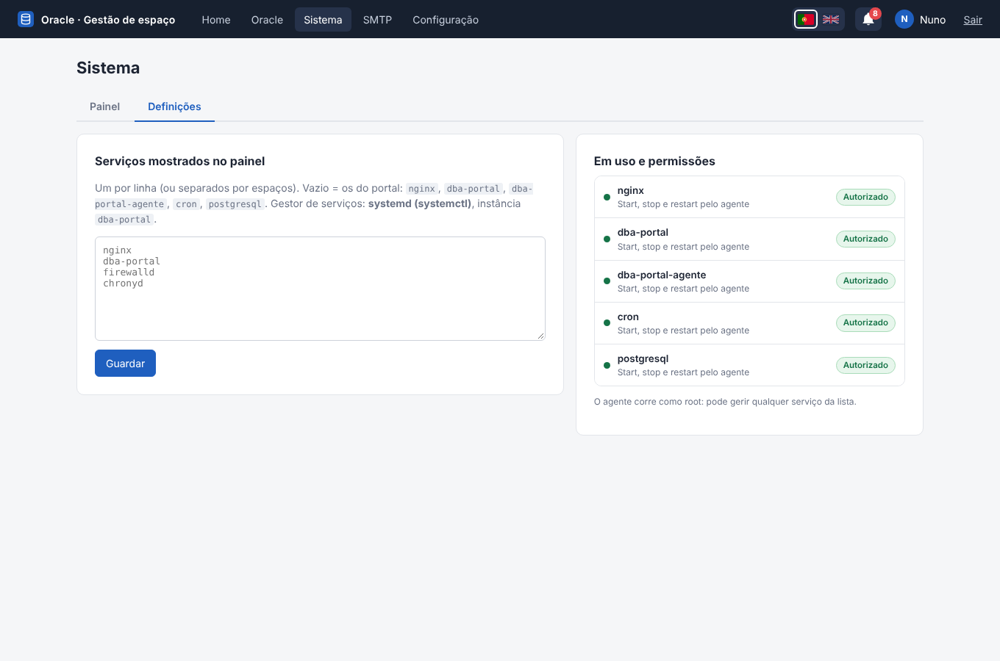

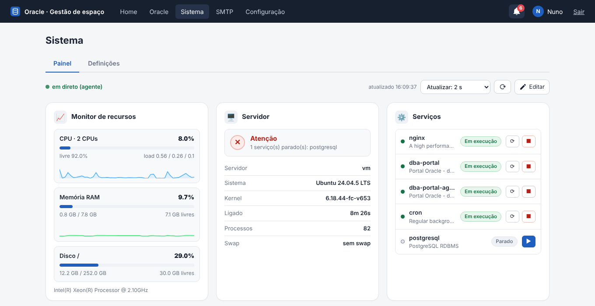

### Sistema → Agentes

Uma sub-aba por agente (Agente Oracle, Agente do portal). No topo, como na Home, a **atualização automática** (manual, 5 s, 10 s, 30 s, 1 min, 5 min; por omissão 10 s, guardada no browser) e o botão ↻: atualiza o estado, os recursos, as execuções em curso, os processos e os gráficos (nos períodos relativos; um período a partir de uma data fica fixo). Não atualiza com o separador escondido. A **Análise** tem o mesmo controlo.

| Cartão | Conteúdo |
|---|---|
| **Estado** | A correr/parado, serviço, PID, versão, servidor, utilizador, desde quando, nice, threads, execuções em curso e terminadas |
| **Parâmetros** | Agente do portal: ciclo, métricas a cada (s), execuções Oracle em simultâneo (sem agente Oracle), nice. Agente Oracle: execuções em simultâneo, paralelismo por omissão, ciclo, nice. Guardados na tabela `settings` (`<agente>.<parâmetro>`); aplicam-se no ciclo seguinte (nice ao reiniciar) |
| **Recursos do serviço** | Limite de CPU, de memória e Nice do systemd, e o comando `--agente-recursos` montado com os valores escolhidos (precisa de root) |
| **Processos** | PID, PPID, CPU, memória, threads, estado, início e comando (atualizado a cada 10 s) |
| **Desempenho** | Gráficos de CPU (média e máximo) e memória: 1 hora, 5 horas, 24 horas, 1 semana, 1 mês, ou a partir de uma data com duração |

### Sistema → Análise

Recursos usados pelo portal por componente — Portal (Gunicorn), Agente do portal, Agente Oracle, outros processos — e o servidor (total): cartões com o valor atual, gráficos de CPU e memória por componente (o servidor a tracejado) com o mesmo seletor de período, e a tabela de processos ordenável.

As medições são feitas pelo agente do portal com `psutil` (processos do mesmo utilizador e da pasta do portal): leitura a cada 10 s, registo na tabela `metricas` a cada 30 s, guardado 35 dias. Sem o agente do portal não há leituras novas.

| Sistema → Agentes | Sistema → Análise |
|---|---|
| 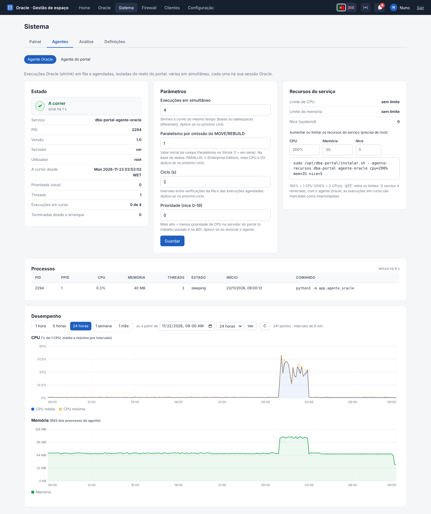 | 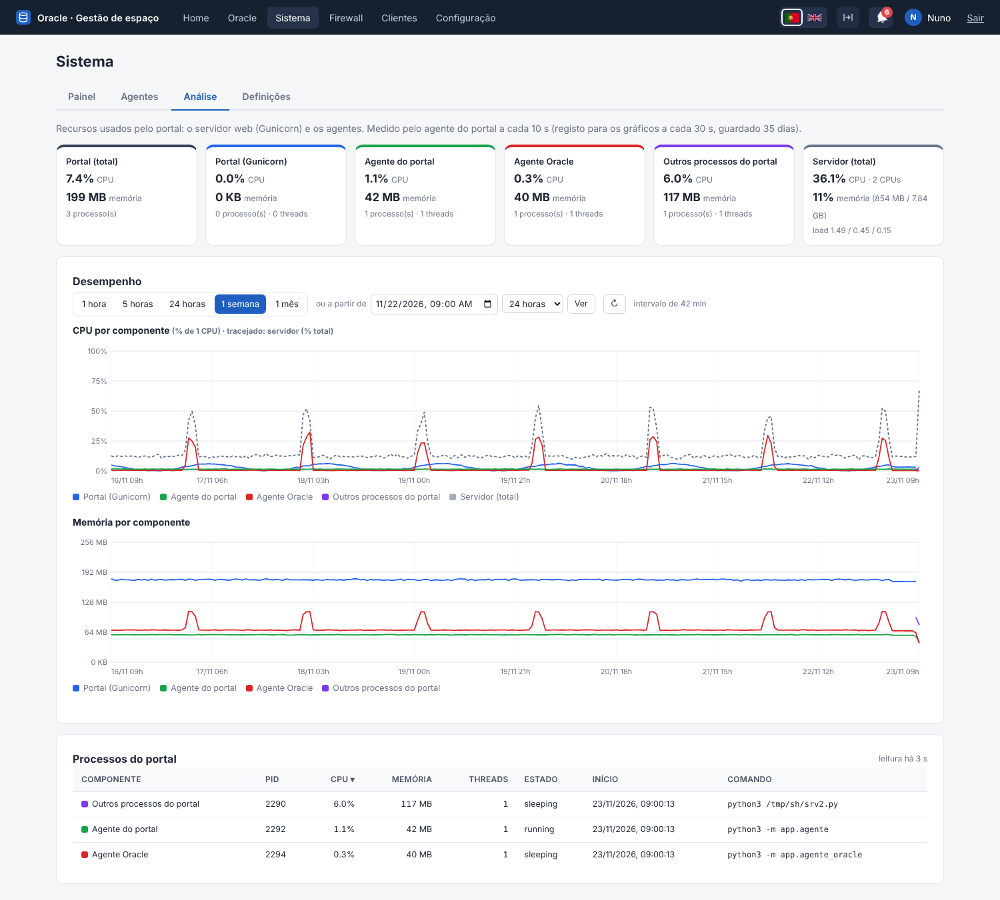 |

---

## Módulo SMTP e notificações

Desativado por omissão: ative-o em **Configuração → Módulos**. Aparece o menu **SMTP** com quatro abas.

| Aba | Conteúdo | Permissão |
|---|---|---|
| **Geral** | Servidor, porta, segurança (**Nenhuma**, **STARTTLS** ou **SSL/TLS**), validar o certificado (desligado por omissão: aceita CA interna), autenticação opcional, remetente, destinatários por omissão, prefixo do assunto, endereço do portal (para as ligações nos emails), timeout e validação periódica. Cartão **Estado** e **Testar**: *Validar ligação* (liga, TLS e autentica, sem enviar) e *Enviar teste*, com a barra "SMTP" e o diálogo com o servidor até "mensagem aceite pelo servidor" | `smtp.configurar` |
| **Regras** | Que emails enviar: evento (por módulo), situações e destinatários | `smtp.regras` |
| **Notificações** | As mesmas regras para o **sininho** do portal, o histórico das notificações e um botão de teste | `smtp.regras` |
| **Logs** | Todos os emails (fila, enviados, com erro, testes), pesquisa, janela com a mensagem e o diálogo SMTP, **Reenviar** e limpeza dos antigos | `modulo.smtp` |

**Eventos disponíveis**

| Módulo | Evento | Situações |
|---|---|---|
| Oracle | Execução (shrink) terminada | Sucesso, Com avisos, Com erros, Falhada (interrompida, cancelada, erro de ligação) |
| Sistema | Serviço (detetado pelo agente) | Parou, Falhou, Voltou a correr |
| Sistema | Disco acima do limiar | Acima do limiar (o limiar, em %, é definido na regra) |
| SMTP | Ligação SMTP | Falhou, Recuperou |

**Destinatários de uma regra:** destinatários por omissão (Geral), outros emails, quem lançou (ex. a execução), quem gere o portal (administrador e perfis com `config.portal`), quem tem acesso ao módulo, ou perfis escolhidos. Os utilizadores só recebem email se tiverem o email preenchido.

**Regras criadas na instalação** (podem ser alteradas ou apagadas):

| Canal | Regra |
|---|---|
| Sininho | Execução Oracle terminada → quem a lançou; serviço parado/com falha, disco acima de 90 % e falha na ligação SMTP → quem gere o portal |
| Email | Execução Oracle com erros ou falhada → destinatários por omissão e quem a lançou; serviço parado/com falha e disco acima de 90 % → destinatários por omissão |

**Quem envia:** o agente (fila `email_queue`, até 3 tentativas, com 2 e 4 min de intervalo). Sem o agente, o portal envia logo a seguir ao evento. Os emails só saem com **Envio automático ligado** (Geral); o teste envia sempre. As credenciais nunca aparecem no log (`******`).

**Sininho:** no topo do portal, com o número de notificações por ler. Ao clicar, mostra as últimas, com a cor da situação (verde, amarelo, vermelho); clicar numa abre a página relacionada e marca-a como lida. Atualiza a cada 20 s.

| SMTP → Geral (teste) | Sininho |
|---|---|
| 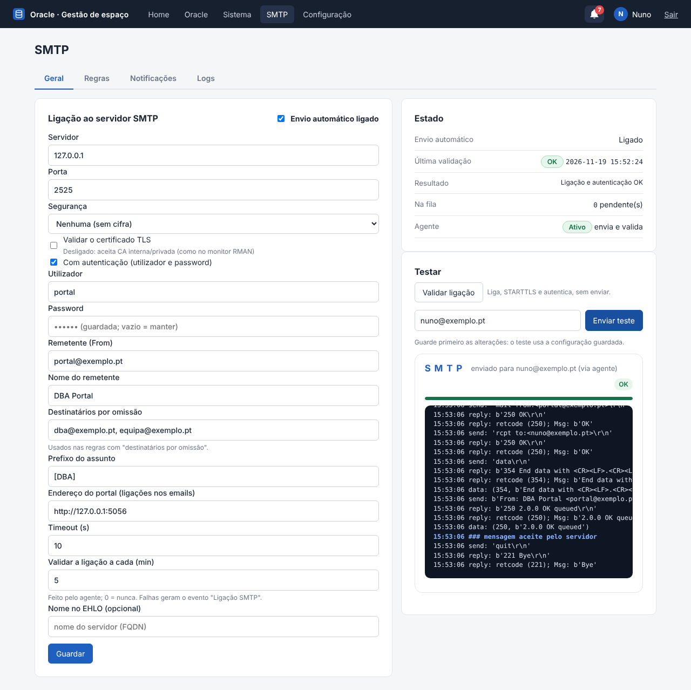 | 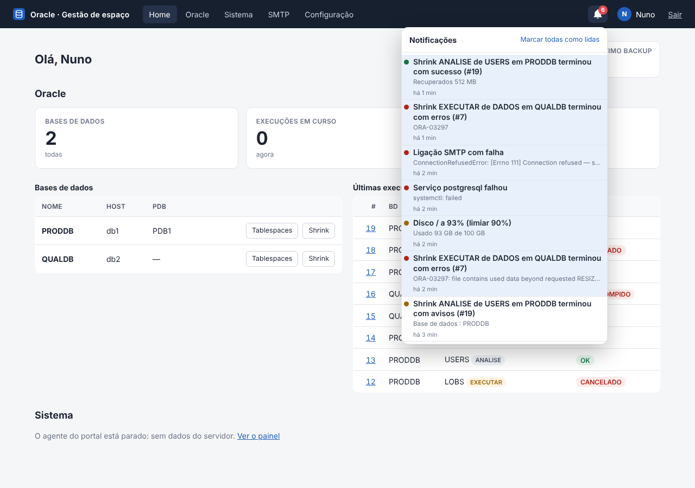 |

| SMTP → Regras | SMTP → Logs |
|---|---|
| 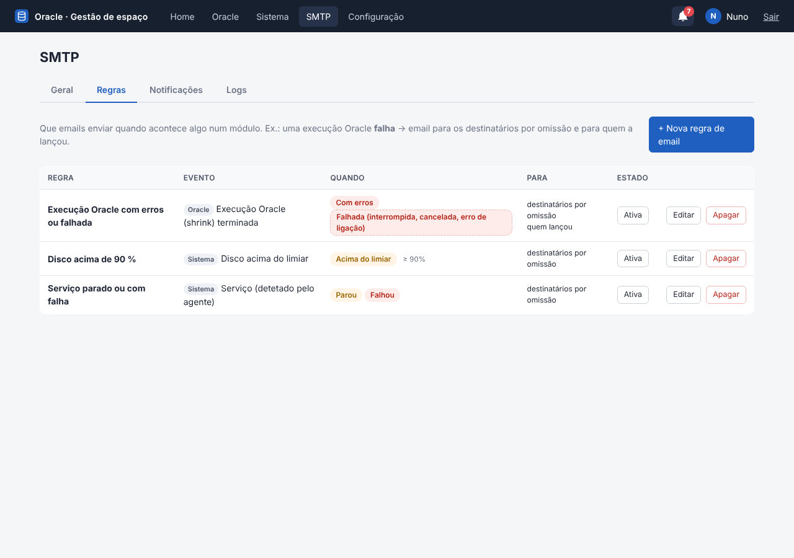 | 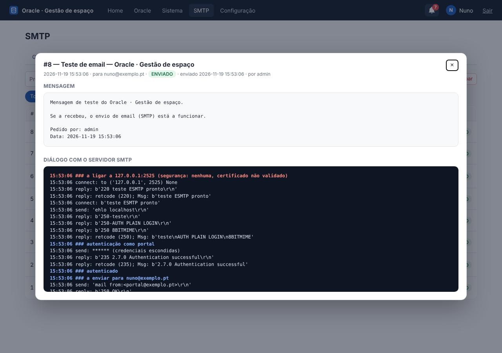 |

---

## Módulo Autenticação (LDAP / Active Directory)

Desativado por omissão: ative-o em **Configuração → Módulos**. Os utilizadores passam a ter um **tipo de autenticação**:

| Tipo | Como entra | Password |
|---|---|---|
| **Local** | Password do portal (hash na base de dados do portal) | Muda-se em Minha área ou em Utilizadores |
| **LDAP** | Bind no diretório (OpenLDAP ou Active Directory) | Muda-se no diretório; o portal não a guarda |
| Administrador | Sempre local (`data/admin.json`), mesmo com o LDAP em baixo | — |

O tipo escolhe-se em **Configuração → Utilizadores** (formulário do utilizador), que tem **Utilizador**, **Nome próprio**, **Último nome** e **E-mail**. Num utilizador LDAP, **Preencher a partir do LDAP / AD** procura-o no diretório (conta de serviço e correspondência de atributos) e preenche o nome próprio, o último nome e o e-mail. O perfil (o que pode fazer) é sempre o do portal.

**Configuração → Autenticação** mostra os cartões **Local** e **LDAP** com o número de utilizadores de cada tipo. Clicar em **LDAP** abre a janela de configuração (a mesma página está em **Autenticação → LDAP**):

| Campo | Notas |
|---|---|
| **LDAP ligado** | Desligado, os utilizadores LDAP não entram (os locais e o administrador sim) |
| **Driver** | **OpenLDAP** ou **Active Directory (Microsoft)**: muda os valores por omissão do filtro e dos atributos e, no AD, o grupo obrigatório inclui grupos dentro de grupos |
| **Segurança** | Sem cifra (389), **STARTTLS** (389) ou **LDAPS** (636) |
| **Servidor(es)** | Vários separados por vírgulas (usa o primeiro que responder); `host:porta` para outra porta |
| **Validar o certificado** + **Certificado da CA (PEM)** | Para a CA interna do AD/OpenLDAP. Vazio = as CAs do sistema. Desligar a validação aceita qualquer certificado (só para testes). O certificado é validado ao guardar |
| **Conta de serviço** (bind DN + password) | Só de leitura, para procurar os utilizadores. No AD pode ser `conta@dominio`. Password cifrada (como as das BDs Oracle) |
| **Base de procura** e **Filtro de objetos** (opcional) | OpenLDAP: `(objectClass=inetOrgPerson)`. AD: `(&(objectCategory=person)(objectClass=user))`. O portal procura `(&<filtro>(<atributo utilizador>=<login>))`; um filtro completo com `{u}` (versões anteriores) continua a funcionar |
| **Correspondência de atributos** | **Atributo utilizador** \* (AD `sAMAccountName`, OpenLDAP `uid`: o nome do login), **Atributo nome próprio** (`givenName`), **Atributo último nome** (`sn`), **Atributo e-mail** (`mail`). Vazio = o valor do driver |
| **Grupo obrigatório** | DN do grupo; só os membros entram |
| **Atualizar nome próprio, último nome e e-mail** | A partir do diretório (pela correspondência acima) em cada login |
| **Criar o utilizador no primeiro login** | Se não existir no portal, é criado como LDAP com o perfil escolhido |

**Testar ligação** usa os valores do formulário (mesmo sem guardar) e mostra cada passo: ligação, TLS, bind da conta de serviço, base de procura e, opcionalmente, o utilizador (encontrado, grupo, password).

**Autenticação → Acessos**: todos os logins (sucesso e falhados, com o motivo: password errada, fora do grupo, LDAP desligado, ...), o método e o IP. Limpos pela tarefa "Limpeza do histórico".

> Precisa do pacote Python `ldap3` (está no `requirements.txt`: `instalar.sh --atualizar` ou recriar o contentor instala-o).

| Configuração → Autenticação | Janela LDAP (teste) |
|---|---|
| 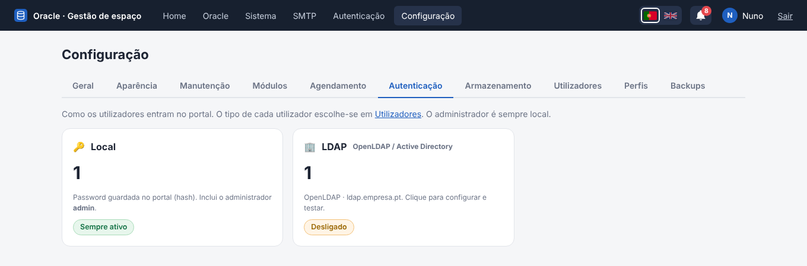 | 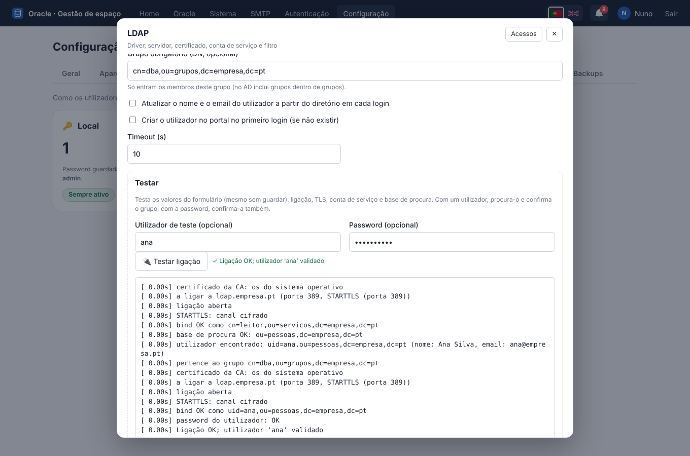 |

---

## Módulos

Em **Configuração → Módulos** os módulos estão em duas abas, **Ativos** e **Inativos** (com o número de cada), em **Cartões** (2, 3 ou 4 por linha) ou em **Lista**. Cada módulo mostra a descrição, ID, abas, permissões, agendamentos, eventos, perfis com acesso e um **interruptor** Ativo/Inativo: muda logo, sem recarregar a página (pede confirmação ao desativar); o módulo passa para a outra aba e o menu atualiza-se ao recarregar.

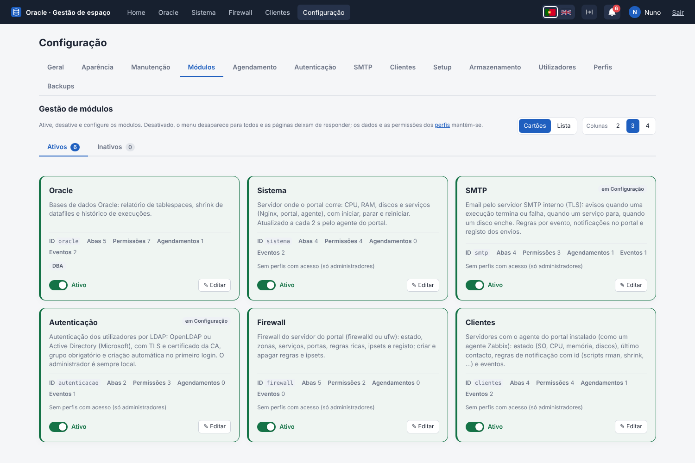

| Estado | Efeito |
|---|---|
| **Ativo** | O menu do módulo aparece a quem tem acesso no perfil (e ao administrador), e os cartões do módulo ficam disponíveis na Home |
| **Inativo** | O menu desaparece para todos, as páginas do módulo respondem 404 e as permissões do módulo deixam de contar. Os dados e os perfis mantêm-se; ao reativar, tudo volta como estava |

O estado fica na tabela `settings` (`module.<chave>` = `1`/`0`), por isso entra nos backups.

**✎ Editar** (cada módulo):

| Secção | O que se faz |
|---|---|
| **Geral** | Mudar o **nome** do módulo (menu, Home, notificações; o original fica indicado) e ativar/desativar |
| **Quem tem acesso** | Escolher os perfis (um ou mais) com acesso ao módulo. Retirar um perfil retira também as ações desse módulo; as ações escolhem-se em Perfis |
| **Agendamento** | As tarefas do módulo: ativar/desativar, frequência, última execução e **Editar** |
| **Notificações** | Os eventos do módulo e as regras de sininho e de email que os usam: ativar/desativar, editar e criar regras (no módulo SMTP) |

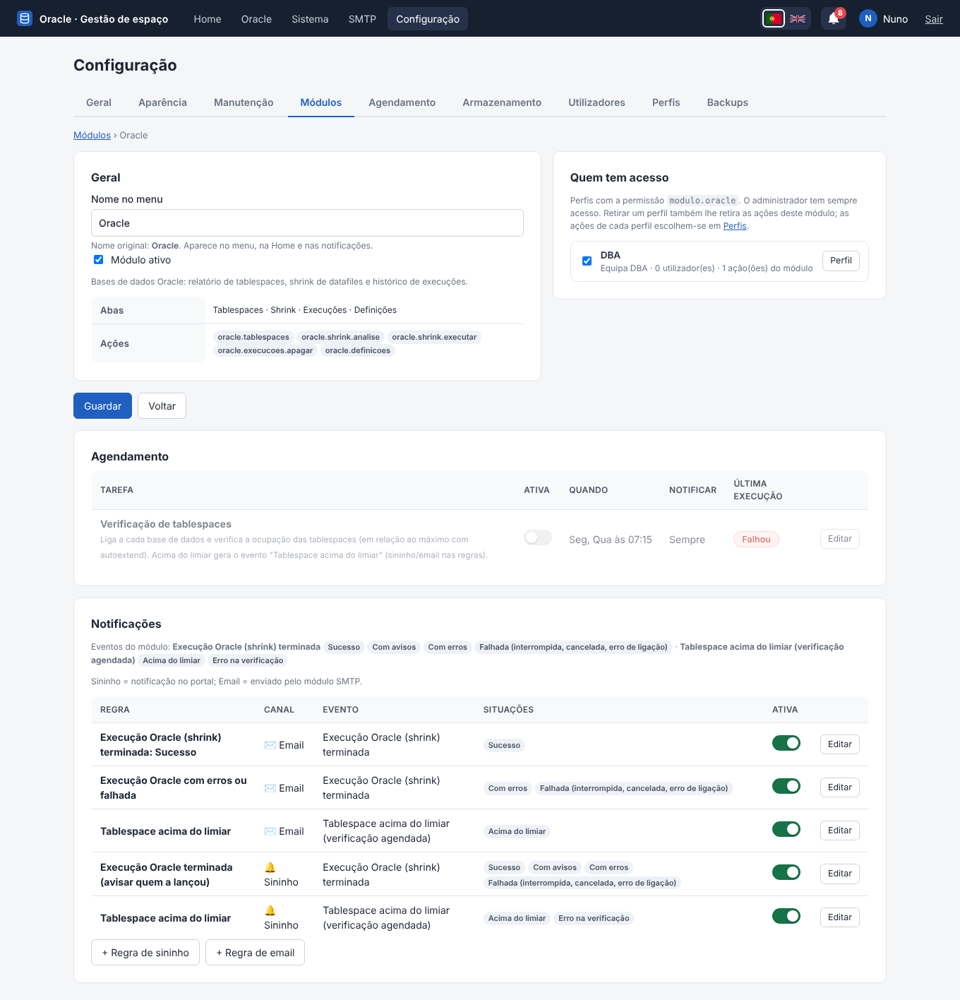

| Configuração → Módulos | Perfil com permissões por módulo |
|---|---|
| 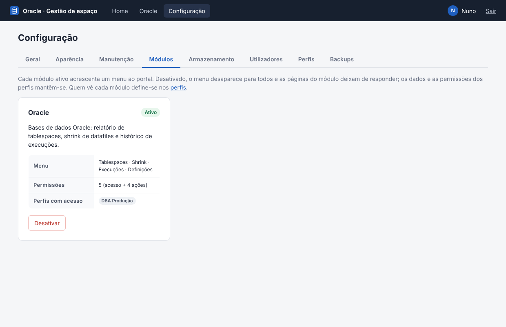 | 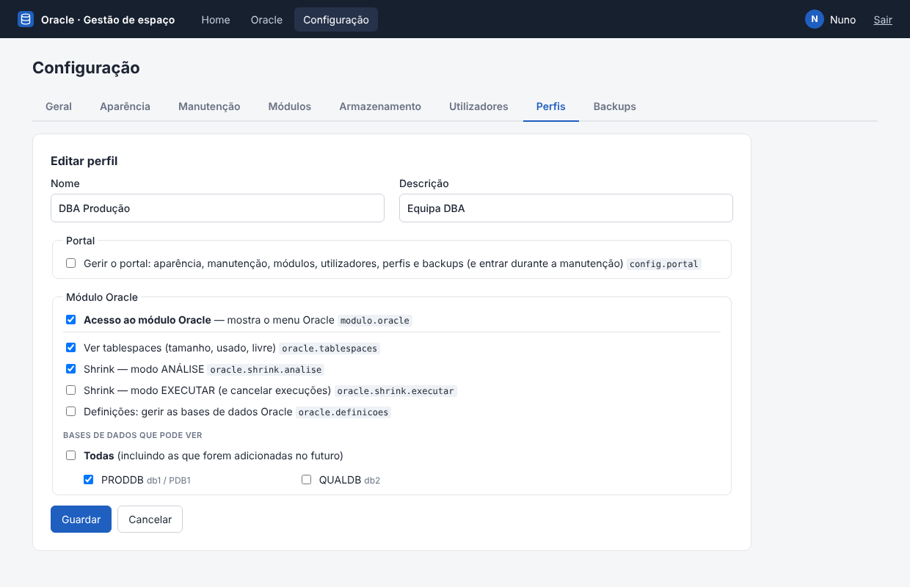 |

**Estrutura de um módulo** (exemplo: Oracle):

| Ficheiro | Conteúdo |
|---|---|
| `app/modulos.py` | Registo: lista `INSTALADOS`, classe `Modulo`, permissões do portal, conversão das permissões antigas |
| `app/modules/oracle/__init__.py` | Definição `MODULO` (nome, descrição, ações, abas do menu, cartões da Home, eventos) e o Blueprint com prefixo `/oracle` |
| `app/modules/oracle/views.py` | Rotas: `/oracle/tablespaces`, `/oracle/shrink`, `/oracle/execucoes`, `/oracle/definicoes` |
| `app/modules/oracle/bd.py`, `jobs.py`, `sql/` | Lógica do módulo (ligação Oracle, shrink em segundo plano, scripts SQL) |
| `app/modules/oracle/templates/oracle/` | Páginas do módulo, `_tabs.html` (abas) e `c_*.html` (conteúdo dos cartões da Home, com as peças de `app/templates/_cartoes.html`) |

**Acrescentar um módulo** (ex. `mysql`):

1. Criar `app/modules/mysql/__init__.py` com um `Blueprint("mysql", __name__, url_prefix="/mysql", template_folder="templates")`, uma rota `index` e um `MODULO = modulos.registar(modulos.Modulo(chave="mysql", nome="MySQL", ...))` com as ações (`"mysql.<acao>": "descrição"`) e as abas. Opcionais: `cartoes` (Home), `eventos` (regras de notificação) e `tarefas` (agendamentos: `{"mysql.verificar": {"nome": ..., "funcao": f(parametros) -> (estado, mensagem), "padrao": {...}, "parametros": [...]}}`), que aparecem sozinhos em Configuração → Agendamento.
2. Acrescentar `"mysql"` a `INSTALADOS`, em `app/modulos.py`.
3. Proteger as rotas com `@auth.requires("mysql.<acao>")`. O acesso ao módulo (`modulo.mysql`) e as ações aparecem sozinhos nos perfis, o menu aparece quando o módulo está ativo e o perfil tem acesso.

---

> Os módulos **SMTP** e **Autenticação**, quando ativos, aparecem como abas de **Configuração** (com as suas sub-abas) e não no menu principal. Quem só tem acesso a um deles (sem `config.portal`) vê o menu Configuração apenas com essa aba.

## Módulo Firewall (firewalld / ufw)

Ver e alterar a firewall do servidor do portal. Ative-o em **Configuração → Módulos** e dê, nos perfis, o acesso (`modulo.firewall`) e, a quem pode alterar, `firewall.alterar`.

| Aba | Conteúdo |
|---|---|
| Geral | Estado (ativa/parada, versão), zona por omissão, LogDenied, modo pânico, zonas ativas (interfaces e origens), **Recarregar** e as últimas alterações feitas pelo portal (comando, utilizador e resultado) |
| Regras | Por zona e por configuração (em execução / permanente): serviços, portas, origens (IP, rede ou `ipset:nome`), regras ricas e outros (target, masquerade, forward). No ufw, as regras numeradas. Acrescentar e apagar |
| IPsets | Tabela dos ipsets (`/etc/firewalld/ipsets/`): tipo, número e primeiras entradas, e onde são usados (origens e regras ricas). Clicar abre o ipset: entradas com filtro, acrescentar várias de uma vez, retirar, apagar o ipset |
| Logs | Registo do serviço `firewalld` e pacotes recusados (registo do kernel), com filtro |
| Definições | Versão, ficheiros de configuração, serviços predefinidos, LogDenied, modo pânico e as permissões do portal |

As alterações são feitas na configuração permanente e na em execução ao mesmo tempo (não é preciso recarregar). Para ser rápido, o portal corre os `firewall-cmd` em paralelo, lê todas as zonas numa só chamada e guarda os dados 15 s em cache (limpa a cada alteração; **↻ Atualizar** força a leitura); muitas entradas de um ipset vão de uma vez (`--add-entries-from-file`). Os valores são validados (zona, serviço, porta 1-65535, IP/rede, regra rica a começar por `rule `) e o comando é executado sem shell.

**Permissões** (instalação sem Docker): o portal corre como utilizador de serviço e usa `sudo -n firewall-cmd`/`ufw` e `journalctl` com comandos exatos, autorizados por um ficheiro `sudoers` próprio (validado com `visudo`):

```bash
sudo ./instalar.sh --firewall dba-portal on       # autorizar (/etc/sudoers.d/dba-portal-firewall)
sudo ./instalar.sh --firewall dba-portal status   # ver
sudo ./instalar.sh --firewall dba-portal off      # retirar
```

Sem isto, as abas mostram o comando a correr. Iniciar, parar e reiniciar o `firewalld` faz-se no módulo **Sistema** (`--servicos dba-portal +firewalld`). No Docker, o módulo vê só o contentor (não se aplica).

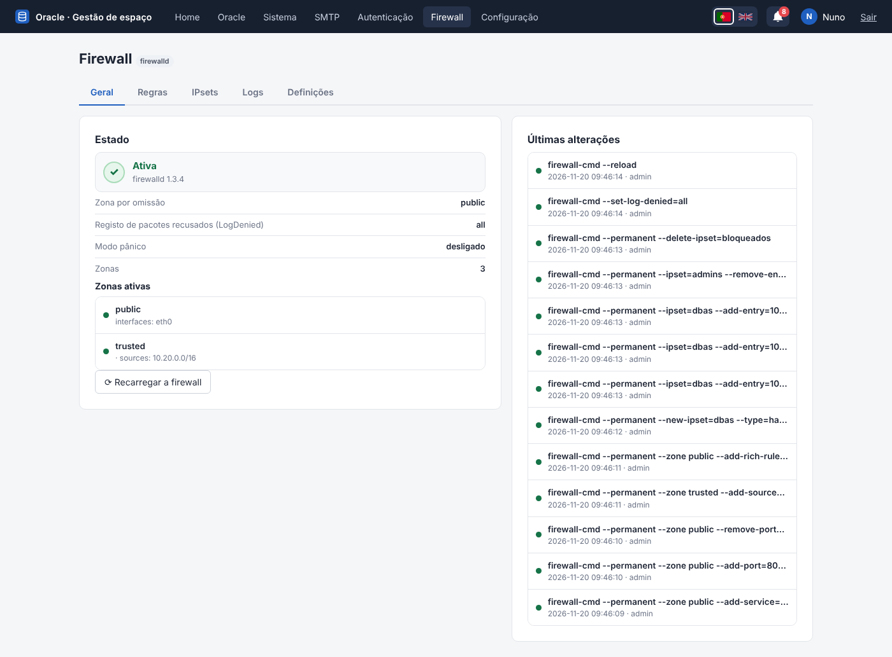
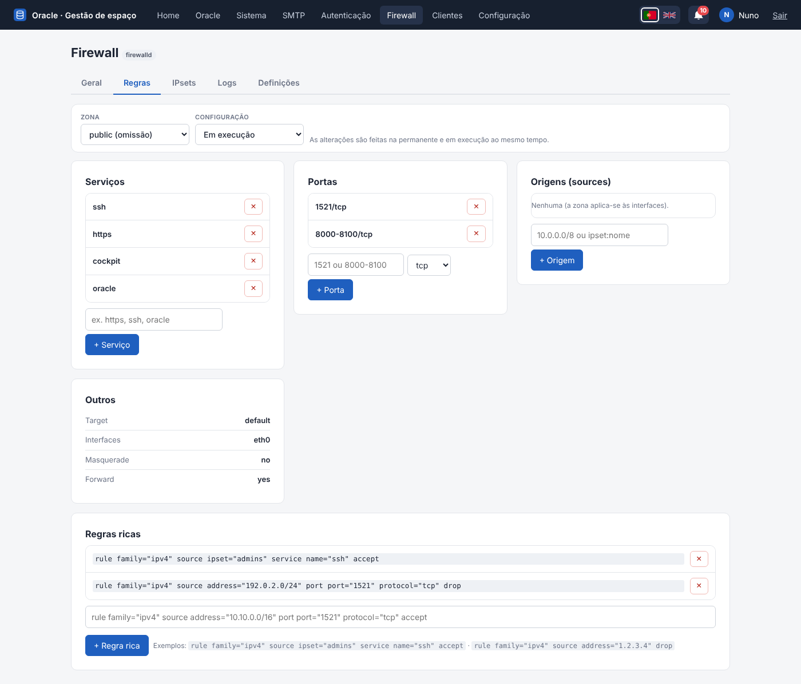
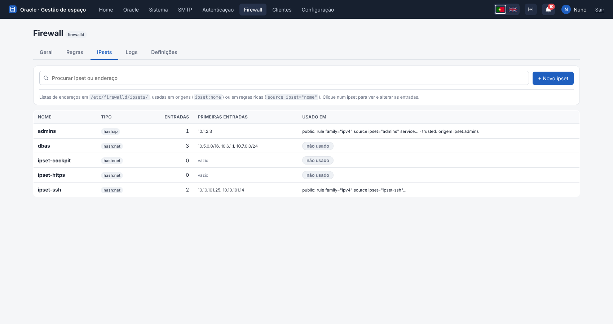
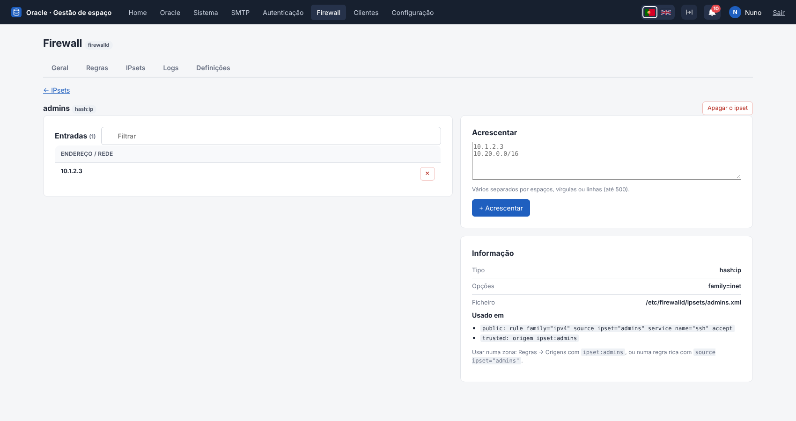

---

## Módulo Clientes (agente cliente)

Servidores com o **agente do portal** instalado, como um agente Zabbix: o agente envia o estado do servidor a cada N segundos e as notificações dos scripts (RMAN, shrink, montagens, ...). Ative o módulo em **Configuração → Módulos**; ações nos perfis: `clientes.gerir` (clientes, token, teste) e `clientes.regras` (regras de notificação).

| Onde | Conteúdo |
|---|---|
| Configuração → Clientes | Lista e **Novo cliente**: nome, IP ou DNS, descrição, VM ou físico, Linux (Debian/Ubuntu ou Red Hat/Rocky/Alma/Oracle Linux), utilizador e porta SSH. Por cliente: id, token (mostrar / gerar novo), comandos de instalação por distribuição, download do `setup.sh` e do agente, **Testar** (DNS, porta SSH, SSH com a chave do portal, último contacto) e **Esquecer a chave do servidor**. Definições: endereço do portal visto pelos clientes, utilizador SSH por omissão (ex. o do Ansible), certificado autoassinado. Chave SSH pública do portal |
| Clientes → Clientes | Estado de cada cliente (verde = sincronizou dentro do intervalo, laranja = atrasado, vermelho = sem contacto há mais de 10 intervalos, cinza = nunca), sistema, CPU, memória, disco mais cheio, último contacto, intervalo e eventos das últimas 24 h. Detalhe por cliente: agente, sistema, recursos (discos), regras e eventos |
| Clientes → Alarmes | Limiares sobre as métricas do agente: **disco** (% usado, por pontos de montagem, aceita `*`, ex. `/u02*`), **CPU**, **memória**, **carga** (por CPU) e **sem contacto** (minutos). Ciclos seguidos antes de disparar, severidade (aviso/crítico), cliente (ou todos) e **canais próprios**: notificação no portal (administradores ou quem tem acesso ao módulo) e/ou email (destinatários por omissão do SMTP e outros). Opcionalmente avisa quando volta ao normal. Lista dos alarmes disparados agora |
| Clientes → Regras de notificação | Regras com **id gerado** (ex. `R3F09A1C2`), nome, descrição, cliente (ou todos), log opcional (o agente envia a última linha quando muda) e padrões de erro/aviso (regex). Exemplos de uso por regra |
| Clientes → Eventos | Notificações recebidas, com filtros por cliente, regra, estado e texto |

**Instalar no cliente** (comandos prontos na página do cliente, com o id e o token):

```bash
sudo dnf install -y curl python3        # Debian/Ubuntu: sudo apt-get install -y curl python3
curl -fsS https://<portal>/clientes/agente/setup.sh -o /tmp/setup-agente.sh
sudo bash /tmp/setup-agente.sh --portal https://<portal> --id <ID> --token <TOKEN> --utilizador ansible --grupo "oracle"
```

O `setup.sh` (em `agente-cliente/` no repositório):

| Passo | O que faz |
|---|---|
| Sistema | Deteta a distribuição e a virtualização; instala `python3`/`curl` se faltarem |
| Utilizador SSH (`--utilizador`) | Confirma que existe, a shell, a home sem escrita para outros, `~/.ssh` 700, `authorized_keys` 600 e o dono, e acrescenta a chave pública do portal (se ainda não estiver). SELinux: `restorecon`. Avisa se o `sshd` não aceitar chaves ou tiver `AllowUsers` sem o utilizador. Só as verificações: `--verificar` |
| Agente | `/opt/agente-portal/agente-portal.py` (só biblioteca padrão do Python 3.6+), `.env` 600 com o **token cifrado** (chave local `.chave` 400 ligada ao `/etc/machine-id`: o `.env` copiado para outra máquina não serve), comando `agente-portal` |
| Grupo `agente-portal` (`--grupo`) | Quem pode notificar pelo socket local `/run/agente-portal/agente.sock` (ex. o utilizador `oracle` dos scripts RMAN) |
| Serviço | `agente-portal.service` (systemd, reinício automático) e teste final |

Outras opções: `--intervalo 60`, `--inseguro` (certificado autoassinado), `--ca /caminho/ca.pem`, `--sem-ssh`, `--desinstalar`.

**No cliente:**

| Comando | Para quê |
|---|---|
| `agente-portal estado` | Versão, portal, id, intervalo, último ciclo, socket e fila |
| `agente-portal intervalo 120` | Muda o intervalo de sincronização (só no cliente; o portal mostra-o na sincronização seguinte) |
| `agente-portal notificar <ID> ok "Backup terminado"` | Notifica o portal (estados `ok`, `aviso`, `erro`, `info`; o texto também pode vir do stdin) |
| `agente-portal testar` | Testa a ligação e lista as regras deste cliente |
| `journalctl -u agente-portal -f` | Registo do serviço |

Exemplo no fim de um script RMAN:

```bash
rman target / cmdfile=/u01/scripts/rman_full.rcv log=/u01/scripts/logs/rman_full.log
if [ $? -eq 0 ]; then agente-portal notificar <ID> ok "RMAN full OK"
else agente-portal notificar <ID> erro "$(grep -E 'RMAN-|ORA-' /u01/scripts/logs/rman_full.log | tail -3)"; fi
```

Se o portal não responder, as notificações ficam em fila (`/opt/agente-portal/fila.jsonl`) e seguem na sincronização seguinte. As notificações geram o evento **Notificação de um cliente** (o parâmetro da regra filtra por ids) e a tarefa agendada **Verificar o contacto dos clientes** gera **Contacto do agente cliente** (sem contacto / voltou); as regras por omissão avisam no portal e por email.

**Alarmes:** avaliados em cada sincronização do agente (o "sem contacto" pela tarefa *Verificar o contacto dos clientes*). Os disparos e regressos aparecem em Eventos (regra `A<n>`) e no painel do cliente; os emails precisam do SMTP ativo.

**Integração Zabbix (preparada)**, em Configuração → Clientes:

| Peça | Para quê |
|---|---|
| API só de leitura (ligar + token) | `GET /clientes/api/zabbix/descoberta` (LLD: `{#CLIENTE}`, `{#HOST}`, `{#FSNAME}`, `{#FSTYPE}`), `.../metricas?cliente=<nome>` (JSON com as chaves de um agente Zabbix: `vfs.fs.size[/u01,pused]`, `system.cpu.util`, `vm.memory.utilization`, `system.cpu.load[percpu,avg1]`, `agent.ping`, ...) e `.../alarmes` (alarmes como triggers, com a expressão sugerida). Header `Authorization: Bearer <token>`: itens HTTP agent e itens dependentes com JSONPath |
| Host no Zabbix (por cliente) | Nome do host no Zabbix (vazio = nome do cliente) |
| Endereço e token da API do Zabbix | Guardados para a fase seguinte (criar hosts e ler problemas no Zabbix) |
| `agente-portal valor <chave>` no cliente | Mesmas chaves, para um agente Zabbix no mesmo servidor: `UserParameter=portal.metrica[*],agente-portal valor "$1"` (`agente-portal valor todas` lista-as) |

API usada pelo agente (sem sessão, autenticada pelo id e token): `POST /clientes/agente/api/sync` e `/clientes/agente/api/evento`; downloads em `/clientes/agente/setup.sh`, `agente-portal.py` e `chave.pub`.

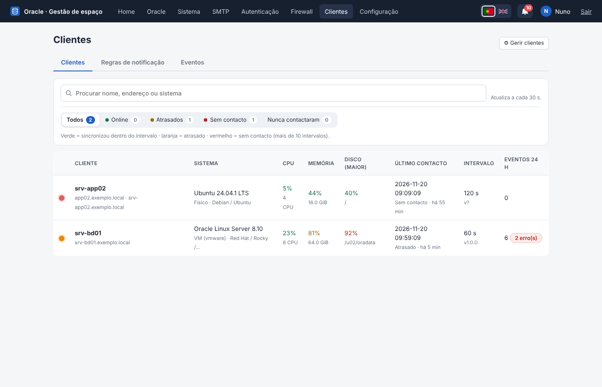
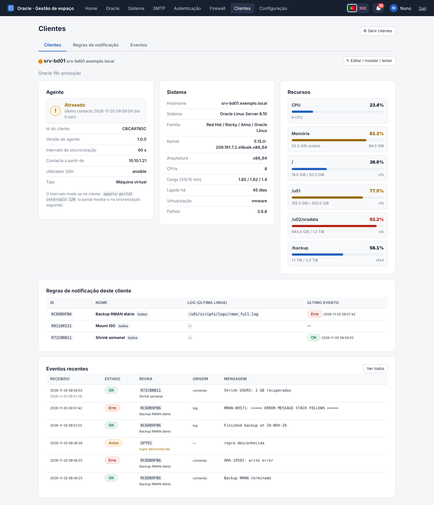
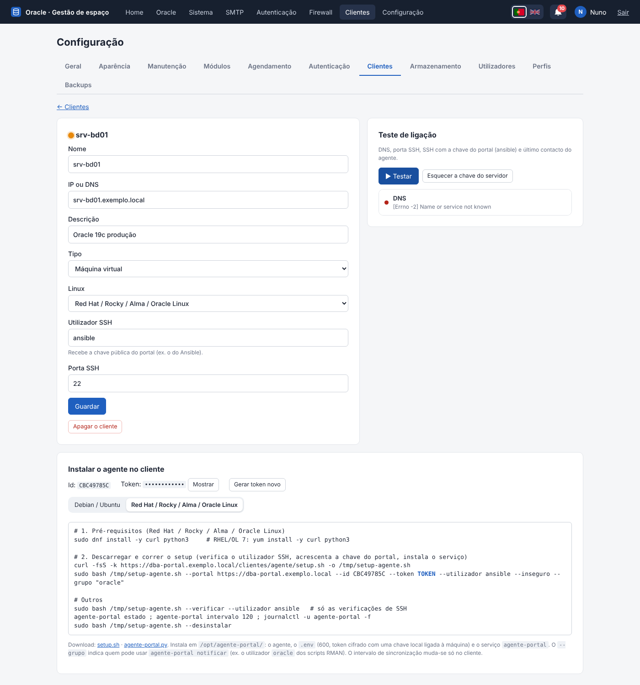
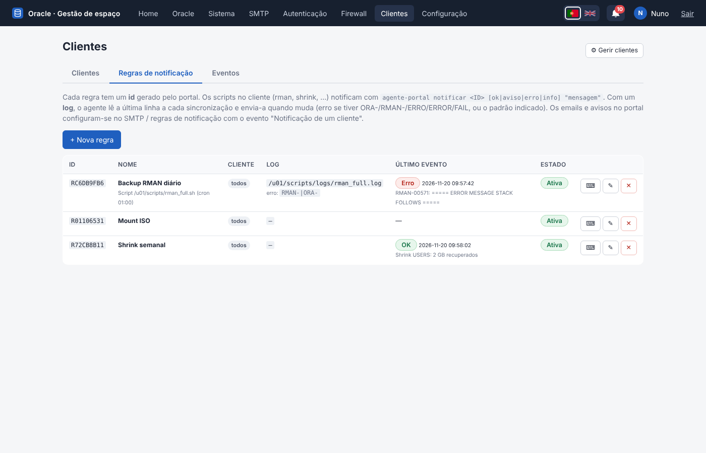
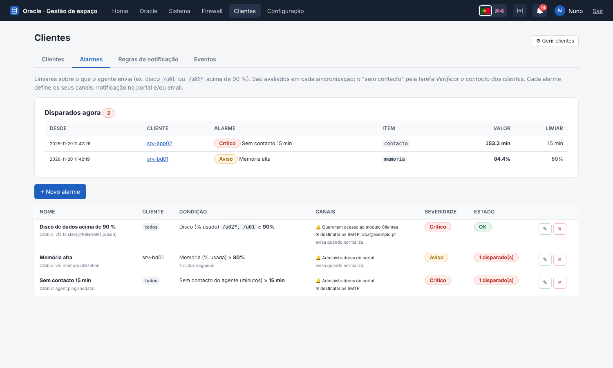
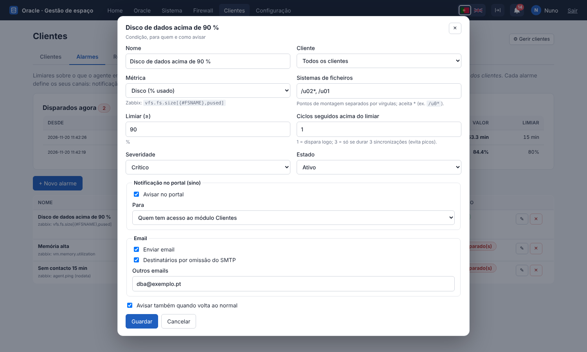
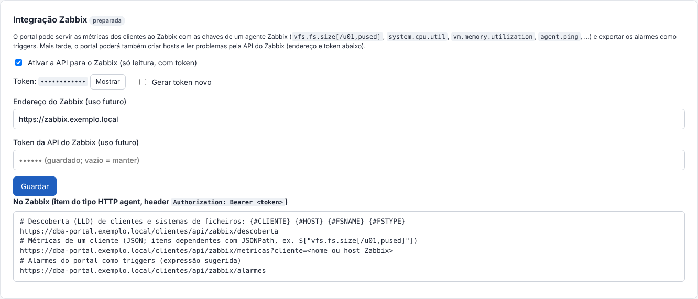

### Cliente: abas, atualização automática e bases de dados

A página de cada cliente tem, como a Home, a **atualização automática** (manual, 10 s, 30 s, 1 min, 5 min; por omissão 30 s) e abas:

| Aba | Conteúdo | Origem / frequência |
|---|---|---|
| **Resumo** | Agente, sistema, recursos, serviço Oracle, regras e eventos | Cada sincronização |
| **Processos** | Totais (processos, threads, por estado) e os ~50 com mais CPU e memória: PID, utilizador, CPU % (de um núcleo), memória, threads, estado, início, comando; filtro e ordenação | Agente, cada sincronização |
| **Sistema** | Processador, memória, swap, arranque, fuso, NTP, SELinux, firewall, sessões, pacotes; rede (IPs, rota, DNS, portas TCP à escuta); serviços com falha | Agente, cada hora |
| **Logs** | Avisos e erros das últimas 24 h (`journalctl -p warning`; sem journald, `/var/log/messages`), até 300 linhas, com filtro | Agente, cada 5 min |
| **Atualizações** | Pacotes pendentes (dnf/yum `check-update`, apt `list --upgradable`), os de segurança e se é preciso reiniciar (`needs-restarting -r`, `/var/run/reboot-required`) | Agente, cada 6 h (corre em segundo plano) |
| **Bases de dados** | Bases de dados associadas ao cliente com o estado do módulo Oracle (estado, versão, instância, papel, Data Guard, log), quem faz os pedidos e o modo; **associar/desassociar** aqui (o mesmo que em Oracle → Definições) | Cache do módulo Oracle |
| **Zabbix** | Com a API do Zabbix configurada (Gerir clientes → Zabbix: endereço e token): anfitrião, interfaces, problemas por gravidade e os itens principais (CPU, memória, carga, discos, processos, uptime, versão do agente) e ligação para o Zabbix | API do Zabbix (cache 60 s) |

**Logs — ficheiros seguidos** (agente 1.4.0): além do journal ("Sistema"), cada cliente pode seguir ficheiros de log, agrupados por **tag** na coluna da esquerda. Em **＋ Adicionar / procurar**: *à mão* (pasta, ficheiro — aceita `*` e `?`, usa o mais recente, ex. `alert_*.log` —, descrição, tag e nº de linhas) ou **Procurar ficheiros (scan)**: o agente lista os ficheiros de texto de `/var/log` (sem os rodados/comprimidos) e escolhem-se os que interessam, com descrição e tag. O agente envia as últimas linhas a cada 5 min. Só lê ficheiros dentro de `LOGS_PASTAS` (no `.env` do agente; por omissão `/var/log /u01 /u02 /opt /oracle /app /home`).

Cada log da lista pode ser **editado** (tipo, pasta, ficheiro, descrição, tag, linhas) ou **apagado** (só da lista; o ficheiro no servidor não muda). Além de ficheiros, podem seguir-se **pastas**: o agente (1.6.0+) lista os ficheiros (mais recentes primeiro) e escolhe-se o que abrir.

**Visualizador** (Abrir / Abrir no visualizador): o agente envia as últimas 1 000, 5 000 ou 20 000 linhas, ou o ficheiro completo até 10 MB, e o portal mostra-o como num editor — números de linha, **tipo de log detetado** (Oracle alert log, listener, journald, syslog, acesso Apache/Nginx, auditd, dnf/yum, JSON, data ISO, texto; pode mudar-se), realce de datas, códigos ORA-/TNS-, níveis, IPs, processos, caminhos e texto entre aspas, linhas de erro e aviso marcadas, contagem por nível com filtros (erros, avisos, info, debug), **pesquisa** com navegação (Enter/↑↓) e "só as linhas encontradas", quebra de linha e ir para a linha. **⭳ Descarregar** guarda o que foi lido. Quem não tem `clientes.gerir` só abre os ficheiros configurados nos logs desse cliente; o agente só lê dentro de `LOGS_PASTAS`.

| Visualizador (Oracle alert log) | Pasta de logs |
|---|---|
| 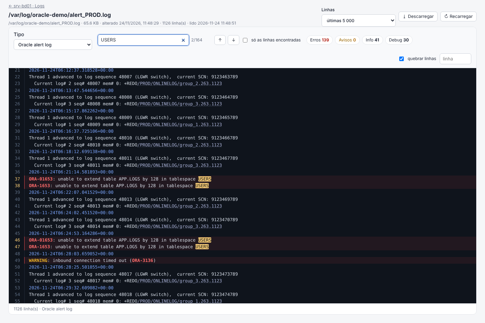 | 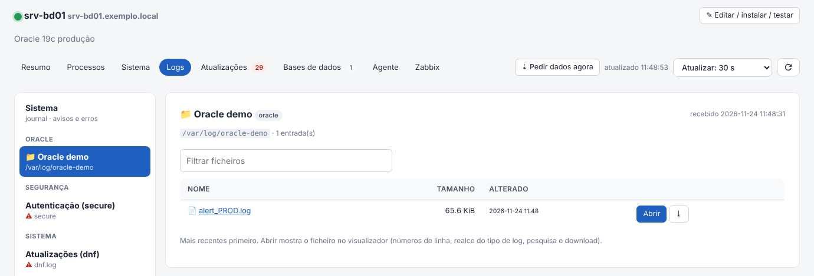 |

| Ficheiro seguido | Adicionar / procurar |
|---|---|
| 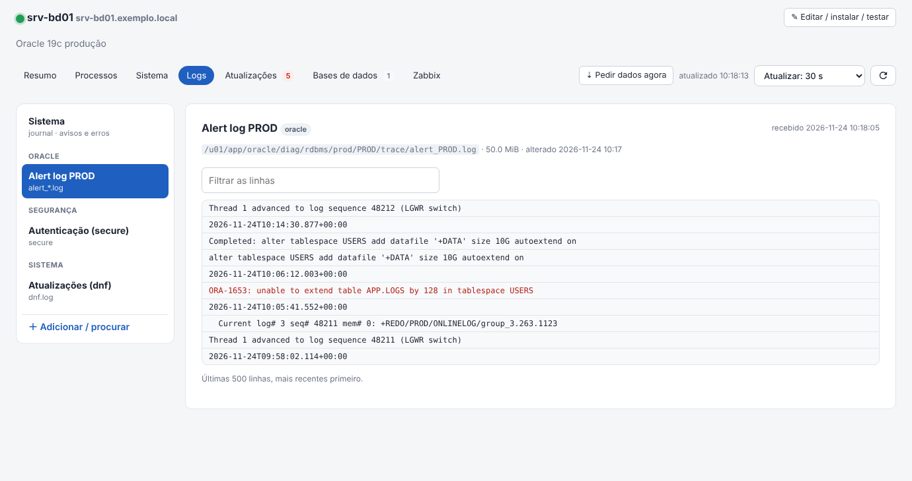 | 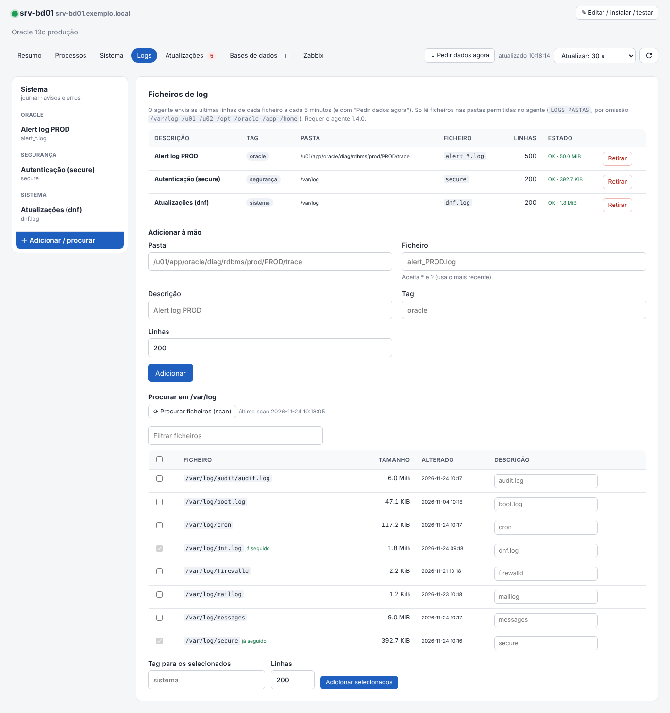 |

**Aba Agente e atualização pelo portal**: no cliente, a aba **Agente** mostra a versão instalada e a do portal, o Python, o modo dos comandos, o serviço Oracle e a última atualização, o botão **⇧ Atualizar** e o histórico de **comandos enviados ao agente** — clicar num mostra o output. Em Ferramentas → **Agentes nos clientes** escolhem-se os clientes (caixas; a do cabeçalho seleciona os desatualizados) e **Atualizar selecionados** mostra o output de cada um em direto.

O agente **1.5.0** consulta o portal a cada 5 s (`COMANDOS_CADA` no `.env`; sem abrir portas no servidor): a atualização e o "Pedir dados agora" começam em segundos. O output mostra cada passo — descarregar, SHA-256 confirmado (o valor vem do portal pelo canal autenticado), sintaxe verificada, versão anterior guardada em `agente-portal.py.anterior`, substituição, reinício (mesmo PID) e "agente X a correr", enviado pelo processo novo. Com um shrink a correr no agente, a atualização espera que termine. Os agentes 1.4 recebem o pedido na sincronização seguinte (o output mostra a entrega e a versão nova quando sincroniza); anteriores à 1.4 atualizam-se uma vez com o `setup.sh`.

| Cliente → Agente | Ferramentas → Agentes nos clientes |
|---|---|
| 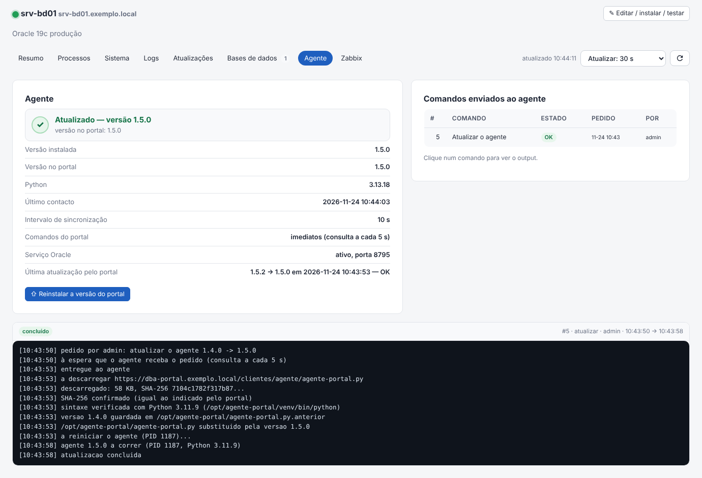 | 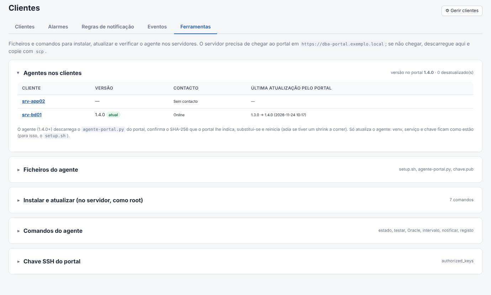 |

**Clientes → Pedidos**: tudo o que o portal pede aos agentes fica registado como um *pedido* com estado (à espera do agente, em curso, concluído, falhou) e output: pedir dados (processos, sistema, logs, atualizações), scan de `/var/log`, ficheiro de log novo e atualização do agente. Filtros por cliente, tipo e estado, atualização automática (5 s) e, ao clicar num pedido, o output em direto. Ao pedir no cliente (botão, scan, ficheiro novo), o output aparece logo na própria página; o pedido fecha quando os dados chegam ("recebido: processos — 312 processos…"). Agentes 1.5+ recebem-no em ~5 s; sem resposta em 15 min passa a "falhou" com o motivo.


**Pedir dados agora** (Processos, Sistema, Logs, Atualizações): o portal responde à sincronização seguinte com o pedido e o agente envia logo esses dados (até um intervalo). A lista de clientes mostra as bases de dados associadas e o número de atualizações pendentes (vermelho com atualizações de segurança, "reiniciar" quando preciso). Requer o agente **1.3.0** (atualize em Ferramentas); `EXTRAS=0` no `.env` do agente desliga estes dados.

**Atualizações**: filtros por **tipo** (segurança com a gravidade, correção, melhoria, pacote novo — do `dnf updateinfo`, agente 1.6.0+), **repositório** e nome do pacote, 20 por página. **Intervalos de recolha** (processos, sistema, logs, ficheiros de log, atualizações — por omissão 6 h): Gerir clientes → **Recolha de dados pelo agente**, aplicados pelos agentes 1.6.0+ na sincronização seguinte.

| Atualizações (filtros e páginas) | Recolha de dados |
|---|---|
|  |  |

Os painéis de output dos pedidos têm **✕** para fechar.

| Processos | Atualizações |
|---|---|
|  |  |

| Bases de dados | Zabbix |
|---|---|
|  |  |

| Sistema | Logs |
|---|---|
|  |  |

### Clientes → Ferramentas

Secções recolhíveis (o estado fica guardado no browser): **Agentes nos clientes** (versões e atualização), download do `setup.sh`, do `agente-portal.py` (versão, tamanho, SHA-256) e da chave SSH pública do portal, e os comandos prontos a copiar, já com o endereço do portal: descarregar o instalador, instalação nova, serviço Oracle, atualizar (mantém id e token), verificar, desinstalar, instalar num servidor sem acesso HTTPS ao portal (o `setup.sh` usa o `agente-portal.py` que estiver ao lado dele), comandos do agente e como pôr a chave à mão.

O `setup.sh` cria o comando `agente-portal` em `/usr/local/bin` e `/usr/bin` (o `sudo` do RHEL não procura em `/usr/local/bin`), a usar o Python do venv quando existe (serviço Oracle). Ao acrescentar a chave do portal ao `authorized_keys`, garante a quebra de linha antes e separa chaves que tenham ficado coladas na mesma linha (guarda uma cópia `authorized_keys.antes-setup`).

### Cliente → Firewall (firewalld ou ufw)

Aba **Firewall** em cada cliente (agente **1.7.0+**): o agente deteta o serviço ativo e mostra-o de forma organizada.

| firewalld | ufw |
|---|---|
| Zona por omissão e zonas ativas; por zona (ativas e a de omissão): interfaces, target, **serviços**, **portas**, **origens** (IP, rede ou `ipset:nome`) e **regras ricas**, com ✕ para retirar e campos para acrescentar (lista de serviços conhecidos; construtor simples de regra rica: ipset/endereço, porta, protocolo, accept/reject/drop) | Política e regras numeradas (para, ação, direção, origem, comentário), com ✕ para apagar e formulário para acrescentar (allow/deny/reject/limit, porta ou intervalo, tcp/udp, origem, comentário) |
| **ipsets**: tipo e entradas, acrescentar/retirar entradas, criar (com entradas) e apagar | |

**Serviço Oracle do agente**: um botão aplica tudo o que é preciso para a porta RPC (8795) — no firewalld cria o ipset (por omissão `agente-portal`) se não existir, junta as origens que faltam e põe a regra rica em todas as zonas ativas (só o que ainda não existe); no ufw, uma regra por origem.

Cada alteração é um **pedido ao agente** (Clientes → Pedidos) com output em direto (`$ firewall-cmd ...` e a resposta); no fim o agente relê o estado. No firewalld vai para a configuração permanente seguida de `--reload`. Ao abrir a aba sem dados, o estado é pedido automaticamente; **⇣ Ler o estado** relê-o.

Segurança: ler é permitido a quem acede ao módulo; **alterar exige a permissão `clientes.firewall`** (Configuração → Perfis) **e** que o agente o permita (`FIREWALL_GERIR=1` no `.env`: `sudo agente-portal configurar --gerir-firewall` ou `setup.sh --gerir-firewall`; `--sem-gerir-firewall` desliga). O agente valida cada operação (nomes de zona/serviço/ipset, porta `N[-M]/proto`, IP/rede, regra rica a começar por `rule `) e corre os comandos sem shell.

| | |
|---|---|
|  |  |

Em **Clientes → Ferramentas**, a secção **Firewall (serviço Oracle do agente)** tem os comandos prontos a copiar: setup.sh com ipset, permitir a gestão pelo portal, criar o ipset, juntar origens, abrir a porta ao ipset em cada zona ativa, ver, retirar uma origem e o equivalente no ufw.


### Pedidos às bases de dados pelo agente cliente (serviço Oracle)

Em vez de o portal se ligar diretamente a cada base de dados, o **agente cliente instalado no servidor da BD** pode fazer os pedidos: o portal envia-os ao agente e fica a aguardar a resposta. Vale para tudo o que o módulo Oracle faz — estado e inspeção (Oracle → Bases de dados), relatório de tablespaces, teste de ligação, cancelamento — e para o **shrink**, que corre no agente.

| Ponto | Detalhe |
|---|---|
| **Ativar no servidor** | `sudo bash setup.sh --oracle --origens "<IP do portal>" --abrir-firewall` (num agente já instalado basta isto: mantém id e token). Cria `/opt/agente-portal/venv` com o `python-oracledb` (Python 3.8+), gera o certificado e liga o serviço na porta **8795/tcp** |
| **Associar a base de dados** | Oracle → Definições → Editar → **Agente cliente**: escolher o agente (o que tem o mesmo host aparece como *sugerido*) e o modo |
| **Modos** | **Automático**: o agente se estiver disponível, senão o portal. **Obrigatório**: só pelo agente (sem ele dá erro) |
| **Quem tratou** | Coluna **Pedidos feitos por** em Oracle → Bases de dados e → Definições (verde = agente; cinza/laranja = portal, com o motivo). Em cada execução, **Executado por**; na lista, ⇄ agente. Em Clientes → cliente, o cartão **Serviço Oracle** com as BDs associadas |
| **Shrink** | O bloco corre numa sessão do agente; o portal acompanha (passo, %, output em direto) e grava o resultado. Se o portal ou o agente Oracle do portal reiniciar, a execução **continua no agente** e volta a ser acompanhada. Cancelar termina a sessão pelo agente |
| **Segurança** | HTTPS com certificado próprio do agente; o portal confirma a impressão digital (SHA-256) que o agente envia na sincronização autenticada. Cada pedido é assinado com o token do cliente (HMAC-SHA256 com hora e nonce: não pode ser repetido). `--origens` limita aos IPs do portal. A password da BD vai no pedido (cifrado pelo TLS) e não fica guardada no agente |
| **Firewall com ipset** | `setup.sh --oracle --origens "<IP do portal> <IP2> <REDE>/24" --abrir-firewall` cria o ipset **agente-portal** (hash:net) com essas origens e abre a porta 8795 só para o ipset em **todas as zonas ativas** do firewalld. `--ipset NOME` usa um ipset existente. Mais IPs depois: `firewall-cmd --permanent --ipset=agente-portal --add-entry=IP && firewall-cmd --reload`. As `--origens` também ficam no agente (`RPC_ORIGENS`, aceita redes CIDR desde a 1.6.1); com `--ipset` sem `--origens`, o controlo de origem fica só na firewall (os pedidos continuam assinados) |
| **Bases 11g** | O modo thin do python-oracledb precisa de 12.1+. Para 11g: `--oracle-lib /u01/app/oracle/product/11.2.0/dbhome_1/lib` (modo thick, usa as bibliotecas do Oracle do servidor) |
| **Sem internet no servidor** | `pip download oracledb` noutra máquina (mesma versão de Python) e `setup.sh --oracle --oracledb-wheel /tmp/oracledb-*.whl` |

```bash
agente-portal estado          # inclui a linha "oracle" (porta, versão do python-oracledb, certificado)
agente-portal oracle --dsn localhost:1521/PROD --utilizador DBOPERATOR    # testa uma ligação (pede a password)
journalctl -u agente-portal -f   # "servico Oracle a escutar...", "job ... iniciado/terminou"
```

| Oracle → Bases de dados | Execução feita pelo agente |
|---|---|
|  |  |

| Base de dados → Agente cliente | Clientes → Serviço Oracle |
|---|---|
|  |  |

---

## Configuração → Agendamento → Eventos

A página de Agendamento tem duas abas: **Geral** (estado, últimas execuções e as tarefas de cada módulo, como antes) e **Eventos**: todas as execuções das tarefas com filtros por tarefa, estado (sucesso, aviso, erro, a correr), período (24 h, 7, 30, 90 dias, todos) e texto; totais por estado, duração, origem (agendamento ou manual, com o utilizador) e a mensagem completa (expandir). Atualização automática como na Home.


---

## Configuração → Setup

Resumo da instalação, só de leitura (administrador):

| Secção | Conteúdo |
|---|---|
| **Resumo** | Problemas de ficheiros/permissões, armazenamento ligado, serviços ativos |
| **Identidade** | Instância, modo (systemd / Docker), pasta do portal, pasta de dados, utilizador de serviço, PID |
| **Armazenamento** | Tipo, ligação, teste (registos e tempo), origem da chave de cifra (`fernet.key` ou `PORTAL_FERNET_KEY`) |
| **Ficheiros, chaves e permissões** | `data/`, `admin.json`, `portal.json`, `fernet.key`, `flask_secret.key`, `clientes_ssh/`, `portal.sqlite3`, `backups/`: dono, modo atual/esperado (700 pastas, 600 ficheiros) e o comando para corrigir, com botão Copiar |
| **Serviços** | `<nome>`, `<nome>-agente`, `<nome>-agente-oracle`, `nginx`, e as regras `/etc/sudoers.d/<nome>-agente` e `-firewall` |
| **Runtime** | Python, Flask, Gunicorn, oracledb, psutil, ldap3, cryptography, sistema, fuso horário |
| **Configuração do instalador** | `/etc/portal-oracle/<nome>.conf` (passwords ocultadas). Por omissão só o root o lê (600): a página indica o comando `--mostrar` |
| **Comandos úteis** | Mostrar, atualizar, verificar, reaplicar, listar, recursos do agente Oracle, registos — com o caminho real da instância |


---

## Agendamento

Em **Configuração → Agendamento**: as tarefas periódicas do portal e dos módulos ativos, executadas pelo **agente** (sem o agente não correm à hora marcada; podem correr à mão com **▶ Agora**).

| Tarefa | Módulo | O que faz | Por omissão |
|---|---|---|---|
| **Backup do portal** | Portal | Backup da configuração (como em Backups), mantém os N mais recentes | Inativa, diário às 02:00 |
| **Limpeza do histórico** | Portal | Apaga notificações lidas, emails enviados/com erro, execuções de agendamentos e ações sobre serviços com mais de N dias | Ativa, diário às 03:30, 90 dias |
| **Verificação de tablespaces** | Oracle | Liga a cada BD (todas ou as indicadas) e verifica a ocupação em relação ao máximo com autoextend; acima do limiar gera o evento "Tablespace acima do limiar" | Inativa, a cada 4 h, 90 % |
| **Validação da ligação SMTP** | SMTP | Liga ao servidor de email (TLS e autenticação) sem enviar; gera o evento "Ligação SMTP" (falhou/recuperou) | Ativa, a cada 60 min |

| Opção | Valores |
|---|---|
| **Ativos / Desativar todos** | Interruptor geral: desativado, nenhuma tarefa corre à hora marcada |
| **Frequência** | A cada N minutos (5–1440), a cada N horas (1–168), todos os dias às HH:MM, ou dias da semana às HH:MM |
| **Notificar** | Não, Só se falhar, Sempre → evento **"Tarefa agendada terminada"** (sucesso, com avisos, falhou), entregue pelas regras do SMTP (sininho e/ou email). Vêm criadas: "Tarefa agendada falhou" no sininho (quem gere o portal) e por email (destinatários por omissão) |
| **Parâmetros** | Próprios de cada tarefa (ex. backups a manter, dias a manter, limiar, bases de dados) |

Cada execução fica registada (início, fim, estado, origem: agendamento ou manual, e a mensagem), em **Últimas execuções** e na página da tarefa. A configuração (tabela `agendamentos`) entra nos backups.

> A validação SMTP passou a ser esta tarefa (antes era o campo "Validar a cada (min)" em SMTP → Geral). Numa instalação com o backup diário no cron do `instalar.sh`, a página avisa: use um ou o outro.


---

## Caixas de confirmação e aviso

As confirmações (apagar, atualizar o agente, desativar um módulo…) e os avisos usam uma caixa própria do portal em vez da janela do browser (que mostrava o endereço do servidor, ex. "<servidor> says"): título com a pergunta, texto explicativo, ícone, fundo desfocado, animação curta, tema claro/escuro/Oracle e botões **Voltar** / **Confirmar**. Ações destrutivas (apagar, remover, desativar, cancelar…) ficam a vermelho e com o foco em **Voltar**; `Esc` ou clicar fora cancela.

Está em `app/static/dialogo.js` (HTML5 `<dialog>` + CSS) e é carregado em todas as páginas. O código existente não muda: `onsubmit="return confirm(...)"` e `if (!confirm(...)) return;` passam a abrir esta caixa; ao confirmar, o formulário é submetido / o clique é repetido. Para código novo: `await PortalDialogo.confirmar('Apagar X? Texto.', {perigo: true})` e `PortalDialogo.aviso('...')`.


## Línguas (português e inglês)

O portal é escrito em português. Ao lado do sininho há as **bandeiras**: cada utilizador escolhe a língua (fica guardada para ele e num cookie, para a página de entrada). Para quem ainda não escolheu, vale a **língua por omissão**.

Em **Configuração → Aparência → Linguagem** (permissão `config.portal`):

| Ação | Descrição |
|---|---|
| **Línguas** | Nome, ativa/inativa (inativa não aparece nas bandeiras), língua por omissão, e a percentagem traduzida |
| **Acrescentar língua** | Código ISO (ex. `es`, `fr`, `pt-BR`) e nome. Fica inativa até ser traduzida e ativada |
| **Ver traduções** | Tabela com o texto original e a tradução, pesquisa e filtros (Traduzidos, Alterados no portal, Em falta). Altera-se no próprio campo (guarda ao sair) e **Repor** volta à tradução do portal |
| **Exportar XML** | Todos os textos do portal com a tradução atual (os em falta vêm vazios) |
| **Importar** | Escolher o XML → **validação** sem alterar nada (XML bem formado, língua certa, sem `DOCTYPE`/`ENTITY`, marcadores `{n}` mantidos, textos desconhecidos, repetidos) → resumo (alterados, novos, iguais, sem tradução, erros) e a lista das diferenças → **Aplicar** |

Formato do XML:

```xml
<?xml version="1.0" encoding="UTF-8"?>
<lingua codigo="en" nome="English">
  <texto>
    <origem>Guardar</origem>
    <traducao>Save</traducao>
  </texto>
  <texto>
    <origem>há {n} min</origem>
    <traducao>{n} min ago</traducao>
  </texto>
</lingua>
```

| Pormenor | Como funciona |
|---|---|
| Onde estão as traduções | As do portal em `app/i18n/<codigo>.xml` (vêm com o código); as alteradas no portal na tabela `traducoes`, que tem prioridade e entra nos backups |
| Como se aplicam | No browser (`static/i18n.js`): os textos da página e dos atributos (dicas, marcadores dos campos) são trocados, incluindo o que o JavaScript cria depois. Um texto sem tradução fica em português |
| Números | Procuram-se como `{n}`: "há 5 min" usa a tradução de "há {n} min". A tradução tem de manter os mesmos marcadores |
| O que não é traduzido | Dados (nomes de BDs, tablespaces, utilizadores), código (`<code>`, logs, output do Oracle), o título do portal e o texto da manutenção (são definidos por si), e as notificações e emails já gerados (ficam na língua em que foram criados) |

| Inglês | Linguagem → traduções | Importar (validação) |
|---|---|---|
|  |  |  |


---

## Modo de manutenção

Em **Configuração → Manutenção**:

| Elemento | Descrição |
|---|---|
| **Estado** | Ativo (em manutenção) ou inativo (operacional), com a data e quem ativou |
| **Editor HTML** | Barra com título, parágrafo, negrito, itálico, texto pequeno, lista, ligação, quebra e linha, e **pré-visualização ao lado**, atualizada enquanto escreve |
| **Botões** | Guardar mensagem · Guardar e ativar/desativar a manutenção · Repor a mensagem por omissão |

Com a manutenção ativa:

- **Quem gere o portal** (administrador e perfis com `config.portal`) entra e navega normalmente, com um aviso no topo de todas as páginas.
- **Os outros utilizadores** veem a mensagem, com o código HTTP 503 (a API responde em JSON). A página de login mostra a mensagem e continua a deixar entrar os administradores.
- **Segurança da mensagem:** ao guardar, o HTML é filtrado. Ficam só títulos, parágrafos, formatação, listas, ligações `http(s)`/`mailto`, imagens, tabelas e `style`. Scripts, eventos (`onclick`, ...), `javascript:`, formulários e iframes são removidos, e a página é servida com uma CSP que bloqueia scripts.

| Editor (administrador) | O que os outros utilizadores veem |
|---|---|
|  |  |

Pela linha de comandos (se não conseguir entrar no portal):

```bash
cd /opt/<nome>
sudo -u <nome> .venv/bin/python manage.py maintenance status
sudo -u <nome> .venv/bin/python manage.py maintenance on --html mensagem.html
sudo -u <nome> .venv/bin/python manage.py maintenance off
# ou, numa instalação em servidor:
sudo ./instalar.sh --manutencao <nome> on|off|status
# Docker:
docker-compose exec -u portal portal python manage.py maintenance on
```

> Durante um reinício do serviço (por exemplo ao atualizar), o Nginx mostra uma página "O portal está a reiniciar", que volta a tentar a cada 10 segundos (`app/static/indisponivel.html`). Isto acontece mesmo sem o modo de manutenção.

---

## Instalação com Docker

> Para instalar diretamente num servidor, sem Docker, veja [Instalação num servidor (sem Docker)](#instalação-num-servidor-sem-docker).

### Com o script `portal-docker.sh` (recomendado)

Descarrega **só a pasta do portal** do repositório (sem o resto nem o histórico) para a pasta que escolher, e trata do Docker. Só precisa do `git` e do Docker Compose. Serve para a instalação e para as atualizações.

```bash
# 1.a vez: obter o script (só a pasta do portal) e instalar
git clone --depth 1 --filter=blob:none --sparse https://github.com/<conta>/<repositorio>.git /tmp/p
git -C /tmp/p sparse-checkout set docker/portal-oracle
sudo /tmp/p/docker/portal-oracle/portal-docker.sh -d /opt/oracle-portal -r https://github.com/<conta>/<repositorio>.git
rm -rf /tmp/p

# atualizar para a última versão (a origem ficou guardada em /opt/oracle-portal/.origem)
sudo /opt/oracle-portal/portal-docker.sh -d /opt/oracle-portal

# mudar as portas (ficam no .env)
sudo /opt/oracle-portal/portal-docker.sh -d /opt/oracle-portal -H 8090 -S 2223
```

| Opção | Descrição |
|---|---|
| `-d PASTA` | Pasta de destino (omissão `/opt/oracle-portal`) |
| `-r URL` | Repositório (HTTPS ou SSH). Só na 1.ª vez; depois fica em `PASTA/.origem` |
| `-b BRANCH` | Branch (omissão o guardado, ou `main`) |
| `-p SUBPASTA` | Pasta do portal no repositório (omissão `docker/portal-oracle`) |
| `-H PORTA` / `-S PORTA` | Porta HTTP / SSH no anfitrião (gravadas no `.env`: `PORTAL_HTTP_PORT`, `PORTAL_SSH_PORT`) |
| `-c` | Só atualiza o código, sem mexer no Docker |
| `-y` | Não pede confirmação |
| `-v` | Mostra a versão instalada (`PASTA/.versao`) e a origem |
| `-h` | Ajuda |

| Na pasta | O que o script faz |
|---|---|
| Código (`app/`, `docker/`, `Dockerfile`, ...) | Substitui pela versão do repositório. **Ficheiros que não vêm do repositório são apagados**: não guarde outros ficheiros na pasta |
| `data/`, `.env` e `docker-compose.override.yml` | Nunca altera. O `.env` é criado na 1.ª vez a partir do `.env.example` |
| `.origem` / `.versao` | Repositório, branch e pasta usados / commit instalado (`-v` mostra-os) |
| Portas no `.env` | Limpa os valores (aspas, espaços, comentário no fim da linha, CRLF do Windows), deixa uma linha por variável e para com erro se não forem números entre 1 e 65535 |
| Docker | Valida a configuração (`config -q`) antes de arrancar. 1.ª vez: `up -d --build` e pede a password do `admin`. Seguintes: `up -d --build` (só reconstrói se o `Dockerfile` mudou) e `restart` |

- Repositório privado: no HTTPS use um token do GitHub (só leitura) como password; no SSH registe a chave do servidor no GitHub.
- **Nome do contentor:** `PORTAL_CONTAINER` no `.env` (omissão `oracle-portal`); tem de ser único no anfitrião. Depois de arrancar, o script espera que o contentor fique a correr; se não ficar, mostra as últimas linhas do log.
- **Portas e outras alterações locais:** não altere o `docker-compose.yml` (é substituído em cada atualização). As portas ficam no `.env` (`PORTAL_HTTP_PORT=8080`, `PORTAL_SSH_PORT=2222`; ou `-H`/`-S`); para o resto (volumes, rede, ...) use um `docker-compose.override.yml` na mesma pasta, que o Docker Compose junta sozinho. Se um `docker-compose.yml` antigo tiver as portas alteradas à mão, o script passa-as para o `.env` na 1.ª atualização.
- Recusa pastas do sistema (`/`, `/opt`, `/usr/...`, homes dos utilizadores).
- Depois de atualizar, faça **Ctrl+F5** no browser.

**Portas no `.env`** (só o número, uma linha por variável):

```
PORTAL_HTTP_PORT=8090
PORTAL_SSH_PORT=2223
```

Para as aplicar sem o script: `docker-compose config -q && docker-compose up -d` (o `restart` não muda as portas).

### Manualmente

```bash
cd /opt/oracle-portal               # pasta com o código (fica no anfitrião)
cp .env.example .env
mkdir -p data/ssh/users data/home
cp ~/.ssh/id_ed25519.pub data/ssh/users/<utilizador>.pub        # utilizador SSH pessoal (com sudo)

docker-compose build
docker-compose up -d
docker-compose exec -u portal portal python manage.py set-admin-password
```

| Acesso | Endereço |
|---|---|
| Portal | `http://<servidor>:8080` (utilizador `admin`; porta `PORTAL_HTTP_PORT` no `.env`) |
| SSH | `ssh -p 2222 <utilizador>@<servidor>` (porta `PORTAL_SSH_PORT` no `.env`) |

> **A atualizar a partir da versão anterior?** O serviço passou a chamar-se `portal` (antes era `app`), e já não há um contentor separado para o Nginx. Corra `docker-compose down` antes do `up`. As bases de dados Oracle já configuradas são migradas automaticamente. Um `PORTAL_ADMIN_PASSWORD_HASH` que já esteja no `.env` é usado para criar o `admin.json` no primeiro arranque.

### Ficheiros em `data/` (não versionar — **fazer backup**)

| Ficheiro | Conteúdo |
|---|---|
| `admin.json` | Administrador local (hash da password) |
| `fernet.key` | Chave de cifra das passwords. **Sem ela, as passwords guardadas perdem-se** |
| `portal.json` | Onde ficam os dados do portal (SQLite, MariaDB ou PostgreSQL) |
| `portal.sqlite3` | Dados do portal, quando se usa SQLite |
| `backups/` | Ficheiros de backup da configuração |
| `ssh/` | Chaves do servidor SSH, `authorized_keys` do `portal` e `users/` (utilizadores pessoais) |
| `home/` | Homes dos utilizadores (`home/portal`, `home/<utilizador>`, ...): `.vscode-server`, `.gitconfig`, histórico |

---

## Instalação num servidor (sem Docker)

O portal corre com o Gunicorn como serviço **systemd**, atrás do **Nginx**. Testado para **Ubuntu 26.04 LTS** (funciona também em 24.04/22.04, Debian 12 e RHEL/Rocky/Alma 9).

Há duas formas de instalar:

| Forma | Para quem |
|---|---|
| [**Script `instalar.sh`**](#instalação-com-o-script-instalarsh-recomendado) (recomendado) | Pergunta tudo e faz tudo: nome da instância, base de dados, Nginx, SSL, systemd, cron e firewall. Não é preciso alterar nenhum ficheiro |
| [**Passo a passo manual**](#instalação-manual-passo-a-passo) | Para perceber o que é feito, ou para adaptar a um caso especial |

### Nome da instância

Tudo o que depende do nome é gerado a partir de **um único valor**, o nome da instância (por omissão `portal-oracle`). Assim pode chamar-lhe, por exemplo, `nome-portal`, ou ter várias instâncias no mesmo servidor:

| Item | Valor gerado (exemplo com `nome-portal`) |
|---|---|
| Pasta | `/opt/nome-portal` |
| Utilizador de serviço (sem login) | `nome-portal` |
| Serviço systemd | `nome-portal.service` |
| Site do Nginx | `/etc/nginx/sites-available/nome-portal` (RHEL: `/etc/nginx/conf.d/nome-portal.conf`) |
| Logs do Nginx | `/var/log/nginx/nome-portal.access.log` / `.error.log` |
| Cron do backup | `/etc/cron.d/nome-portal` |
| Configuração guardada (respostas do instalador) | `/etc/portal-oracle/nome-portal.conf` |
| Base de dados do portal (MariaDB/PostgreSQL) | `nome_portal`, utilizador `nome_portal` |
| Porta interna do Gunicorn | `127.0.0.1:8000`, ou a primeira livre a seguir |

Os ficheiros em `deploy/` são **templates** com marcadores (`@NOME@`, `@DIR@`, `@UTILIZADOR@`, ...), que o script preenche:

| Template | Gera |
|---|---|
| `deploy/portal.service.tpl` | `/etc/systemd/system/<nome>.service` |
| `deploy/nginx-http.conf.tpl` | Site do Nginx só com HTTP |
| `deploy/nginx-https.conf.tpl` | Site do Nginx com HTTPS (e HTTP a redirecionar para HTTPS) |
| `deploy/bd/postgresql.sql`, `deploy/bd/mariadb.sql` | SQL para criar a base de dados do portal, com os passos de acesso remoto em comentário |
| `deploy/bd/preparar-postgresql.sh`, `deploy/bd/preparar-mariadb.sh` | Scripts para correr **no servidor da base de dados** (não são templates) |

---

### Instalação com o script `instalar.sh` (recomendado)

#### 1. Obter o código

Não é preciso descarregar o repositório inteiro. Escolha uma das opções:

**a) Só o script.** O `instalar.sh` não encontra o código ao lado e oferece-se para ir buscar **só a pasta do portal** ao Git (clone parcial com `sparse-checkout`, a mesma lógica do [`extrair_pasta_git`](../../linux/geral/extrair_pasta_git)):

```bash
curl -fsSLO https://raw.githubusercontent.com/<utilizador>/<repositorio>/main/docker/portal-oracle/instalar.sh
sudo bash instalar.sh
#   Origem do codigo: 1) Obter so a pasta do portal de um repositorio Git
#   URL do repositorio: https://github.com/<utilizador>/<repositorio>.git
#   Branch [main]:
#   Pasta do portal no repositorio [docker/portal-oracle]:
```

Para não ter de escrever o URL de cada vez, preencha `REPO_URL_PADRAO` no início do `instalar.sh`.

**b) Só a pasta do portal, com o `extrair_pasta_git`:**

```bash
./extrair_pasta_git.sh -r https://github.com/<utilizador>/<repositorio>.git -p docker/portal-oracle -d /tmp/portal-oracle
sudo /tmp/portal-oracle/instalar.sh
```

**c) Já tem a pasta** (zip, cópia, clone): `sudo ./instalar.sh` dentro dela. O código é copiado para a pasta de instalação.

#### 2. Correr o script

```bash
sudo ./instalar.sh
```

O **Enter** aceita o valor entre `[ ]`. **Nada é alterado antes da confirmação final**, onde é mostrado um resumo.

| Passo | Perguntas |
|---|---|
| 1. Instância | Nome (ex. `nome-portal`), pasta (`/opt/<nome>`), utilizador de serviço (`<nome>`) |
| 2. Código | Copiar desta pasta, obter do Git (só a pasta do portal) ou manter o que já está instalado |
| 3. Aplicação | Porta interna do Gunicorn, nome do administrador, se define a password agora |
| 4. Base de dados | SQLite, MariaDB ou PostgreSQL, local ou remota (ver abaixo) |
| 5. Nginx e HTTPS | Nome DNS, sem HTTPS / certificado próprio / Let's Encrypt, portas |
| 6. Extras | Backup diário no cron (hora), abrir as portas na firewall (ufw ou firewalld, se ativa) |

Depois instala os pacotes, cria o utilizador, copia o código, cria o ambiente Python, prepara a base de dados, define a password do administrador, gera e ativa o serviço systemd, gera e testa o site do Nginx (`nginx -t`; se falhar, repõe o anterior), configura o cron e a firewall e mostra o endereço do portal.

#### 3. Base de dados do portal

| Opção | O que o script faz |
|---|---|
| **SQLite** | Nada a preparar: ficheiro `data/portal.sqlite3` |
| **MariaDB neste servidor** | Instala o `mariadb-server` (se não existir), cria a base de dados e o utilizador (password aleatória ou à escolha), liga e cria as tabelas |
| **PostgreSQL neste servidor** | Instala o `postgresql` (se não existir), cria a base de dados e o utilizador, acrescenta a linha ao `pg_hba.conf`, liga e cria as tabelas |
| **MariaDB / PostgreSQL noutro servidor** | Gera o SQL e diz o que correr no servidor remoto (abaixo). Depois testa a ligação até funcionar, ou continua com SQLite para mudar mais tarde |

**Base de dados remota.** O script deteta o IP deste servidor visto pelo servidor da base de dados e mostra algo como:

```
   Preparar o servidor db.dominio.pt (como root, no servidor postgresql):

     scp /opt/nome-portal/deploy/bd/preparar-postgresql.sh <utilizador>@db.dominio.pt:/tmp/
     sudo PORTAL_DB_PASSWORD=Xy...  bash /tmp/preparar-postgresql.sh \
          --bd nome_portal --utilizador nome_portal --cliente 10.0.0.5

   So SQL, para fazer a mao: /opt/nome-portal/data/bd/postgresql.sql

   Enter = testar a ligacao | i = instrucoes | s = continuar com SQLite e mudar depois:
```

O que os scripts de preparação fazem no servidor da base de dados (podem correr mais do que uma vez):

| Passo | `preparar-postgresql.sh` | `preparar-mariadb.sh` |
|---|---|---|
| Base de dados e utilizador | `CREATE ROLE ... LOGIN PASSWORD`, `CREATE DATABASE ... OWNER` (se já existir, só atualiza a password) | `CREATE DATABASE ... utf8mb4`, `CREATE USER '<util>'@'<IP>'`, `GRANT SELECT, INSERT, UPDATE, DELETE, CREATE, ALTER, INDEX, DROP` |
| Autorizar o IP do portal | Acrescenta ao **`pg_hba.conf`** (o caminho vem de `SHOW hba_file`), antes das outras regras, com cópia de segurança:<br>`host  nome_portal  nome_portal  10.0.0.5/32  scram-sha-256`<br>(usa `md5` se `password_encryption` for `md5`) | O utilizador é criado para esse IP |
| Escutar na rede | Se `listen_addresses` for `localhost`, pergunta se faz `ALTER SYSTEM SET listen_addresses = '*'` e reinicia | Se `bind-address` for `127.0.0.1`, pergunta se cria `99-acesso-remoto.cnf` com `bind-address = 0.0.0.0` e reinicia |
| Aplicar | `pg_reload_conf()` (ou reinício, se mudou o `listen_addresses`) | — |
| Firewall | Se ufw/firewalld estiver ativo, pergunta se abre a 5432 **só para o IP do portal** | Idem, porta 3306 |

Opções úteis: `--sem-rede` (não mexe em `listen_addresses`/`bind-address`), `--sem-firewall`, `-y` (sem confirmações), `--ajuda`. Se o root do MariaDB tiver password: `sudo MYSQL_PWD='...' ./preparar-mariadb.sh ...`.

Para preparar à mão, use o SQL gerado em `data/bd/<tipo>.sql` (com a password já preenchida, só legível pelo dono) ou os modelos `deploy/bd/postgresql.sql` e `deploy/bd/mariadb.sql`.

Mais tarde, a base de dados também pode ser mudada no portal, em **Configuração → Portal → Armazenamento** (copia os dados), ou pela linha de comandos:

```bash
cd /opt/<nome>
sudo -u <nome> PORTAL_DB_PASSWORD='...' .venv/bin/python manage.py set-storage \
     --type postgresql --host db.dominio.pt --port 5432 --database nome_portal --user nome_portal
sudo -u <nome> .venv/bin/python manage.py show-storage
```

O `set-storage` testa a ligação e cria as tabelas antes de gravar; se falhar, nada é alterado. Não copia dados (para isso use o portal).

#### 4. HTTPS (SSL)

| Opção | O que é preciso | O que o script faz |
|---|---|---|
| **Sem HTTPS** | — | Site só com HTTP. `PORTAL_COOKIE_SECURE=0` |
| **Certificado próprio** | Certificado e chave em PEM, chave **sem password**, e a cadeia (intermédios) se não estiver no certificado | Valida os ficheiros (formato, chave corresponde ao certificado, validade, nomes), gera o site com HTTPS e o HTTP a redirecionar para HTTPS. `PORTAL_COOKIE_SECURE=1` |
| **Let's Encrypt** | Nome DNS público a apontar para o servidor, porta 80 acessível da Internet | Instala o `certbot`, pede o certificado e configura o redirecionamento. A renovação é automática. Se falhar, o portal fica em HTTP |

Com certificado próprio:

- se indicar a **cadeia**, o script junta certificado e cadeia em `/etc/nginx/ssl/<nome>/fullchain.pem` e copia a chave para `privkey.pem` (só root). **Ao renovar o certificado, volte a correr o script** (ou repita a junção à mão);
- sem cadeia, o Nginx usa os ficheiros no sítio onde estão: ao renovar, basta substituí-los e fazer `sudo systemctl reload nginx`.

Para ver como fazer à mão, consulte o [passo 8 da instalação manual](#8-https-ssl).

#### 5. Configuração guardada, reconfigurar, atualizar e remover

As respostas (sem passwords) ficam em **`/etc/portal-oracle/<nome>.conf`** (só root). São gravadas **logo após a confirmação**: se a instalação falhar a meio, não se perdem, e a instância aparece como *incompleta*.

Ao voltar a correr o script, ele mostra as instâncias do servidor e a configuração guardada da escolhida:

```
== Configuracao guardada de 'dba-portal'
   Instancia / servico    dba-portal  (dba-portal.service: active)
   Pasta                  /opt/dba-portal
   Codigo (Git)           https://github.com/<utilizador>/<repositorio>.git (main) docker/portal-oracle
   Base de dados          postgresql remota - dba_portal@db.dominio.pt:5432/dba_portal
   HTTPS                  certificado proprio: /etc/ssl/portal.crt
   Endereco               https://portal.dominio.pt/
   Ultima execucao        2026-11-19 14:13
   ...
   O que pretende fazer?
     1) Rever a configuracao (os valores guardados aparecem como omissao)
     2) Reaplicar sem perguntas, mantendo o codigo instalado
     3) Atualizar o codigo pelo Git (main) e reaplicar sem perguntas
     4) Desinstalar esta instancia
     5) Sair sem alterar nada
```

| Objetivo | Comando |
|---|---|
| Ajuda | `./instalar.sh --help` |
| Ver as instâncias do servidor | `sudo ./instalar.sh --lista` |
| Ver a configuração guardada | `sudo ./instalar.sh --mostrar <nome>` |
| **Mudar a configuração** (SSL, nome DNS, base de dados, porta, cron) | `sudo ./instalar.sh <nome>` → "Rever". A base de dados pode ficar como está (opção "Manter") |
| **Reaplicar** sem perguntas (ex.: depois de atualizar o script ou os templates) | `sudo ./instalar.sh --reaplicar <nome>` |
| **Atualizar o código** pelo Git e reaplicar | `sudo ./instalar.sh --atualizar <nome> [URL [branch [pasta]]]`. Se a instância foi instalada a partir de uma pasta (sem repositório guardado), usa o URL indicado ou pergunta-o, e guarda-o para a próxima vez (ver [Atualizar o código](#6-atualizar-o-código-sincronizar-com-o-repositório)) |
| **Diagnóstico** (portal indisponível?) | `sudo ./instalar.sh --verificar <nome>` |
| **Modo de manutenção** | `sudo ./instalar.sh --manutencao <nome> on\|off\|status` |
| **Firewall** (sudoers do portal para o módulo Firewall) | `sudo ./instalar.sh --firewall <nome> on\|off\|status` |
| **Serviços do módulo Sistema** (sudoers do agente) | `sudo ./instalar.sh --servicos <nome> [+servico\|-servico\|"lista"]`, ex. `+firewalld` |
| **Outra instância** no mesmo servidor | `sudo ./instalar.sh` → "Nova instancia". Use outro nome DNS (ou outra porta HTTP) |
| **Remover** | `sudo ./instalar.sh --desinstalar <nome>`: remove o serviço, o site do Nginx, o cron e a configuração guardada. Pergunta se apaga a pasta (antes guarda `data/` em `/root/<nome>-data-<data>.tar.gz`) e o utilizador. A base de dados MariaDB/PostgreSQL não é tocada |

Notas:

- **Nunca são substituídos:** `data/`, `.env` e `.venv`.
- **Confirmação:** mesmo a reaplicar sem perguntas, o resumo é mostrado e pede confirmação.
- **Quando volta a perguntar:** se algum valor guardado já não servir (por exemplo, o certificado mudou de sítio ou deixou de ser válido), o script pergunta só esse.
- **Instalações anteriores:** a configuração guardada em `/opt/<nome>/.instalacao` é lida e passa para `/etc/portal-oracle/` na execução seguinte.

#### 6. Atualizar o código (sincronizar com o repositório)

Use **sempre o script** para atualizar:

```bash
sudo /opt/<nome>/instalar.sh --atualizar <nome>     # obtém do Git só a pasta do portal
# ou, a partir de uma pasta com a versão nova (ex. extraída com o extrair_pasta_git):
sudo /tmp/portal-oracle/instalar.sh <nome>          # -> Rever -> origem "Copiar da pasta deste script"
```

| Passo | Porquê |
|---|---|
| Substitui cada entrada de código (`app/`, `deploy/`, `manage.py`, ...) em vez de copiar por cima | Não ficam ficheiros antigos (ex. `app/oracle.py`, `app/views/ops.py` de antes dos módulos) |
| Remove `Dockerfile`, `docker-compose.yml`, `.dockerignore`, `docker/` e `portal-docker.sh` | Numa instalação em servidor não servem; também são removidos ao reaplicar com o código mantido |
| Nunca toca em `data/`, `.env` e `.venv` | Configuração, chaves, SQLite e backups |
| Corrige as permissões (código do root, `data/` e `.venv` do utilizador de serviço) | O serviço tem de conseguir escrever em `data/` |
| `pip install -r requirements.txt` | Pacotes novos ou atualizados |
| Reinicia o serviço | O Gunicorn carrega o código Python no arranque: sem reiniciar, continua com a versão antiga |

**Porque é que o portal fica indisponível depois de copiar o repositório à mão** (ex. `extrair_pasta_git.sh -d /opt/<nome>`, `cp -a` ou `rsync` como root):

| Causa | Sintoma |
|---|---|
| A cópia como root traz `data/` do repositório (só tem o `.gitkeep`) e muda o dono de `data/` para `root` | O serviço deixa de conseguir escrever: SQLite só de leitura, erros 500 |
| O Gunicorn continua com o código Python antigo, mas os templates são lidos do disco já na versão nova | Erros 500 (`BuildError`) em páginas que usam rotas novas, até reiniciar |
| Ficheiros antigos ficam ao lado dos novos | Comportamentos inesperados depois de mudanças grandes |

O que já está previsto para isto:

- **O serviço corrige as permissões ao arrancar:** antes de arrancar, o systemd faz `chown` de `data/` e `.venv` para o utilizador de serviço (`ExecStartPre=+...`). Depois de uma cópia à mão, um `sudo systemctl restart <nome>` resolve as permissões.
- **Diagnóstico:** `sudo ./instalar.sh --verificar <nome>` verifica o serviço, se o Gunicorn responde, os donos e as permissões de `data/` e `.venv`, se o código é legível, se há ficheiros do Docker ou antigos, o Nginx e as últimas linhas do registo, e diz o que fazer.
- **Correção completa:** `sudo ./instalar.sh --reaplicar <nome>`.
- **Durante o reinício**, o Nginx mostra "O portal está a reiniciar" em vez de "502 Bad Gateway".

Para uma janela de manutenção mais longa (ex. migração da base de dados), ative o [modo de manutenção](#modo-de-manutenção) antes.

#### Permissões aplicadas

| Caminho | Dono | Porquê |
|---|---|---|
| Código (`app/`, `deploy/`, `*.py`, `instalar.sh`) | `root:<utilizador>`, só leitura para o grupo | O root volta a correr o `instalar.sh` e os templates: o serviço não os pode alterar |
| `.env` | `root:<utilizador>`, `640` | Lido pelo systemd |
| `data/` | `<utilizador>`, `700` | Chaves, passwords cifradas, SQLite, backups |
| `.venv/` | `<utilizador>` | Pacotes Python |
| `app/static/` | legível por todos | Servido diretamente pelo Nginx |

Para editar o código diretamente no servidor, use `sudo` (ou volte a correr o script com a origem Git).

---

### Instalação manual (passo a passo)

É o que o `instalar.sh` faz. Comece por definir as variáveis, que são usadas em todos os passos (o nome pode ser qualquer um, por exemplo `nome-portal`):

```bash
NOME=portal-oracle               # nome da instancia
DIR=/opt/$NOME                   # pasta de instalacao
UTIL=$NOME                       # utilizador de servico
BIND=127.0.0.1:8000              # Gunicorn (outra porta se ja houver outra instancia)
SERVER_NAME=portal.dominio.pt    # nome DNS, ou _ para qualquer nome
SERVICOS="nginx $NOME $NOME-agente"   # servicos do modulo Sistema (geridos pelo agente)
```

| Componente | Valor |
|---|---|
| Código | `$DIR` |
| Dados | `$DIR/data` (`admin.json`, `fernet.key`, SQLite, backups) |
| Ambiente Python | `$DIR/.venv` |
| Utilizador de serviço | `$UTIL` (sem login) |
| Gunicorn | `$BIND`, só local |
| Nginx | Porta 80/443, faz de proxy para o Gunicorn |

#### 1. Pacotes

> **Ubuntu 26.04:** o `sudo` é o sudo-rs, compatível com os comandos abaixo. O SSH é o OpenSSH 10.2, que já não aceita chaves DSA nem assinaturas `ssh-rsa` com SHA-1: use chaves ed25519.

```bash
sudo apt update
sudo apt install -y python3 python3-venv python3-pip nginx git curl openssl
# opcional, para testar a BD do portal a mao:
sudo apt install -y mariadb-client      # se usar MariaDB
sudo apt install -y postgresql-client   # se usar PostgreSQL
```

| Pacote | Para quê |
|---|---|
| `python3`, `python3-venv`, `python3-pip` | Correr o portal num ambiente Python isolado (`.venv`). O Ubuntu 26.04 traz Python 3.14 e, por causa do PEP 668, não deixa instalar pacotes com `pip` fora de um venv |
| `nginx` | Servidor web e proxy para o Gunicorn |
| `git` | Obter e atualizar o código |
| `openssl` | Validar certificados |

Não precisa do Oracle Instant Client: o `python-oracledb` em modo *thin* é Python puro. Os drivers de MariaDB (`pymysql`) e PostgreSQL (`psycopg[binary]`) também são instalados pelo `pip`, sem bibliotecas do sistema.

> **RHEL / Rocky / Alma:** `sudo dnf install -y python3.12 nginx git openssl`. Os ficheiros do Nginx vão para `/etc/nginx/conf.d/` e o utilizador do Nginx é `nginx`. Com SELinux ativo, corra também `sudo setsebool -P httpd_can_network_connect 1`.

#### 2. Utilizador e código

```bash
sudo useradd --system --user-group --home-dir $DIR --no-create-home --shell /usr/sbin/nologin $UTIL
sudo mkdir -p $DIR
# copiar o conteudo da pasta do portal, por exemplo so a pasta, com o extrair_pasta_git:
#   ./extrair_pasta_git.sh -r <url do repositorio> -p docker/portal-oracle -d /tmp/portal
sudo cp -rT /tmp/portal $DIR
sudo mkdir -p $DIR/data/backups $DIR/.venv

# codigo do root (so leitura para o servico); data/ e .venv do utilizador de servico
sudo chown -R root:$UTIL $DIR
sudo chmod -R u=rwX,g=rX,o= $DIR
sudo chown -R $UTIL:$UTIL $DIR/data $DIR/.venv
sudo chmod 700 $DIR/data
# o Nginx precisa de ler app/static
sudo chmod 755 $DIR $DIR/app
sudo chmod -R o+rX $DIR/app/static
```

#### 3. Ambiente Python e pacotes

```bash
cd $DIR
sudo -u $UTIL python3 -m venv .venv
sudo -u $UTIL .venv/bin/pip install --upgrade pip
sudo -u $UTIL .venv/bin/pip install -r requirements.txt
```

#### 4. Configuração (`.env`)

```bash
sudo cp .env.example .env
sudo chown root:$UTIL .env && sudo chmod 640 .env
sudo nano .env
```

Sem Docker, só estas variáveis contam (as `SSH_*` são ignoradas):

| Variável | Valor recomendado |
|---|---|
| `PORTAL_FERNET_KEY` | Vazio: a chave é criada em `data/fernet.key` |
| `PORTAL_COOKIE_SECURE` | `1` se usar HTTPS, `0` caso contrário |
| `TZ` | `Europe/Lisbon` |

#### 5. Base de dados do portal

Por omissão é SQLite e não é preciso fazer nada. Para MariaDB ou PostgreSQL:

1. No servidor da base de dados, corra o script de preparação (ou o SQL de `deploy/bd/`, substituindo os marcadores):
   ```bash
   sudo PORTAL_DB_PASSWORD='...' ./preparar-postgresql.sh --bd nome_portal --utilizador nome_portal --cliente <IP deste servidor>
   # local: --cliente 127.0.0.1 --sem-rede      (MariaDB local: --cliente localhost,127.0.0.1)
   ```
2. Neste servidor, aponte o portal para ela:
   ```bash
   cd $DIR
   sudo -u $UTIL PORTAL_DB_PASSWORD='...' .venv/bin/python manage.py set-storage \
        --type postgresql --host <servidor> --database nome_portal --user nome_portal
   ```

Os passos do `pg_hba.conf`, do `listen_addresses` e do `bind-address` estão explicados [acima](#3-base-de-dados-do-portal) e em comentário nos ficheiros `deploy/bd/*.sql`.

#### 6. Password do administrador

```bash
cd $DIR
sudo -u $UTIL .venv/bin/python manage.py set-admin-password
#   Administrador: admin
#   Nova password: ********
#   Gravado em /opt/<nome>/data/admin.json
```

Para usar outro nome: `manage.py set-admin-password --user <nome>`. O mesmo comando serve para repor a password se a esquecer.

#### 7. Serviço systemd e Nginx (HTTP)

Os templates são preenchidos com `sed`:

```bash
cd $DIR
preencher() { sed -e "s|@NOME@|$NOME|g" -e "s|@DIR@|$DIR|g" -e "s|@UTILIZADOR@|$UTIL|g" -e "s|@BIND@|$BIND|g" -e "s|@SERVICOS@|$SERVICOS|g" \
                  -e "s|@SERVER_NAME@|$SERVER_NAME|g" -e "s|@HTTP_PORT@|80|g" -e "s|@HTTPS_PORT@|443|g" \
                  -e "s|@HTTPS_URL@|https://\$host|g" -e "s|@SSL_CERT@|$SSL_CERT|g" -e "s|@SSL_KEY@|$SSL_KEY|g" "$1"; }

# systemd
preencher deploy/portal.service.tpl | sudo tee /etc/systemd/system/$NOME.service >/dev/null
sudo systemctl daemon-reload
sudo systemctl enable --now $NOME
sudo systemctl status $NOME                    # deve estar "active (running)"
curl -sI http://$BIND/login | head -1          # HTTP/1.1 200 OK

# Nginx (RHEL: /etc/nginx/conf.d/$NOME.conf, sem o ln)
preencher deploy/nginx-http.conf.tpl | sudo tee /etc/nginx/sites-available/$NOME >/dev/null
sudo ln -sf /etc/nginx/sites-available/$NOME /etc/nginx/sites-enabled/$NOME
sudo nginx -t && sudo systemctl reload nginx
```

O serviço corre o Gunicorn como `$UTIL`, lê o `.env` e reinicia se falhar. O `--bind` no serviço sobrepõe-se ao do `gunicorn.conf.py` (usado no Docker).

Se o `server_name` for `_` e o servidor só tiver este site, desative o site por omissão: `sudo rm /etc/nginx/sites-enabled/default`. Se já tiver outros sites, use um nome DNS.

O portal fica em `http://<servidor>/`.

**Agente** (opcional, recomendado):

```bash
cd $DIR
preencher deploy/agente.service.tpl | sudo tee /etc/systemd/system/$NOME-agente.service >/dev/null
# o agente (utilizador de servico) pode iniciar/parar/reiniciar so estes servicos
L=""; for u in $SERVICOS; do for a in start stop restart; do L+="${L:+, }/usr/bin/systemctl $a $u"; done; done
echo "$UTIL ALL=(root) NOPASSWD: $L" | sudo tee /etc/sudoers.d/$NOME-agente >/dev/null
sudo chmod 440 /etc/sudoers.d/$NOME-agente && sudo visudo -cf /etc/sudoers.d/$NOME-agente
sudo systemctl daemon-reload && sudo systemctl enable --now $NOME-agente
```

#### 8. HTTPS (SSL)

**a) Com certificado próprio** (interno ou comprado):

1. Confirme os ficheiros:
   ```bash
   openssl x509 -in certificado.crt -noout -subject -enddate -ext subjectAltName   # nomes e validade
   openssl x509 -in certificado.crt -noout -pubkey | sha256sum                     # estes dois valores
   openssl pkey -in chave.key -pubout | sha256sum                                  # tem de ser iguais
   ```
   A chave não pode ter password (o Nginx não a consegue pedir). Para a retirar: `openssl pkey -in chave.key -out chave-sem-pw.key`.
2. Junte o certificado e a cadeia (intermédios) num só ficheiro e proteja a chave:
   ```bash
   sudo mkdir -p /etc/nginx/ssl/$NOME && sudo chmod 700 /etc/nginx/ssl/$NOME
   cat certificado.crt cadeia.crt | sudo tee /etc/nginx/ssl/$NOME/fullchain.pem >/dev/null
   sudo install -m 600 chave.key /etc/nginx/ssl/$NOME/privkey.pem
   SSL_CERT=/etc/nginx/ssl/$NOME/fullchain.pem
   SSL_KEY=/etc/nginx/ssl/$NOME/privkey.pem
   ```
3. Troque o site pelo template com HTTPS (o HTTP passa a redirecionar para HTTPS):
   ```bash
   cd $DIR
   preencher deploy/nginx-https.conf.tpl | sudo tee /etc/nginx/sites-available/$NOME >/dev/null
   sudo nginx -t && sudo systemctl reload nginx
   ```
4. Ponha `PORTAL_COOKIE_SECURE=1` no `.env` e `sudo systemctl restart $NOME`.
5. Abra a porta 443 (`sudo ufw allow 443/tcp`) e teste:
   ```bash
   curl -sI https://$SERVER_NAME/login | head -1
   openssl s_client -connect $SERVER_NAME:443 -servername $SERVER_NAME </dev/null 2>/dev/null | grep -E "Verify return|subject="
   ```

**b) Com Let's Encrypt** (nome DNS público e porta 80 acessível da Internet), a partir do site HTTP do passo 7:

```bash
sudo apt install -y certbot python3-certbot-nginx
sudo certbot --nginx -d $SERVER_NAME --redirect
```

Depois, `PORTAL_COOKIE_SECURE=1` no `.env` e `sudo systemctl restart $NOME`. O certbot renova o certificado automaticamente.

> Com `PORTAL_COOKIE_SECURE=1` o login só funciona por HTTPS: se o HTTPS não estiver a funcionar, volte a pôr `0`.

#### 9. Firewall

```bash
sudo ufw allow 'Nginx Full'          # 80 e 443
sudo ufw allow OpenSSH
```

O servidor tem também de chegar às bases de dados Oracle (porta 1521, ou a do listener) e, se for o caso, à base de dados do portal (3306 MariaDB, 5432 PostgreSQL).

#### 10. Backup automático (cron)

```bash
echo "0 2 * * * $UTIL cd $DIR && .venv/bin/python manage.py backup --prune >> data/cron.log 2>&1" | sudo tee /etc/cron.d/$NOME
```

Se tiver definido `PORTAL_FERNET_KEY` no `.env`, o cron não a vê. Nesse caso, no comando acima, antes do `.venv/bin/python`, acrescente `export $(grep -E '^PORTAL_FERNET_KEY=.' .env) &&` (o `.env` tem de ser legível pelo utilizador de serviço, o que já acontece com `640 root:$UTIL`).

### Operação

| Objetivo | Comando |
|---|---|
| Estado / reiniciar | `sudo systemctl status <nome>` / `sudo systemctl restart <nome>` |
| Logs do portal | `sudo journalctl -u <nome> -f` |
| Logs do Nginx | `sudo tail -f /var/log/nginx/<nome>.*.log` |
| Repor a password do admin | `cd /opt/<nome> && sudo -u <nome> .venv/bin/python manage.py set-admin-password` |
| Backup manual | `cd /opt/<nome> && sudo -u <nome> .venv/bin/python manage.py backup --note "manual"` |
| Ver a base de dados do portal | `cd /opt/<nome> && sudo -u <nome> .venv/bin/python manage.py show-storage` |
| Reconfigurar / atualizar | `sudo /opt/<nome>/instalar.sh <nome>` (ou `--reaplicar` / `--atualizar <nome>`) |

**Atualizar o portal à mão:** copie os ficheiros novos para a pasta (sem `data/`, `.env` e `.venv`), depois:

```bash
cd /opt/<nome>
sudo -u <nome> .venv/bin/pip install -r requirements.txt  # se o requirements.txt mudou
sudo systemctl restart <nome>
```

A pasta `data/` não é alterada por atualizações. Faça backup dela, sobretudo do `fernet.key` e do `admin.json`.

### Problemas conhecidos

**`job-working-directory: error retrieving current directory: getcwd: cannot access parent directories`**

Aparecia ao correr o `instalar.sh --atualizar` de dentro de uma pasta da instalação (ex. `/opt/<instância>/app`): o código é substituído e a pasta onde o terminal estava deixa de existir. É só um aviso (a atualização continua); o script passa agora para `/` antes de copiar o código. No terminal, faça `cd /opt/<instância>` para voltar a uma pasta válida.

**O portal fica indisponível (erro 500 ou 502) depois de sincronizar o código**

Ver [Atualizar o código](#6-atualizar-o-código-sincronizar-com-o-repositório): `sudo ./instalar.sh --verificar <nome>` e depois `sudo ./instalar.sh --reaplicar <nome>`.

**`[ERROR] Control server error: [Errno 13] Permission denied: '/opt/<nome>/.gunicorn/gunicorn.ctl'`**

A partir da versão 25.1, o Gunicorn cria um *control socket* (para o cliente `gunicornc`) em `$XDG_RUNTIME_DIR/gunicorn.ctl` ou, sem essa variável, em `$HOME/.gunicorn/`. O HOME do utilizador de serviço é a pasta da instalação, que é só de leitura para ele. O portal continua a funcionar, mas o erro aparece nos logs.

O template `deploy/portal.service.tpl` já trata disto: o systemd cria `/run/<nome>` para o serviço (`RuntimeDirectory`) e o `XDG_RUNTIME_DIR` aponta para lá. Numa instalação feita antes desta correção, volte a correr o `instalar.sh` (com a origem Git, ou a partir da pasta com a versão nova). Também pode acrescentar só isto ao serviço:

```bash
sudo systemctl edit <nome>
#   [Service]
#   RuntimeDirectory=<nome>
#   RuntimeDirectoryMode=0750
#   Environment=XDG_RUNTIME_DIR=/run/<nome>
sudo systemctl restart <nome>
sudo journalctl -u <nome> -n 20          # ja sem o erro
```

Para usar o `gunicornc` (estado dos workers, reload): `sudo -u <nome> /opt/<nome>/.venv/bin/gunicornc -s /run/<nome>/gunicorn.ctl`.

---

## Código no anfitrião (mount) e atualizações (Docker)

A imagem só contém o sistema: Ubuntu 26.04, Nginx, SSH, cron, git, Python 3.14 e os pacotes (num venv em `/opt/venv`). **Nada do portal é copiado para a imagem.** Tudo vem da pasta do anfitrião, montada em `/srv/portal`:

| Pasta / ficheiro no anfitrião | Conteúdo | Para aplicar uma alteração |
|---|---|---|
| `app/`, `wsgi.py`, `manage.py` | Código da aplicação | `supervisorctl restart gunicorn` |
| `docker/nginx.conf`, `docker/sshd.conf`, `docker/supervisord.conf` | Configuração do sistema (ligações simbólicas na imagem) | `docker-compose restart` |
| `docker/entrypoint.sh` | Preparação no arranque (utilizadores SSH, chaves, ...) | `docker-compose restart` |
| `requirements.txt` | Pacotes Python | `docker-compose restart` (o arranque instala as diferenças). Em alternativa, `docker-compose build` |
| `data/` | Dados, chaves, backups e homes | — |

Se o contentor (ou a imagem) for destruído, o código, as configurações e os dados ficam na pasta do anfitrião. Para voltar a pôr tudo a funcionar, basta `docker-compose up -d --build`.

**Atualizar o portal:** com o script, `sudo /opt/oracle-portal/portal-docker.sh -d /opt/oracle-portal` (ver [Com o script `portal-docker.sh`](#com-o-script-portal-dockersh-recomendado)). Se a pasta for um clone git:

```bash
cd /opt/oracle-portal && git pull          # no anfitrião, ou dentro do contentor por SSH
docker-compose restart                     # ou só: supervisorctl restart gunicorn
```

Só é preciso refazer a imagem (`docker-compose build`) para mudar o sistema base: pacotes apt ou versão do Ubuntu.

---

## Aparência: título, rodapé, ícone e tema

**Largura da página:** o botão ao lado das notificações alterna entre *automática* (por omissão: centrada e alarga em ecrãs grandes, até 92 % da janela), *toda a largura* e *normal* (1200 px). Fica guardada no browser de cada utilizador.

Em **Configuração → Aparência → Geral** (permissão `config.portal`; a sub-aba **Linguagem** está em [Línguas](#línguas-português-e-inglês)):

| Campo | Onde aparece | Notas |
|---|---|---|
| **Título do portal** | Cabeçalho, login e separador do browser | Por omissão `Oracle · Gestão de espaço`. Até 80 caracteres |
| **Texto no login** | Por baixo do título, na página de entrada | Opcional, ex. `Equipa de bases de dados — acesso restrito` |
| **Rodapé** | Fundo de todas as páginas, incluindo o login | Opcional. `{ano}` é trocado pelo ano atual, ex. `© {ano} Empresa · Suporte: extensão 1234` |
| **Ícone (favicon)** | Separador do browser e, se escolher, ao lado do título | PNG, ICO ou SVG até 32 KB (o tipo é verificado pelo conteúdo). SVG com scripts ou eventos é recusado. Sem ícone próprio, é usado um ícone de base de dados na cor do tema |
| **Tema** | Todo o portal, para todos os utilizadores | **Claro** (azul, por omissão), **Escuro** e **Oracle** (vermelho e grafite) |

O botão **Repor por omissão** volta ao título, textos, ícone e tema originais.


| Tema Escuro | Tema Oracle |
|---|---|
|  |  |

**Onde fica guardado.** Na tabela `settings` da base de dados do portal (o ícone em base64), por isso:

- entra nos **backups da configuração** e é reposto ao importar;
- vale para todos os workers do Gunicorn e é mantido ao mudar de SQLite para MariaDB/PostgreSQL (com "Copiar os dados atuais").

O ícone é servido em `/favicon.ico` (rota pública, para aparecer no login), com cache. O URL muda quando o ícone ou o tema mudam, por isso o browser mostra logo o novo.

**Acrescentar um tema:** um bloco `html[data-tema="<nome>"] { ... }` com as variáveis de cor em `app/static/style.css` (copie o de um tema existente) e uma entrada em `THEMES`, no ficheiro `app/aparencia.py` (nome, descrição e cores da pré-visualização). Aparece automaticamente na página Aparência.

---

## Armazenamento: SQLite, MariaDB ou PostgreSQL

Escolhe-se em **Configuração → Portal → Armazenamento** (só o administrador):

1. Escolha o tipo e preencha host, porta, base de dados, utilizador e password (fica cifrada no `portal.json`).
2. Clique em **Testar ligação**. O portal liga e cria as tabelas.
3. Clique em **Guardar e mudar**, com a opção **Copiar os dados atuais** marcada.

A base de dados pode ser local (no anfitrião, ou noutro contentor) ou remota. Preparação:

```sql
-- MariaDB / MySQL
CREATE DATABASE portal CHARACTER SET utf8mb4;
CREATE USER 'portal'@'%' IDENTIFIED BY '...';
GRANT ALL ON portal.* TO 'portal'@'%';

-- PostgreSQL
CREATE USER portal PASSWORD '...';
CREATE DATABASE portal OWNER portal;
```

> Para ligar a uma base de dados no **anfitrião** a partir do contentor, use o IP da bridge do Docker (normalmente `172.17.0.1`). A base de dados tem de aceitar ligações nesse IP.

**Permissões no MariaDB.** O `GRANT` tem de ser para o host **de onde o contentor liga** (o MariaDB vê `172.17.0.1`, ou `172.18+.x.x` numa rede do docker-compose). Se o nome da base de dados tiver hífen, tem de ir entre backticks:

```sql
CREATE USER IF NOT EXISTS 'portal_oracle'@'172.%' IDENTIFIED BY '...';
GRANT SELECT, INSERT, UPDATE, DELETE, CREATE, ALTER, INDEX, DROP
   ON `portal-oracle`.* TO 'portal_oracle'@'172.%';
```

Sem isto, aparece `(1142, "SELECT command denied to user ...")`.

O administrador (`admin.json`), a chave de cifra e o `portal.json` ficam **sempre** em ficheiros locais.

---

## Backups da configuração

Em **Configuração → Portal → Backups**:

| Ação | Descrição |
|---|---|
| **Fazer backup agora** | Cria `data/backups/backup_<data>_manual_<id>.json` e regista-o, com uma nota opcional |
| **Importar de ficheiro** | Carrega um `.json`, que fica registado, e pode importá-lo logo |
| **Importar** (na lista) | Modo **juntar** (cria ou atualiza pelo nome) ou **substituir** (apaga as bases de dados, perfis e utilizadores atuais) |
| **Descarregar** | Faz download do ficheiro |
| **Remover** | Apaga o **ficheiro e o registo** |

- O backup inclui as definições (incluindo a aparência: título, textos, ícone e tema), as bases de dados Oracle (passwords cifradas), os perfis e os utilizadores (hashes).
- Não inclui o histórico de execuções, o administrador local nem a configuração de armazenamento.
- Antes de qualquer importação, é criado um backup automático (origem `pre-import`).
- Se o backup tiver sido feito com outra `fernet.key`, o portal avisa: as passwords Oracle terão de ser introduzidas outra vez.

### Backup automático com o cron

Entre por SSH, abra o crontab com `crontab -e` e acrescente:

```cron
0 2 * * * . /etc/profile.d/portal.sh; cd /srv/portal && /opt/venv/bin/python manage.py backup --prune >> data/cron.log 2>&1
```

O `--prune` mantém só os N últimos backups do cron. N define-se em **Configuração → Portal → Geral**. Em alternativa, use a tarefa **Backup do portal** em [Configuração → Agendamento](#agendamento) (feita pelo agente; não use os dois).

---

## SSH e VS Code

### Utilizadores pessoais (com sudo)

Cada pessoa tem o seu utilizador. Para o criar, ponha a chave pública num ficheiro com o nome do utilizador:

```bash
# no anfitrião, na pasta do portal
cp utilizador1_id_ed25519.pub data/ssh/users/utilizador1.pub
cp utilizador2_id_ed25519.pub data/ssh/users/utilizador2.pub
docker-compose up -d --force-recreate
docker-compose logs portal | grep "Utilizador SSH"
#  Utilizador SSH: utilizador1 (uid 1001, sudo)
#  Utilizador SSH: utilizador2 (uid 1002, sudo)
```

No arranque, o contentor faz isto para cada ficheiro `data/ssh/users/<utilizador>.pub`:

| O quê | Detalhe |
|---|---|
| Conta | Cria `<utilizador>` com home persistente em `data/home/<utilizador>` |
| Chaves | Copia o `.pub` para `~/.ssh/authorized_keys`. Pode ter várias chaves, uma por linha (por exemplo, PC e portátil) |
| sudo | `NOPASSWD`, em `/etc/sudoers.d/ssh-users`. As contas não têm password (só chave), por isso o sudo não a pode pedir. A imagem usa o `sudo` clássico, não o sudo-rs que o 26.04 traz por omissão |
| Grupos | `sshusers` (acesso SSH) e `portal` (editar o código e usar `supervisorctl`) |
| UID | Fixo, guardado em `data/ssh/users/<utilizador>.uid`, e não muda ao recriar o contentor |

**Remover um utilizador:** apague o `.pub` (e o `.uid`) e recrie o contentor. A home em `data/home/` fica guardada até a apagar.

Os nomes de utilizador só podem ter minúsculas, números, `_` e `-`. `root` e `portal` são reservados.

### Chaves no Docker: onde ficam

| Chave | Para quê | Onde |
|---|---|---|
| Pública de cada pessoa | Entrar por SSH com o seu utilizador (com sudo) | `data/ssh/users/<utilizador>.pub` (várias chaves: uma por linha) |
| Pública do utilizador `portal` | Entrar por SSH como `portal` (sem sudo) | `data/ssh/authorized_keys` ou `SSH_AUTHORIZED_KEYS` no `.env` |
| Privada | Usar a partir do contentor (`git pull`, `ssh` para outros servidores) | De preferência não a copiar: use *agent forwarding*. Se for preciso: `data/home/<utilizador>/.ssh/` |
| Do servidor SSH | Impressão digital fixa ao recriar o contentor | `data/ssh/ssh_host_*` (criadas no 1.º arranque) |

Tudo fica em `data/`, que o `portal-docker.sh` nunca altera. Depois de acrescentar ou remover um `.pub`, recrie o contentor: `docker-compose up -d --force-recreate`.

**Chave privada com *agent forwarding* (recomendado):** a chave fica no seu PC. No `~/.ssh/config` do PC use `ForwardAgent yes` (exemplo abaixo) e carregue a chave com `ssh-add ~/.ssh/id_ed25519`. Dentro do contentor, o `git` e o `ssh` usam-na enquanto estiver ligado.

**Chave privada no contentor** (ex. o cron faz `git pull` sozinho). Use uma chave própria (ex. uma *Deploy key* só de leitura no GitHub), não a pessoal:

```bash
cd /opt/oracle-portal
U=<utilizador>
UID_U=$(cat data/ssh/users/$U.uid)          # uid do utilizador no contentor (criado no arranque)
sudo install -d -m 700 -o $UID_U -g $UID_U data/home/$U/.ssh
sudo install -m 600 -o $UID_U -g $UID_U ~/chave_deploy     data/home/$U/.ssh/id_ed25519
sudo install -m 644 -o $UID_U -g $UID_U ~/chave_deploy.pub data/home/$U/.ssh/id_ed25519.pub
```

- Criar a chave: `ssh-keygen -t ed25519 -f chave_deploy -N ''`.
- Para o utilizador `portal`: `data/home/portal/.ssh/` com dono `1000:1000`.
- Permissões obrigatórias: `700` na pasta `.ssh` e `600` na chave privada. Em partilhas de NAS (Synology, NFS, CIFS) podem não ser possíveis: use o *agent forwarding*.
- A pasta `data/` passa a ter uma chave privada: proteja os backups.

### Utilizador de serviço `portal`

É o utilizador que corre o Gunicorn. O acesso SSH com ele é opcional (chave em `data/ssh/authorized_keys` ou em `SSH_AUTHORIZED_KEYS`) e não tem sudo, a não ser que defina `PORTAL_SSH_SUDO=1`. Para trabalhar no dia a dia, use os utilizadores pessoais.

| Item | Valor |
|---|---|
| Porta | `2222` (`PORTAL_SSH_PORT` no `.env`) |
| Autenticação | Só chave pública. A password (`SSH_PASSWORD`) aplica-se apenas ao utilizador `portal` |
| Código | `/srv/portal` (montado a partir do anfitrião) |

**Editar o código com vários utilizadores.** Os ficheiros em `/srv/portal` pertencem ao dono no anfitrião. Para que o grupo `portal` (gid 1000) os possa editar, corra uma vez no anfitrião:

```bash
# NAO incluir data/ (homes e chaves SSH exigem permissoes restritas)
cd /opt/oracle-portal
sudo find . -path ./data -prune -o -exec chgrp 1000 {} + -exec chmod g+rwX {} +
sudo find . -path ./data -prune -o -type d -exec chmod g+s {} +
```

As sessões SSH usam `umask 002`, por isso os ficheiros novos ficam editáveis pelo grupo. Com sudo, também pode sempre usar `sudo`.

**`~/.ssh/config` no seu PC:**

```
Host oracle-portal
    HostName <servidor>
    Port 2222
    User <utilizador>
    IdentityFile ~/.ssh/id_ed25519
    ForwardAgent yes        # usar a sua chave no git push/pull
```

**VS Code:** instale a extensão *Remote - SSH*, escolha **Connect to Host…** → `oracle-portal` e abra a pasta `/srv/portal`. O VS Code Server fica em `data/home`, por isso não volta a ser instalado quando o contentor é recriado.

**Git** (dentro do contentor):

```bash
git config --global user.name "<nome>"
git config --global user.email "..."
cd /srv/portal && git init && git remote add origin git@...:portal.git    # na 1.a vez
git pull / git push
```

**Aplicar alterações de código:**

```bash
supervisorctl restart gunicorn       # no terminal do VS Code / SSH (grupo portal)
```

Ou, a partir do anfitrião, `docker-compose restart`.

---

## Comandos úteis

| Objetivo | Comando (no anfitrião) |
|---|---|
| Logs (Nginx, Gunicorn, SSH, cron) | `docker-compose logs -f` |
| Estado dos processos | `docker-compose exec portal supervisorctl status` |
| Shell como root | `docker-compose exec portal bash` |
| Alterar a password do admin | `docker-compose exec -u portal portal python manage.py set-admin-password` |
| Backup manual pela linha de comandos | `docker-compose exec -u portal portal python manage.py backup --note "antes de atualizar"` |

---

## Bases de dados Oracle: privilégios

| Ligação | Necessário | Notas |
|---|---|---|
| SYSDBA | Password file (`remote_login_passwordfile = EXCLUSIVE`) | Usa `X$KTFBUE`: o cálculo do HWM é muito mais rápido |
| Normal | `SELECT ANY DICTIONARY`, `ALTER DATABASE`, `ALTER ANY TABLE`, `ALTER ANY INDEX`, `ALTER SYSTEM` (para cancelar) | Sem a vista abaixo, estima o HWM por `DBA_FREE_SPACE` (rápido) e só usa `DBA_EXTENTS` para os objetos acima do alvo e se o resize falhar com ORA-03297 |
| HWM rápido com ligação Normal (recomendado) | Como SYS: `CREATE OR REPLACE VIEW SYS.X_$KTFBUE AS SELECT * FROM SYS.X$KTFBUE;` e `GRANT SELECT ON SYS.X_$KTFBUE TO <utilizador>;` | Igual ao script `oracledb/query/shrink_tablespace`. O **Testar ligação** (Oracle → Definições) indica o método usado: `X$KTFBUE`, `X_$KTFBUE` ou `DBA_FREE_SPACE` |
| Output em direto (opcional) | `GRANT EXECUTE ON SYS.DBMS_PIPE TO <utilizador>` | Sem este privilégio, a barra e o passo atual continuam em direto, mas as linhas do output só aparecem no fim. Com SYSDBA já existe |

**Utilizador dedicado do portal (recomendado).** Em vez do SYS/SYSTEM, crie um utilizador só com o que o portal precisa (ex. `DBOPERATOR`). Em **Oracle → Definições → Utilizador do portal** (cada BD):

| O quê | Descrição |
|---|---|
| Privilégios | `CREATE SESSION`, `SELECT ANY DICTIONARY`, `ALTER DATABASE`, `ALTER ANY TABLE`, `ALTER ANY INDEX`, `ALTER SYSTEM`, `EXECUTE ON SYS.DBMS_PIPE` e `SELECT ON SYS.X_$KTFBUE` (com a vista), cada um com o motivo |
| SQL | O script completo para uma PDB/BD sem multitenant e para o `CDB$ROOT` (utilizador comum `C##…`, `CONTAINER = ALL`), para correr como SYSDBA |
| **Criar utilizador** | Corre o script pela ligação já guardada (SYSDBA, ou DBA com `WITH ADMIN OPTION`), mostra o resultado de cada comando (password escondida) e, se escolher, passa a ligação a usar o novo utilizador (tipo Normal). Fica registado como "criado pelo portal" e aparece destacado em Bases de dados → Schemas |

O driver é o **python-oracledb** em modo *thin* (sem Instant Client). Requer Oracle 12.1 ou superior e não suporta Native Network Encryption: nesses casos, use o modo *thick*.

---

## Problemas comuns

| Erro | Causa e solução |
|---|---|
| `sem ligação a <servidor>:8795 ([Errno 113] No route to host)` | A firewall do servidor da BD rejeita a porta 8795 (firewalld responde "host prohibited"). No servidor: `sudo firewall-cmd --permanent --add-rich-rule='rule family=ipv4 source address=<IP do portal> port port=8795 protocol=tcp accept' && sudo firewall-cmd --reload` (ou `setup.sh --oracle --origens "<IP do portal>" --abrir-firewall`, tudo no mesmo comando; com o agente já configurado basta `setup.sh --abrir-firewall`, que usa a porta e as origens guardadas e abre a regra nas zonas ativas do firewalld). Com o modo Automático o pedido é feito pelo portal entretanto. `[Errno 111]` = serviço Oracle do agente parado; *timed out* = firewall na rede |
| Base de dados com "Portal" e o motivo, em vez do agente | Agente sem contacto, sem `--oracle`, `python-oracledb` em falta, ou o portal não chega à porta 8795 do servidor (firewall). Veja o motivo na coluna e `agente-portal estado` no servidor |
| Atualização do agente "pedida" e nunca termina | O agente é anterior à 1.4.0 (não conhece o pedido) ou está sem contacto. Os pedidos sem resposta passam a erro ao fim de 15 min (com o motivo no output) e podem ser cancelados na aba Agente ou em Ferramentas. Agentes anteriores à 1.4.0: atualize uma vez com o `setup.sh` (`sudo agente-portal versao` mostra a versão no servidor) |
| `agente-portal: command not found` | Agente instalado com um `setup.sh` anterior: volte a correr o `setup.sh` (Clientes → Ferramentas → Atualizar) ou use `sudo /usr/local/bin/agente-portal` |
| A chave do portal ficou na mesma linha que a anterior em `authorized_keys` | O ficheiro não acabava em quebra de linha. Voltar a correr o `setup.sh` separa-as; ou o comando em Clientes → Ferramentas → Separar chaves |
| `assinatura invalida` / `hora do pedido invalida` no registo do agente | Token mudado no portal (reconfigure o agente) ou relógios desacertados mais de 5 min (NTP/chrony) |
| Shrink demora muito (20 min ou mais) | O tempo está na BD (MOVE/REBUILD). Use o **Paralelismo** (ex. 4) no Shrink, de preferência agendado para a noite; confirme em Sistema → Agentes que o Agente Oracle está a correr |
| Sistema → Agentes/Análise sem gráficos | Falta o `psutil` (`--atualizar` instala-o) ou o agente do portal está parado |
| Login falha logo depois de instalar | Corra `manage.py set-admin-password` (comando na tabela "Comandos úteis") |
| `No supported authentication methods` / `Permission denied (publickey)` com uma chave que funciona noutros servidores | Veja o motivo em `docker-compose logs portal \| grep sshd`. `bad ownership or modes`: recrie o contentor, que corrige as permissões. `ssh-rsa not in PubkeyAcceptedAlgorithms`: atualize o PuTTY (0.75 ou superior) ou use uma chave ed25519 |
| `Permission denied (publickey)` no SSH | A chave não está em `data/ssh/users/<utilizador>.pub`. Depois de a acrescentar, recrie o contentor e confirme com `docker-compose logs portal \| grep "Utilizador SSH"` |
| `WARNING: REMOTE HOST IDENTIFICATION HAS CHANGED` | Apagou `data/ssh/`. Remova a linha antiga do `~/.ssh/known_hosts` |
| `Driver Python em falta` no Armazenamento | Recrie a imagem: `docker-compose build --no-cache` |
| `dubious ownership` no git | Já está tratado para `/srv/portal`. Noutras pastas, use `git config --global --add safe.directory <pasta>` |
| Páginas sem formatação depois de atualizar (ex. Sistema com texto corrido, filtros desalinhados) | O browser ainda tinha o CSS antigo em cache (o Nginx guarda `/static/` 1 h). A partir desta versão o endereço do CSS muda a cada atualização; para a primeira vez, faça **Ctrl+F5** |
| `403 Forbidden` (página do Nginx) logo depois de instalar com Docker | O código ficou só legível pelo root (servidor com `umask` 027/077): o Nginx e o Gunicorn do contentor não o leem. Corra de novo o `portal-docker.sh` (corrige as permissões) ou, à mão: `sudo find /opt/oracle-portal -path /opt/oracle-portal/data -prune -o -exec chmod u+rwX,go+rX {} +` e `docker-compose restart`. Detalhe em `docker-compose logs portal \| grep -i "permission denied"` |
| `ERROR: No container found for portal_1` no `docker-compose exec` | O contentor não está a correr. Veja `docker-compose ps` e `docker-compose logs --tail 60 portal`. Se o `up` disse `container name "/oracle-portal" is already in use`, há outro contentor com o mesmo nome (outra instalação): pare-o ou mude `PORTAL_CONTAINER` no `.env`. O `portal-docker.sh` deteta os dois casos |
| `services.portal.ports contains an invalid type, it should be a number, or an object` | Uma porta no `.env` não é só um número (ex. ficou `<porta_http>`, tem aspas, espaços, um comentário no fim ou CRLF). Veja com `grep -n PORT .env \| cat -A`, deixe `PORTAL_HTTP_PORT=8090` e `PORTAL_SSH_PORT=2223` e confirme com `docker-compose config -q`. O `portal-docker.sh` limpa e valida estes valores |
| O `portal-docker.sh` volta a pôr as portas 8080 e 2222 | As portas foram alteradas no `docker-compose.yml`, que é substituído em cada atualização. Ponha-as no `.env` (`PORTAL_HTTP_PORT`, `PORTAL_SSH_PORT`) ou use `-H`/`-S` |
| Um serviço aparece com 🔒 "sem sudoers" no Sistema | O agente não tem permissão para esse serviço: `sudo ./instalar.sh --servicos <nome> +<servico>` |
| Firewall: "O portal não tem permissão para ler a firewall" | Falta o `sudoers`: `sudo ./instalar.sh --firewall <nome> on`. Se a firewall estiver parada, inicie-a no Sistema |
| Cliente a vermelho (sem contacto) | No cliente: `agente-portal estado` e `journalctl -u agente-portal -n 30`. `HTTP 401`: id ou token errados (token novo: `agente-portal configurar --token <novo>`). Erro de certificado: `agente-portal configurar --inseguro` ou `--ca`. Firewall entre o cliente e o portal (porta HTTPS) |
| Teste de ligação: `Permission denied (publickey)` | A chave do portal não está no `authorized_keys` do utilizador SSH: `sudo bash setup.sh --verificar --utilizador <utilizador> --portal https://<portal>` |
| Cancelar: `ORA-00031: session marked for kill` | Normal: o cancelamento foi aceite e o Oracle termina a sessão depois do rollback (o portal já o trata como cancelado) |
| SMTP (STARTTLS/SSL): `server_hostname cannot be an empty string or start with a leading dot` | Corrigido: o portal passa o nome do servidor ao TLS (SNI e validação do certificado). Em SMTP → Geral → Servidor escreva só o nome (`mail.empresa.pt`; `smtp://` e `:porta` são ignorados, a porta é o campo ao lado). O LDAP também passou a indicar o nome do servidor ao TLS |
| Uma tarefa agendada não corre | Confirme em Configuração → Agendamento: interruptor geral **Ativos**, tarefa ativa, módulo ativo e agente ativo (`systemctl status <nome>-agente`). O resultado de cada execução fica no histórico da tarefa |
| Textos em português com a língua inglesa | São textos sem tradução: traduza-os em Configuração → Aparência → Linguagem (filtro **Em falta**) ou exporte/importe o XML. Dados, código e notificações já criadas não são traduzidos |
| `Internal Server Error` | O erro fica no log do serviço com uma referência que aparece na página: `journalctl -u <nome> \| grep <referência>`. Na versão anterior acontecia em Oracle → Execuções quando havia uma execução em curso (corrigido) |
| Emails não chegam | SMTP → Logs mostra o diálogo com o servidor e o erro. Confirme o **Envio automático ligado**, a regra ativa e o agente ativo (`systemctl status <nome>-agente`) |
| Execução em `INTERROMPIDO` | O portal foi reiniciado durante a execução. Confirme em `V$SESSION` se a sessão Oracle continuou |
