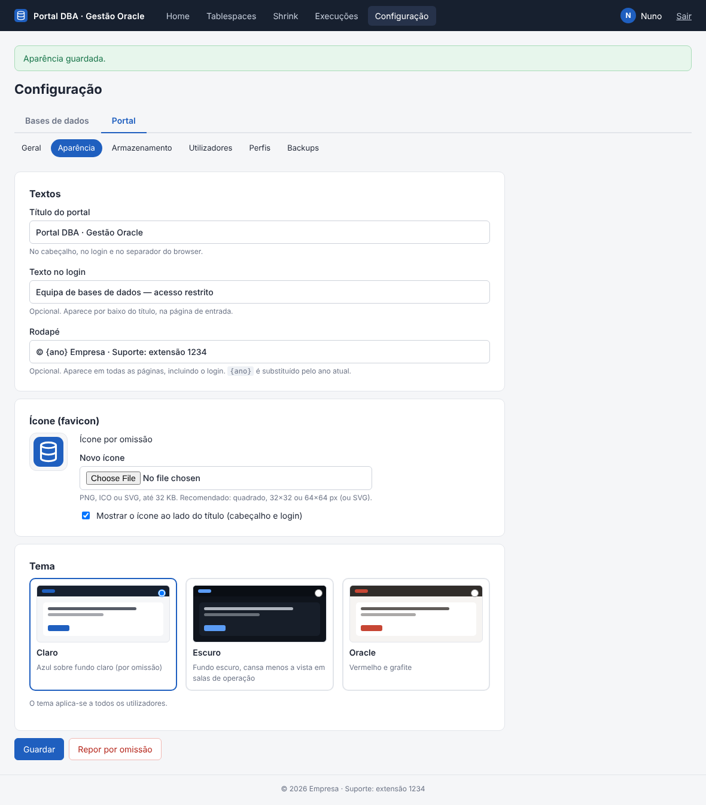

# Portal Oracle — gestão de espaço

Portal web em Python (Flask + Gunicorn + Nginx) para gerir bases de dados Oracle, com **utilizadores e perfis**. Para já faz o **shrink de tablespaces**, e está preparado para receber outras operações no futuro.

Corre num **contentor único em Ubuntu 26.04 LTS** com Nginx, Gunicorn, **OpenSSH** (para o VS Code Remote-SSH), **cron**, **git** e as ferramentas habituais (`ping`, `ip`, `vim`, `nano`).

---

## Funcionalidades

| Menu | Conteúdo |
|---|---|
| **Home** | Número de bases de dados visíveis, execuções em curso, execuções nas últimas 24 h, último backup, lista de bases de dados e últimas execuções |
| **Tablespaces** | Tamanho, usado e livre, do maior para o mais pequeno (sem SYSTEM, SYSAUX, UNDO e TEMP) |
| **Shrink** | Um tablespace ou TODOS, em ANÁLISE ou EXECUTAR, corre em segundo plano |
| **Execuções** | Histórico, passo em curso, log e cancelamento |
| **Configuração → Bases de dados** | Bases de dados Oracle: host, porta, SID ou Service Name, PDB, utilizador, password cifrada, Normal ou SYSDBA |
| **Configuração → Portal** | **Geral**, **Aparência** (título, textos, ícone e tema), **Armazenamento**, **Utilizadores**, **Perfis** e **Backups** |
| **Minha área** (nome no canto superior direito) | Dados do utilizador e alteração da password |

### Situações que o shrink trata automaticamente

| Situação | O que o script faz |
|---|---|
| O `MOVE ONLINE` deixa o segmento novo **no fim do ficheiro**, porque o antigo e o novo coexistem durante o MOVE | **2.ª passagem**: se o HWM continuar acima do alvo, volta a mover esses segmentos, que vão então para o espaço libertado no início |
| Segmentos **`TEMPORARY`** órfãos, restos de MOVE/REBUILD que o SMON ainda não limpou | Lista-os. Em EXECUTAR, se não houver MOVE/REBUILD/CREATE INDEX a correr, executa o evento `DROP_SEGMENTS` (nível = `ts# + 1`) e espera até 60 s |
| `ORA-03297` no resize (há blocos usados acima do valor pedido) | Recalcula o HWM e tenta tamanhos progressivamente maiores (+10 % + 64 MB), até 6 tentativas |
| Objetos na recyclebin (`BIN$`) | Avisa, e com a opção PURGE faz `PURGE TABLESPACE` |

### Utilizadores e perfis

- O **administrador** é o único utilizador **local**: fica no ficheiro `data/admin.json`, tem todas as permissões e vê todas as bases de dados.
- Os restantes utilizadores ficam na **base de dados do portal** e cada um tem um **perfil**.
- Um perfil define:
  - **que bases de dados** o utilizador vê (todas, ou uma lista);
  - **o que pode fazer**:

| Permissão | Descrição |
|---|---|
| `tablespaces.ver` | Ver tablespaces |
| `shrink.analise` | Shrink em modo ANÁLISE |
| `shrink.executar` | Shrink em modo EXECUTAR e cancelar execuções |
| `config.bds` | Gerir as bases de dados Oracle |
| `config.portal` | Gerir utilizadores, perfis e backups |

A aba **Armazenamento** só está disponível para o administrador.

**Acrescentar uma funcionalidade no futuro:** registe a nova permissão em `ACTIONS`, no ficheiro `app/auth.py`, e proteja a rota com `@auth.requires("nova.permissao")`. A permissão aparece automaticamente no formulário dos perfis.

---

## Instalação com Docker

> Para instalar diretamente num servidor, sem Docker, veja [Instalação num servidor (sem Docker)](#instalação-num-servidor-sem-docker).

```bash
cd /opt/oracle-portal               # pasta com o código (fica no anfitrião)
cp .env.example .env
mkdir -p data/ssh/users data/home
cp ~/.ssh/id_ed25519.pub data/ssh/users/<utilizador>.pub        # utilizador SSH pessoal (com sudo)

docker-compose build
docker-compose up -d
docker-compose exec -u portal portal python manage.py set-admin-password
```

| Acesso | Endereço |
|---|---|
| Portal | `http://<servidor>:8080` (utilizador `admin`) |
| SSH | `ssh -p 2222 <utilizador>@<servidor>` |

> **A atualizar a partir da versão anterior?** O serviço passou a chamar-se `portal` (antes era `app`), e já não há um contentor separado para o Nginx. Corra `docker-compose down` antes do `up`. As bases de dados Oracle já configuradas são migradas automaticamente. Um `PORTAL_ADMIN_PASSWORD_HASH` que já esteja no `.env` é usado para criar o `admin.json` no primeiro arranque.

### Ficheiros em `data/` (não versionar — **fazer backup**)

| Ficheiro | Conteúdo |
|---|---|
| `admin.json` | Administrador local (hash da password) |
| `fernet.key` | Chave de cifra das passwords. **Sem ela, as passwords guardadas perdem-se** |
| `portal.json` | Onde ficam os dados do portal (SQLite, MariaDB ou PostgreSQL) |
| `portal.sqlite3` | Dados do portal, quando se usa SQLite |
| `backups/` | Ficheiros de backup da configuração |
| `ssh/` | Chaves do servidor SSH, `authorized_keys` do `portal` e `users/` (utilizadores pessoais) |
| `home/` | Homes dos utilizadores (`home/portal`, `home/<utilizador>`, ...): `.vscode-server`, `.gitconfig`, histórico |

---

## Instalação num servidor (sem Docker)

O portal corre com o Gunicorn como serviço **systemd**, atrás do **Nginx**. Testado para **Ubuntu 26.04 LTS** (funciona também em 24.04/22.04, Debian 12 e RHEL/Rocky/Alma 9).

Há duas formas de instalar:

| Forma | Para quem |
|---|---|
| [**Script `instalar.sh`**](#instalação-com-o-script-instalarsh-recomendado) (recomendado) | Pergunta tudo e faz tudo: nome da instância, base de dados, Nginx, SSL, systemd, cron e firewall. Não é preciso alterar nenhum ficheiro |
| [**Passo a passo manual**](#instalação-manual-passo-a-passo) | Para perceber o que é feito, ou para adaptar a um caso especial |

### Nome da instância

Tudo o que depende do nome é gerado a partir de **um único valor**, o nome da instância (por omissão `portal-oracle`). Assim pode chamar-lhe, por exemplo, `nome-portal`, ou ter várias instâncias no mesmo servidor:

| Item | Valor gerado (exemplo com `nome-portal`) |
|---|---|
| Pasta | `/opt/nome-portal` |
| Utilizador de serviço (sem login) | `nome-portal` |
| Serviço systemd | `nome-portal.service` |
| Site do Nginx | `/etc/nginx/sites-available/nome-portal` (RHEL: `/etc/nginx/conf.d/nome-portal.conf`) |
| Logs do Nginx | `/var/log/nginx/nome-portal.access.log` / `.error.log` |
| Cron do backup | `/etc/cron.d/nome-portal` |
| Base de dados do portal (MariaDB/PostgreSQL) | `nome_portal`, utilizador `nome_portal` |
| Porta interna do Gunicorn | `127.0.0.1:8000`, ou a primeira livre a seguir |

Os ficheiros em `deploy/` são **templates** com marcadores (`@NOME@`, `@DIR@`, `@UTILIZADOR@`, ...), que o script preenche:

| Template | Gera |
|---|---|
| `deploy/portal.service.tpl` | `/etc/systemd/system/<nome>.service` |
| `deploy/nginx-http.conf.tpl` | Site do Nginx só com HTTP |
| `deploy/nginx-https.conf.tpl` | Site do Nginx com HTTPS (e HTTP a redirecionar para HTTPS) |
| `deploy/bd/postgresql.sql`, `deploy/bd/mariadb.sql` | SQL para criar a base de dados do portal, com os passos de acesso remoto em comentário |
| `deploy/bd/preparar-postgresql.sh`, `deploy/bd/preparar-mariadb.sh` | Scripts para correr **no servidor da base de dados** (não são templates) |

---

### Instalação com o script `instalar.sh` (recomendado)

#### 1. Obter o código

Não é preciso descarregar o repositório inteiro. Escolha uma das opções:

**a) Só o script.** O `instalar.sh` não encontra o código ao lado e oferece-se para ir buscar **só a pasta do portal** ao Git (clone parcial com `sparse-checkout`, a mesma lógica do [`extrair_pasta_git`](../../linux/geral/extrair_pasta_git)):

```bash
curl -fsSLO https://raw.githubusercontent.com/<utilizador>/<repositorio>/main/docker/portal-oracle/instalar.sh
sudo bash instalar.sh
#   Origem do codigo: 1) Obter so a pasta do portal de um repositorio Git
#   URL do repositorio: https://github.com/<utilizador>/<repositorio>.git
#   Branch [main]:
#   Pasta do portal no repositorio [docker/portal-oracle]:
```

Para não ter de escrever o URL de cada vez, preencha `REPO_URL_PADRAO` no início do `instalar.sh`.

**b) Só a pasta do portal, com o `extrair_pasta_git`:**

```bash
./extrair_pasta_git.sh -r https://github.com/<utilizador>/<repositorio>.git -p docker/portal-oracle -d /tmp/portal-oracle
sudo /tmp/portal-oracle/instalar.sh
```

**c) Já tem a pasta** (zip, cópia, clone): `sudo ./instalar.sh` dentro dela. O código é copiado para a pasta de instalação.

#### 2. Correr o script

```bash
sudo ./instalar.sh
```

O **Enter** aceita o valor entre `[ ]`. **Nada é alterado antes da confirmação final**, onde é mostrado um resumo.

| Passo | Perguntas |
|---|---|
| 1. Instância | Nome (ex. `nome-portal`), pasta (`/opt/<nome>`), utilizador de serviço (`<nome>`) |
| 2. Código | Copiar desta pasta, obter do Git (só a pasta do portal) ou manter o que já está instalado |
| 3. Aplicação | Porta interna do Gunicorn, nome do administrador, se define a password agora |
| 4. Base de dados | SQLite, MariaDB ou PostgreSQL, local ou remota (ver abaixo) |
| 5. Nginx e HTTPS | Nome DNS, sem HTTPS / certificado próprio / Let's Encrypt, portas |
| 6. Extras | Backup diário no cron (hora), abrir as portas na firewall (ufw ou firewalld, se ativa) |

Depois instala os pacotes, cria o utilizador, copia o código, cria o ambiente Python, prepara a base de dados, define a password do administrador, gera e ativa o serviço systemd, gera e testa o site do Nginx (`nginx -t`; se falhar, repõe o anterior), configura o cron e a firewall e mostra o endereço do portal.

#### 3. Base de dados do portal

| Opção | O que o script faz |
|---|---|
| **SQLite** | Nada a preparar: ficheiro `data/portal.sqlite3` |
| **MariaDB neste servidor** | Instala o `mariadb-server` (se não existir), cria a base de dados e o utilizador (password aleatória ou à escolha), liga e cria as tabelas |
| **PostgreSQL neste servidor** | Instala o `postgresql` (se não existir), cria a base de dados e o utilizador, acrescenta a linha ao `pg_hba.conf`, liga e cria as tabelas |
| **MariaDB / PostgreSQL noutro servidor** | Gera o SQL e diz o que correr no servidor remoto (abaixo). Depois testa a ligação até funcionar, ou continua com SQLite para mudar mais tarde |

**Base de dados remota.** O script deteta o IP deste servidor visto pelo servidor da base de dados e mostra algo como:

```
   Preparar o servidor db.dominio.pt (como root, no servidor postgresql):

     scp /opt/nome-portal/deploy/bd/preparar-postgresql.sh <utilizador>@db.dominio.pt:/tmp/
     sudo PORTAL_DB_PASSWORD=Xy...  bash /tmp/preparar-postgresql.sh \
          --bd nome_portal --utilizador nome_portal --cliente 10.0.0.5

   So SQL, para fazer a mao: /opt/nome-portal/data/bd/postgresql.sql

   Enter = testar a ligacao | i = instrucoes | s = continuar com SQLite e mudar depois:
```

O que os scripts de preparação fazem no servidor da base de dados (podem correr mais do que uma vez):

| Passo | `preparar-postgresql.sh` | `preparar-mariadb.sh` |
|---|---|---|
| Base de dados e utilizador | `CREATE ROLE ... LOGIN PASSWORD`, `CREATE DATABASE ... OWNER` (se já existir, só atualiza a password) | `CREATE DATABASE ... utf8mb4`, `CREATE USER '<util>'@'<IP>'`, `GRANT SELECT, INSERT, UPDATE, DELETE, CREATE, ALTER, INDEX, DROP` |
| Autorizar o IP do portal | Acrescenta ao **`pg_hba.conf`** (o caminho vem de `SHOW hba_file`), antes das outras regras, com cópia de segurança:<br>`host  nome_portal  nome_portal  10.0.0.5/32  scram-sha-256`<br>(usa `md5` se `password_encryption` for `md5`) | O utilizador é criado para esse IP |
| Escutar na rede | Se `listen_addresses` for `localhost`, pergunta se faz `ALTER SYSTEM SET listen_addresses = '*'` e reinicia | Se `bind-address` for `127.0.0.1`, pergunta se cria `99-acesso-remoto.cnf` com `bind-address = 0.0.0.0` e reinicia |
| Aplicar | `pg_reload_conf()` (ou reinício, se mudou o `listen_addresses`) | — |
| Firewall | Se ufw/firewalld estiver ativo, pergunta se abre a 5432 **só para o IP do portal** | Idem, porta 3306 |

Opções úteis: `--sem-rede` (não mexe em `listen_addresses`/`bind-address`), `--sem-firewall`, `-y` (sem confirmações), `--ajuda`. Se o root do MariaDB tiver password: `sudo MYSQL_PWD='...' ./preparar-mariadb.sh ...`.

Para preparar à mão, use o SQL gerado em `data/bd/<tipo>.sql` (com a password já preenchida, só legível pelo dono) ou os modelos `deploy/bd/postgresql.sql` e `deploy/bd/mariadb.sql`.

Mais tarde, a base de dados também pode ser mudada no portal, em **Configuração → Portal → Armazenamento** (copia os dados), ou pela linha de comandos:

```bash
cd /opt/<nome>
sudo -u <nome> PORTAL_DB_PASSWORD='...' .venv/bin/python manage.py set-storage \
     --type postgresql --host db.dominio.pt --port 5432 --database nome_portal --user nome_portal
sudo -u <nome> .venv/bin/python manage.py show-storage
```

O `set-storage` testa a ligação e cria as tabelas antes de gravar; se falhar, nada é alterado. Não copia dados (para isso use o portal).

#### 4. HTTPS (SSL)

| Opção | O que é preciso | O que o script faz |
|---|---|---|
| **Sem HTTPS** | — | Site só com HTTP. `PORTAL_COOKIE_SECURE=0` |
| **Certificado próprio** | Certificado e chave em PEM, chave **sem password**, e a cadeia (intermédios) se não estiver no certificado | Valida os ficheiros (formato, chave corresponde ao certificado, validade, nomes), gera o site com HTTPS e o HTTP a redirecionar para HTTPS. `PORTAL_COOKIE_SECURE=1` |
| **Let's Encrypt** | Nome DNS público a apontar para o servidor, porta 80 acessível da Internet | Instala o `certbot`, pede o certificado e configura o redirecionamento. A renovação é automática. Se falhar, o portal fica em HTTP |

Com certificado próprio:

- se indicar a **cadeia**, o script junta certificado e cadeia em `/etc/nginx/ssl/<nome>/fullchain.pem` e copia a chave para `privkey.pem` (só root). **Ao renovar o certificado, volte a correr o script** (ou repita a junção à mão);
- sem cadeia, o Nginx usa os ficheiros no sítio onde estão: ao renovar, basta substituí-los e fazer `sudo systemctl reload nginx`.

Para ver como fazer à mão, consulte o [passo 8 da instalação manual](#8-https-ssl).

#### 5. Reconfigurar, atualizar, várias instâncias e remover

| Objetivo | Como |
|---|---|
| **Mudar a configuração** (SSL, nome DNS, base de dados, porta, cron) | `sudo /opt/<nome>/instalar.sh` e indique o mesmo nome. As respostas anteriores aparecem como valores por omissão (ficam em `/opt/<nome>/.instalacao`, sem passwords). A base de dados pode ficar como está (opção "Manter") |
| **Atualizar o código** | Igual, escolhendo a origem "Git" (ou "Copiar da pasta deste script", a partir de uma pasta com a versão nova). `data/`, `.env` e `.venv` nunca são substituídos |
| **Outra instância** no mesmo servidor | Correr o script com outro nome. Use outro nome DNS (ou outra porta HTTP) para o Nginx |
| **Remover** | `sudo /opt/<nome>/instalar.sh --desinstalar <nome>`: remove o serviço, o site do Nginx e o cron. Pergunta se apaga a pasta (antes guarda `data/` em `/root/<nome>-data-<data>.tar.gz`) e o utilizador. A base de dados MariaDB/PostgreSQL não é tocada |

#### Permissões aplicadas

| Caminho | Dono | Porquê |
|---|---|---|
| Código (`app/`, `deploy/`, `*.py`, `instalar.sh`) | `root:<utilizador>`, só leitura para o grupo | O root volta a correr o `instalar.sh` e os templates: o serviço não os pode alterar |
| `.env` | `root:<utilizador>`, `640` | Lido pelo systemd |
| `data/` | `<utilizador>`, `700` | Chaves, passwords cifradas, SQLite, backups |
| `.venv/` | `<utilizador>` | Pacotes Python |
| `app/static/` | legível por todos | Servido diretamente pelo Nginx |

Para editar o código diretamente no servidor, use `sudo` (ou volte a correr o script com a origem Git).

---

### Instalação manual (passo a passo)

É o que o `instalar.sh` faz. Comece por definir as variáveis, que são usadas em todos os passos (o nome pode ser qualquer um, por exemplo `nome-portal`):

```bash
NOME=portal-oracle               # nome da instancia
DIR=/opt/$NOME                   # pasta de instalacao
UTIL=$NOME                       # utilizador de servico
BIND=127.0.0.1:8000              # Gunicorn (outra porta se ja houver outra instancia)
SERVER_NAME=portal.dominio.pt    # nome DNS, ou _ para qualquer nome
```

| Componente | Valor |
|---|---|
| Código | `$DIR` |
| Dados | `$DIR/data` (`admin.json`, `fernet.key`, SQLite, backups) |
| Ambiente Python | `$DIR/.venv` |
| Utilizador de serviço | `$UTIL` (sem login) |
| Gunicorn | `$BIND`, só local |
| Nginx | Porta 80/443, faz de proxy para o Gunicorn |

#### 1. Pacotes

> **Ubuntu 26.04:** o `sudo` é o sudo-rs, compatível com os comandos abaixo. O SSH é o OpenSSH 10.2, que já não aceita chaves DSA nem assinaturas `ssh-rsa` com SHA-1: use chaves ed25519.

```bash
sudo apt update
sudo apt install -y python3 python3-venv python3-pip nginx git curl openssl
# opcional, para testar a BD do portal a mao:
sudo apt install -y mariadb-client      # se usar MariaDB
sudo apt install -y postgresql-client   # se usar PostgreSQL
```

| Pacote | Para quê |
|---|---|
| `python3`, `python3-venv`, `python3-pip` | Correr o portal num ambiente Python isolado (`.venv`). O Ubuntu 26.04 traz Python 3.14 e, por causa do PEP 668, não deixa instalar pacotes com `pip` fora de um venv |
| `nginx` | Servidor web e proxy para o Gunicorn |
| `git` | Obter e atualizar o código |
| `openssl` | Validar certificados |

Não precisa do Oracle Instant Client: o `python-oracledb` em modo *thin* é Python puro. Os drivers de MariaDB (`pymysql`) e PostgreSQL (`psycopg[binary]`) também são instalados pelo `pip`, sem bibliotecas do sistema.

> **RHEL / Rocky / Alma:** `sudo dnf install -y python3.12 nginx git openssl`. Os ficheiros do Nginx vão para `/etc/nginx/conf.d/` e o utilizador do Nginx é `nginx`. Com SELinux ativo, corra também `sudo setsebool -P httpd_can_network_connect 1`.

#### 2. Utilizador e código

```bash
sudo useradd --system --user-group --home-dir $DIR --no-create-home --shell /usr/sbin/nologin $UTIL
sudo mkdir -p $DIR
# copiar o conteudo da pasta do portal, por exemplo so a pasta, com o extrair_pasta_git:
#   ./extrair_pasta_git.sh -r <url do repositorio> -p docker/portal-oracle -d /tmp/portal
sudo cp -rT /tmp/portal $DIR
sudo mkdir -p $DIR/data/backups $DIR/.venv

# codigo do root (so leitura para o servico); data/ e .venv do utilizador de servico
sudo chown -R root:$UTIL $DIR
sudo chmod -R u=rwX,g=rX,o= $DIR
sudo chown -R $UTIL:$UTIL $DIR/data $DIR/.venv
sudo chmod 700 $DIR/data
# o Nginx precisa de ler app/static
sudo chmod 755 $DIR $DIR/app
sudo chmod -R o+rX $DIR/app/static
```

#### 3. Ambiente Python e pacotes

```bash
cd $DIR
sudo -u $UTIL python3 -m venv .venv
sudo -u $UTIL .venv/bin/pip install --upgrade pip
sudo -u $UTIL .venv/bin/pip install -r requirements.txt
```

#### 4. Configuração (`.env`)

```bash
sudo cp .env.example .env
sudo chown root:$UTIL .env && sudo chmod 640 .env
sudo nano .env
```

Sem Docker, só estas variáveis contam (as `SSH_*` são ignoradas):

| Variável | Valor recomendado |
|---|---|
| `PORTAL_FERNET_KEY` | Vazio: a chave é criada em `data/fernet.key` |
| `PORTAL_COOKIE_SECURE` | `1` se usar HTTPS, `0` caso contrário |
| `TZ` | `Europe/Lisbon` |

#### 5. Base de dados do portal

Por omissão é SQLite e não é preciso fazer nada. Para MariaDB ou PostgreSQL:

1. No servidor da base de dados, corra o script de preparação (ou o SQL de `deploy/bd/`, substituindo os marcadores):
   ```bash
   sudo PORTAL_DB_PASSWORD='...' ./preparar-postgresql.sh --bd nome_portal --utilizador nome_portal --cliente <IP deste servidor>
   # local: --cliente 127.0.0.1 --sem-rede      (MariaDB local: --cliente localhost,127.0.0.1)
   ```
2. Neste servidor, aponte o portal para ela:
   ```bash
   cd $DIR
   sudo -u $UTIL PORTAL_DB_PASSWORD='...' .venv/bin/python manage.py set-storage \
        --type postgresql --host <servidor> --database nome_portal --user nome_portal
   ```

Os passos do `pg_hba.conf`, do `listen_addresses` e do `bind-address` estão explicados [acima](#3-base-de-dados-do-portal) e em comentário nos ficheiros `deploy/bd/*.sql`.

#### 6. Password do administrador

```bash
cd $DIR
sudo -u $UTIL .venv/bin/python manage.py set-admin-password
#   Administrador: admin
#   Nova password: ********
#   Gravado em /opt/<nome>/data/admin.json
```

Para usar outro nome: `manage.py set-admin-password --user <nome>`. O mesmo comando serve para repor a password se a esquecer.

#### 7. Serviço systemd e Nginx (HTTP)

Os templates são preenchidos com `sed`:

```bash
cd $DIR
preencher() { sed -e "s|@NOME@|$NOME|g" -e "s|@DIR@|$DIR|g" -e "s|@UTILIZADOR@|$UTIL|g" -e "s|@BIND@|$BIND|g" \
                  -e "s|@SERVER_NAME@|$SERVER_NAME|g" -e "s|@HTTP_PORT@|80|g" -e "s|@HTTPS_PORT@|443|g" \
                  -e "s|@HTTPS_URL@|https://\$host|g" -e "s|@SSL_CERT@|$SSL_CERT|g" -e "s|@SSL_KEY@|$SSL_KEY|g" "$1"; }

# systemd
preencher deploy/portal.service.tpl | sudo tee /etc/systemd/system/$NOME.service >/dev/null
sudo systemctl daemon-reload
sudo systemctl enable --now $NOME
sudo systemctl status $NOME                    # deve estar "active (running)"
curl -sI http://$BIND/login | head -1          # HTTP/1.1 200 OK

# Nginx (RHEL: /etc/nginx/conf.d/$NOME.conf, sem o ln)
preencher deploy/nginx-http.conf.tpl | sudo tee /etc/nginx/sites-available/$NOME >/dev/null
sudo ln -sf /etc/nginx/sites-available/$NOME /etc/nginx/sites-enabled/$NOME
sudo nginx -t && sudo systemctl reload nginx
```

O serviço corre o Gunicorn como `$UTIL`, lê o `.env` e reinicia se falhar. O `--bind` no serviço sobrepõe-se ao do `gunicorn.conf.py` (usado no Docker).

Se o `server_name` for `_` e o servidor só tiver este site, desative o site por omissão: `sudo rm /etc/nginx/sites-enabled/default`. Se já tiver outros sites, use um nome DNS.

O portal fica em `http://<servidor>/`.

#### 8. HTTPS (SSL)

**a) Com certificado próprio** (interno ou comprado):

1. Confirme os ficheiros:
   ```bash
   openssl x509 -in certificado.crt -noout -subject -enddate -ext subjectAltName   # nomes e validade
   openssl x509 -in certificado.crt -noout -pubkey | sha256sum                     # estes dois valores
   openssl pkey -in chave.key -pubout | sha256sum                                  # tem de ser iguais
   ```
   A chave não pode ter password (o Nginx não a consegue pedir). Para a retirar: `openssl pkey -in chave.key -out chave-sem-pw.key`.
2. Junte o certificado e a cadeia (intermédios) num só ficheiro e proteja a chave:
   ```bash
   sudo mkdir -p /etc/nginx/ssl/$NOME && sudo chmod 700 /etc/nginx/ssl/$NOME
   cat certificado.crt cadeia.crt | sudo tee /etc/nginx/ssl/$NOME/fullchain.pem >/dev/null
   sudo install -m 600 chave.key /etc/nginx/ssl/$NOME/privkey.pem
   SSL_CERT=/etc/nginx/ssl/$NOME/fullchain.pem
   SSL_KEY=/etc/nginx/ssl/$NOME/privkey.pem
   ```
3. Troque o site pelo template com HTTPS (o HTTP passa a redirecionar para HTTPS):
   ```bash
   cd $DIR
   preencher deploy/nginx-https.conf.tpl | sudo tee /etc/nginx/sites-available/$NOME >/dev/null
   sudo nginx -t && sudo systemctl reload nginx
   ```
4. Ponha `PORTAL_COOKIE_SECURE=1` no `.env` e `sudo systemctl restart $NOME`.
5. Abra a porta 443 (`sudo ufw allow 443/tcp`) e teste:
   ```bash
   curl -sI https://$SERVER_NAME/login | head -1
   openssl s_client -connect $SERVER_NAME:443 -servername $SERVER_NAME </dev/null 2>/dev/null | grep -E "Verify return|subject="
   ```

**b) Com Let's Encrypt** (nome DNS público e porta 80 acessível da Internet), a partir do site HTTP do passo 7:

```bash
sudo apt install -y certbot python3-certbot-nginx
sudo certbot --nginx -d $SERVER_NAME --redirect
```

Depois, `PORTAL_COOKIE_SECURE=1` no `.env` e `sudo systemctl restart $NOME`. O certbot renova o certificado automaticamente.

> Com `PORTAL_COOKIE_SECURE=1` o login só funciona por HTTPS: se o HTTPS não estiver a funcionar, volte a pôr `0`.

#### 9. Firewall

```bash
sudo ufw allow 'Nginx Full'          # 80 e 443
sudo ufw allow OpenSSH
```

O servidor tem também de chegar às bases de dados Oracle (porta 1521, ou a do listener) e, se for o caso, à base de dados do portal (3306 MariaDB, 5432 PostgreSQL).

#### 10. Backup automático (cron)

```bash
echo "0 2 * * * $UTIL cd $DIR && .venv/bin/python manage.py backup --prune >> data/cron.log 2>&1" | sudo tee /etc/cron.d/$NOME
```

Se tiver definido `PORTAL_FERNET_KEY` no `.env`, o cron não a vê. Nesse caso, no comando acima, antes do `.venv/bin/python`, acrescente `export $(grep -E '^PORTAL_FERNET_KEY=.' .env) &&` (o `.env` tem de ser legível pelo utilizador de serviço, o que já acontece com `640 root:$UTIL`).

### Operação

| Objetivo | Comando |
|---|---|
| Estado / reiniciar | `sudo systemctl status <nome>` / `sudo systemctl restart <nome>` |
| Logs do portal | `sudo journalctl -u <nome> -f` |
| Logs do Nginx | `sudo tail -f /var/log/nginx/<nome>.*.log` |
| Repor a password do admin | `cd /opt/<nome> && sudo -u <nome> .venv/bin/python manage.py set-admin-password` |
| Backup manual | `cd /opt/<nome> && sudo -u <nome> .venv/bin/python manage.py backup --note "manual"` |
| Ver a base de dados do portal | `cd /opt/<nome> && sudo -u <nome> .venv/bin/python manage.py show-storage` |
| Reconfigurar / atualizar | `sudo /opt/<nome>/instalar.sh` |

**Atualizar o portal à mão:** copie os ficheiros novos para a pasta (sem `data/`, `.env` e `.venv`), depois:

```bash
cd /opt/<nome>
sudo -u <nome> .venv/bin/pip install -r requirements.txt  # se o requirements.txt mudou
sudo systemctl restart <nome>
```

A pasta `data/` não é alterada por atualizações. Faça backup dela, sobretudo do `fernet.key` e do `admin.json`.

---

## Código no anfitrião (mount) e atualizações (Docker)

A imagem só contém o sistema: Ubuntu 26.04, Nginx, SSH, cron, git, Python 3.14 e os pacotes (num venv em `/opt/venv`). **Nada do portal é copiado para a imagem.** Tudo vem da pasta do anfitrião, montada em `/srv/portal`:

| Pasta / ficheiro no anfitrião | Conteúdo | Para aplicar uma alteração |
|---|---|---|
| `app/`, `wsgi.py`, `manage.py` | Código da aplicação | `supervisorctl restart gunicorn` |
| `docker/nginx.conf`, `docker/sshd.conf`, `docker/supervisord.conf` | Configuração do sistema (ligações simbólicas na imagem) | `docker-compose restart` |
| `docker/entrypoint.sh` | Preparação no arranque (utilizadores SSH, chaves, ...) | `docker-compose restart` |
| `requirements.txt` | Pacotes Python | `docker-compose restart` (o arranque instala as diferenças). Em alternativa, `docker-compose build` |
| `data/` | Dados, chaves, backups e homes | — |

Se o contentor (ou a imagem) for destruído, o código, as configurações e os dados ficam na pasta do anfitrião. Para voltar a pôr tudo a funcionar, basta `docker-compose up -d --build`.

**Atualizar o portal**, por exemplo com git:

```bash
cd /opt/oracle-portal && git pull          # no anfitrião, ou dentro do contentor por SSH
docker-compose restart                     # ou só: supervisorctl restart gunicorn
```

Só é preciso refazer a imagem (`docker-compose build`) para mudar o sistema base: pacotes apt ou versão do Ubuntu.

---

## Aparência: título, rodapé, ícone e tema

Em **Configuração → Portal → Aparência** (permissão `config.portal`):

| Campo | Onde aparece | Notas |
|---|---|---|
| **Título do portal** | Cabeçalho, login e separador do browser | Por omissão `Oracle · Gestão de espaço`. Até 80 caracteres |
| **Texto no login** | Por baixo do título, na página de entrada | Opcional, ex. `Equipa de bases de dados — acesso restrito` |
| **Rodapé** | Fundo de todas as páginas, incluindo o login | Opcional. `{ano}` é trocado pelo ano atual, ex. `© {ano} Empresa · Suporte: extensão 1234` |
| **Ícone (favicon)** | Separador do browser e, se escolher, ao lado do título | PNG, ICO ou SVG até 32 KB (o tipo é verificado pelo conteúdo). SVG com scripts ou eventos é recusado. Sem ícone próprio, é usado um ícone de base de dados na cor do tema |
| **Tema** | Todo o portal, para todos os utilizadores | **Claro** (azul, por omissão), **Escuro** e **Oracle** (vermelho e grafite) |

O botão **Repor por omissão** volta ao título, textos, ícone e tema originais.



| Tema Escuro | Tema Oracle |
|---|---|
|  |  |

**Onde fica guardado.** Na tabela `settings` da base de dados do portal (o ícone em base64), por isso:

- entra nos **backups da configuração** e é reposto ao importar;
- vale para todos os workers do Gunicorn e é mantido ao mudar de SQLite para MariaDB/PostgreSQL (com "Copiar os dados atuais").

O ícone é servido em `/favicon.ico` (rota pública, para aparecer no login), com cache. O URL muda quando o ícone ou o tema mudam, por isso o browser mostra logo o novo.

**Acrescentar um tema:** um bloco `html[data-tema="<nome>"] { ... }` com as variáveis de cor em `app/static/style.css` (copie o de um tema existente) e uma entrada em `THEMES`, no ficheiro `app/aparencia.py` (nome, descrição e cores da pré-visualização). Aparece automaticamente na página Aparência.

---

## Armazenamento: SQLite, MariaDB ou PostgreSQL

Escolhe-se em **Configuração → Portal → Armazenamento** (só o administrador):

1. Escolha o tipo e preencha host, porta, base de dados, utilizador e password (fica cifrada no `portal.json`).
2. Clique em **Testar ligação**. O portal liga e cria as tabelas.
3. Clique em **Guardar e mudar**, com a opção **Copiar os dados atuais** marcada.

A base de dados pode ser local (no anfitrião, ou noutro contentor) ou remota. Preparação:

```sql
-- MariaDB / MySQL
CREATE DATABASE portal CHARACTER SET utf8mb4;
CREATE USER 'portal'@'%' IDENTIFIED BY '...';
GRANT ALL ON portal.* TO 'portal'@'%';

-- PostgreSQL
CREATE USER portal PASSWORD '...';
CREATE DATABASE portal OWNER portal;
```

> Para ligar a uma base de dados no **anfitrião** a partir do contentor, use o IP da bridge do Docker (normalmente `172.17.0.1`). A base de dados tem de aceitar ligações nesse IP.

**Permissões no MariaDB.** O `GRANT` tem de ser para o host **de onde o contentor liga** (o MariaDB vê `172.17.0.1`, ou `172.18+.x.x` numa rede do docker-compose). Se o nome da base de dados tiver hífen, tem de ir entre backticks:

```sql
CREATE USER IF NOT EXISTS 'portal_oracle'@'172.%' IDENTIFIED BY '...';
GRANT SELECT, INSERT, UPDATE, DELETE, CREATE, ALTER, INDEX, DROP
   ON `portal-oracle`.* TO 'portal_oracle'@'172.%';
```

Sem isto, aparece `(1142, "SELECT command denied to user ...")`.

O administrador (`admin.json`), a chave de cifra e o `portal.json` ficam **sempre** em ficheiros locais.

---

## Backups da configuração

Em **Configuração → Portal → Backups**:

| Ação | Descrição |
|---|---|
| **Fazer backup agora** | Cria `data/backups/backup_<data>_manual_<id>.json` e regista-o, com uma nota opcional |
| **Importar de ficheiro** | Carrega um `.json`, que fica registado, e pode importá-lo logo |
| **Importar** (na lista) | Modo **juntar** (cria ou atualiza pelo nome) ou **substituir** (apaga as bases de dados, perfis e utilizadores atuais) |
| **Descarregar** | Faz download do ficheiro |
| **Remover** | Apaga o **ficheiro e o registo** |

- O backup inclui as definições (incluindo a aparência: título, textos, ícone e tema), as bases de dados Oracle (passwords cifradas), os perfis e os utilizadores (hashes).
- Não inclui o histórico de execuções, o administrador local nem a configuração de armazenamento.
- Antes de qualquer importação, é criado um backup automático (origem `pre-import`).
- Se o backup tiver sido feito com outra `fernet.key`, o portal avisa: as passwords Oracle terão de ser introduzidas outra vez.

### Backup automático com o cron

Entre por SSH, abra o crontab com `crontab -e` e acrescente:

```cron
0 2 * * * . /etc/profile.d/portal.sh; cd /srv/portal && /opt/venv/bin/python manage.py backup --prune >> data/cron.log 2>&1
```

O `--prune` mantém só os N últimos backups do cron. N define-se em **Configuração → Portal → Geral**.

---

## SSH e VS Code

### Utilizadores pessoais (com sudo)

Cada pessoa tem o seu utilizador. Para o criar, ponha a chave pública num ficheiro com o nome do utilizador:

```bash
# no anfitrião, na pasta do portal
cp utilizador1_id_ed25519.pub data/ssh/users/utilizador1.pub
cp utilizador2_id_ed25519.pub data/ssh/users/utilizador2.pub
docker-compose up -d --force-recreate
docker-compose logs portal | grep "Utilizador SSH"
#  Utilizador SSH: utilizador1 (uid 1001, sudo)
#  Utilizador SSH: utilizador2 (uid 1002, sudo)
```

No arranque, o contentor faz isto para cada ficheiro `data/ssh/users/<utilizador>.pub`:

| O quê | Detalhe |
|---|---|
| Conta | Cria `<utilizador>` com home persistente em `data/home/<utilizador>` |
| Chaves | Copia o `.pub` para `~/.ssh/authorized_keys`. Pode ter várias chaves, uma por linha (por exemplo, PC e portátil) |
| sudo | `NOPASSWD`, em `/etc/sudoers.d/ssh-users`. As contas não têm password (só chave), por isso o sudo não a pode pedir. A imagem usa o `sudo` clássico, não o sudo-rs que o 26.04 traz por omissão |
| Grupos | `sshusers` (acesso SSH) e `portal` (editar o código e usar `supervisorctl`) |
| UID | Fixo, guardado em `data/ssh/users/<utilizador>.uid`, e não muda ao recriar o contentor |

**Remover um utilizador:** apague o `.pub` (e o `.uid`) e recrie o contentor. A home em `data/home/` fica guardada até a apagar.

Os nomes de utilizador só podem ter minúsculas, números, `_` e `-`. `root` e `portal` são reservados.

### Utilizador de serviço `portal`

É o utilizador que corre o Gunicorn. O acesso SSH com ele é opcional (chave em `data/ssh/authorized_keys` ou em `SSH_AUTHORIZED_KEYS`) e não tem sudo, a não ser que defina `PORTAL_SSH_SUDO=1`. Para trabalhar no dia a dia, use os utilizadores pessoais.

| Item | Valor |
|---|---|
| Porta | `2222` |
| Autenticação | Só chave pública. A password (`SSH_PASSWORD`) aplica-se apenas ao utilizador `portal` |
| Código | `/srv/portal` (montado a partir do anfitrião) |

**Editar o código com vários utilizadores.** Os ficheiros em `/srv/portal` pertencem ao dono no anfitrião. Para que o grupo `portal` (gid 1000) os possa editar, corra uma vez no anfitrião:

```bash
# NAO incluir data/ (homes e chaves SSH exigem permissoes restritas)
cd /opt/oracle-portal
sudo find . -path ./data -prune -o -exec chgrp 1000 {} + -exec chmod g+rwX {} +
sudo find . -path ./data -prune -o -type d -exec chmod g+s {} +
```

As sessões SSH usam `umask 002`, por isso os ficheiros novos ficam editáveis pelo grupo. Com sudo, também pode sempre usar `sudo`.

**`~/.ssh/config` no seu PC:**

```
Host oracle-portal
    HostName <servidor>
    Port 2222
    User <utilizador>
    IdentityFile ~/.ssh/id_ed25519
    ForwardAgent yes        # usar a sua chave no git push/pull
```

**VS Code:** instale a extensão *Remote - SSH*, escolha **Connect to Host…** → `oracle-portal` e abra a pasta `/srv/portal`. O VS Code Server fica em `data/home`, por isso não volta a ser instalado quando o contentor é recriado.

**Git** (dentro do contentor):

```bash
git config --global user.name "<nome>"
git config --global user.email "..."
cd /srv/portal && git init && git remote add origin git@...:portal.git    # na 1.a vez
git pull / git push
```

**Aplicar alterações de código:**

```bash
supervisorctl restart gunicorn       # no terminal do VS Code / SSH (grupo portal)
```

Ou, a partir do anfitrião, `docker-compose restart`.

---

## Comandos úteis

| Objetivo | Comando (no anfitrião) |
|---|---|
| Logs (Nginx, Gunicorn, SSH, cron) | `docker-compose logs -f` |
| Estado dos processos | `docker-compose exec portal supervisorctl status` |
| Shell como root | `docker-compose exec portal bash` |
| Alterar a password do admin | `docker-compose exec -u portal portal python manage.py set-admin-password` |
| Backup manual pela linha de comandos | `docker-compose exec -u portal portal python manage.py backup --note "antes de atualizar"` |

---

## Bases de dados Oracle: privilégios

| Ligação | Necessário | Notas |
|---|---|---|
| SYSDBA | Password file (`remote_login_passwordfile = EXCLUSIVE`) | Usa `X$KTFBUE`: o cálculo do HWM é muito mais rápido |
| Normal | `SELECT ANY DICTIONARY`, `ALTER DATABASE`, `ALTER ANY TABLE`, `ALTER ANY INDEX`, `ALTER SYSTEM` (para cancelar) | Usa `DBA_EXTENTS`, que é mais lento |

O driver é o **python-oracledb** em modo *thin* (sem Instant Client). Requer Oracle 12.1 ou superior e não suporta Native Network Encryption: nesses casos, use o modo *thick*.

---

## Problemas comuns

| Erro | Causa e solução |
|---|---|
| Login falha logo depois de instalar | Corra `manage.py set-admin-password` (comando na tabela "Comandos úteis") |
| `No supported authentication methods` / `Permission denied (publickey)` com uma chave que funciona noutros servidores | Veja o motivo em `docker-compose logs portal \| grep sshd`. `bad ownership or modes`: recrie o contentor, que corrige as permissões. `ssh-rsa not in PubkeyAcceptedAlgorithms`: atualize o PuTTY (0.75 ou superior) ou use uma chave ed25519 |
| `Permission denied (publickey)` no SSH | A chave não está em `data/ssh/users/<utilizador>.pub`. Depois de a acrescentar, recrie o contentor e confirme com `docker-compose logs portal \| grep "Utilizador SSH"` |
| `WARNING: REMOTE HOST IDENTIFICATION HAS CHANGED` | Apagou `data/ssh/`. Remova a linha antiga do `~/.ssh/known_hosts` |
| `Driver Python em falta` no Armazenamento | Recrie a imagem: `docker-compose build --no-cache` |
| `dubious ownership` no git | Já está tratado para `/srv/portal`. Noutras pastas, use `git config --global --add safe.directory <pasta>` |
| Execução em `INTERROMPIDO` | O portal foi reiniciado durante a execução. Confirme em `V$SESSION` se a sessão Oracle continuou |
