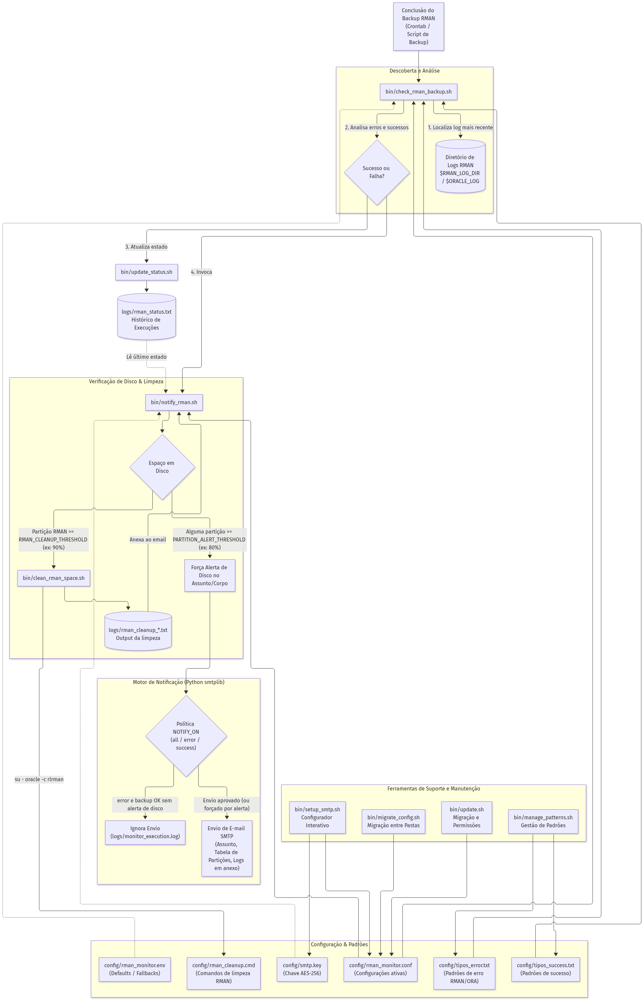
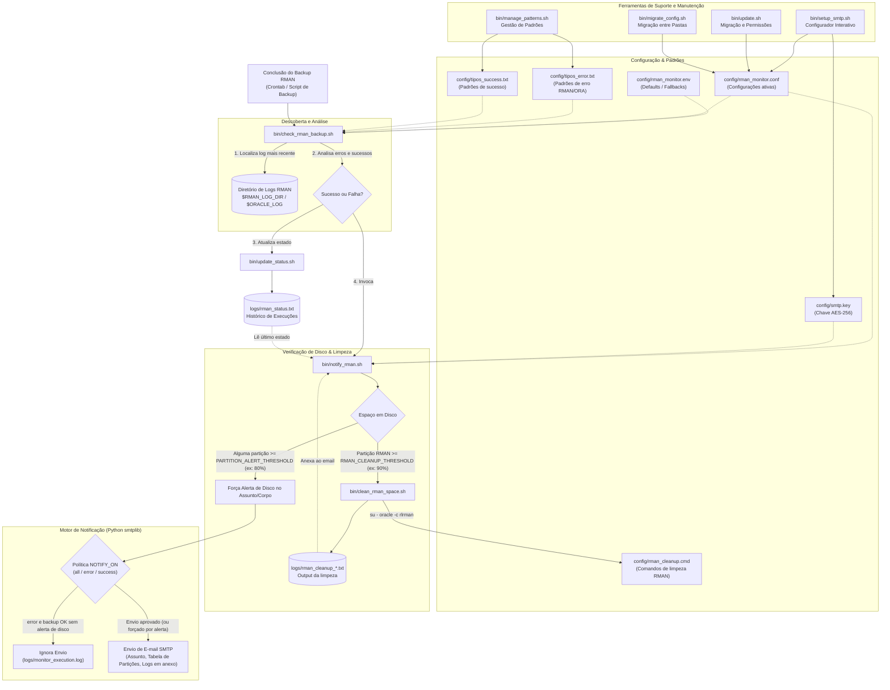

# Diagrama e Especificação do Monitor RMAN

Este documento apresenta o esquema visual da arquitetura e o detalhe das funções e objetivos de cada ficheiro do projeto **Monitor RMAN**.

---

## 1. Esquema Geral da Arquitetura e Fluxo

Ver definição Mermaid em código

---

## 2. Descrição e Objetivo de Cada Ficheiro

### 2.1 Diretório `bin/` (Scripts Executáveis)

| Ficheiro | O que faz | Objetivo |
| :--- | :--- | :--- |
| **`check_rman_backup.sh`** | Ponto de entrada do monitor. Localiza o ficheiro de log mais recente no diretório de backups, valida se foi gerado nas últimas 12 horas, pesquisa termos de falha (`tipos_error.txt`) e termos de sucesso (`tipos_success.txt`). Regista o resultado via `update_status.sh` e dispara `notify_rman.sh`. | Auditar e classificar automaticamente o resultado do backup de forma não invasiva logo após a sua conclusão. |
| **`notify_rman.sh`** | Avalia a ocupação das partições de disco, chama a rotina de limpeza caso a partição RMAN ultrapasse o limite crítico ($\ge 90\%$), força alertas caso alguma partição esteja $\ge 80\%$, valida a política de notificação (`NOTIFY_ON`) e despacha o email via Python 3 (`smtplib`) com suporte a TLS e autenticação. | Centralizar as notificações por email, fornecendo relatórios claros de ocupação em disco, logs em anexo e alertas operacionais. |
| **`clean_rman_space.sh`** | Executa a rotina de limpeza do Oracle RMAN via `rlrman target / catalog /@ADMINDB` com o utilizador `oracle` (recorrendo aos comandos em `rman_cleanup.cmd`). Redireciona o output integral para um ficheiro timestamparamado em `logs/`. | Libertar espaço em disco preventivamente quando a partição de backups atinge níveis críticos, evitando paragens por falta de espaço. |
| **`setup_smtp.sh`** | Assistente interativo em linha de comandos que recolhe, valida e grava as configurações (`ORACLE_SID`, diretório de logs, SMTP, TLS, remetente, destinatários, partições, limiares de alerta e de limpeza). Cifra a password em AES-256 e gera a chave `smtp.key`. | Facilitar a instalação e reconfiguração segura do monitor sem necessidade de editar ficheiros manualmente nem expor senhas. |
| **`update_status.sh`** | Recebe os argumentos de estado (`SUCCESS`/`FAILED`), log analisado e detalhe, gerando uma nova linha cronológica na tabela de histórico `logs/rman_status.txt`. | Manter o registo estruturado e histórico de todas as execuções de backup no servidor. |
| **`manage_patterns.sh`** | Menu de terminal para listar e adicionar interativamente padrões a `config/tipos_error.txt` e `config/tipos_success.txt`, assegurando a prevenção de duplicados. | Gerir a lista de expressões monitorizadas sem risco de corrupção dos ficheiros. |
| **`update.sh`** | Rotina de pós-atualização de código (ex.: após `git pull`). Garante a criação de pastas em falta, migra ficheiros `.conf` antigos adicionando novas variáveis por omissão e repõe permissões estritas (`chmod 600` e `chmod +x`). | Manter a consistência, segurança e compatibilidade retroativa do ambiente após atualizações. |
| **`migrate_config.sh`** | Copia as configurações, chaves de cifra e histórico de uma instalação antiga para uma nova diretoria, criando backups automáticos antes da substituição. | Permitir reinstalações ou mudanças de diretório sem perda de credenciais ou histórico. |

---

### 2.2 Diretório `config/` (Configurações e Regras)

| Ficheiro | O que faz | Objetivo |
| :--- | :--- | :--- |
| **`rman_monitor.env`** | Define as variáveis de ambiente base, caminhos padrão e valores de fallback para todo o ecossistema. | Servir de referência padrão do sistema e fallback caso o `.conf` ainda não exista. |
| **`rman_monitor.conf`** | Ficheiro de configuração ativo gerado pelo `setup_smtp.sh` com permissões restritas (`chmod 600`). Guarda os parâmetros reais do servidor e a password SMTP cifrada. | Armazenar a configuração operacional segura e personalizada de cada servidor. *(Não versionado)* |
| **`smtp.key`** | Chave simétrica aleatória de 256 bits com permissões `chmod 600`. | Chave criptográfica para cifrar e decifrar a password da conta SMTP. *(Não versionada)* |
| **`tipos_error.txt`** | Lista de expressões regulares e códigos de erro padrão da Oracle (`RMAN-00571`, `ORA-19502`, `ORA-00600`, `FAILED`, etc.). | Definir os padrões que classificam uma execução como falhada. |
| **`tipos_success.txt`** | Lista de padrões de conclusão positiva do RMAN (por defeito: `Recovery Manager complete`). | Confirmar que o backup foi concluído na totalidade e sem interrupções. |
| **`rman_cleanup.cmd`** | Script de comandos RMAN com rotina de `CROSSCHECK` e eliminação de backups e archivelogs obsoletos com mais de 7 dias (`SYSDATE-7`). | Fornecer os comandos RMAN a executar automaticamente pelo `clean_rman_space.sh`. |

---

### 2.3 Diretório `logs/` (Histórico e Registos)

| Ficheiro | O que faz | Objetivo |
| :--- | :--- | :--- |
| **`rman_status.txt`** | Tabela formatada por delimitador `\|` com data, host, SID, estado, caminho do log e mensagem descritiva. | Base de dados textual de execuções consultável por scripts ou administradores. |
| **`monitor_execution.log`** | Registo operacional das decisões do monitor (notificações enviadas, ignoradas por política, avisos de ligação, etc.). | Auditoria e diagnóstico de funcionamento interno do monitor. |
| **`rman_cleanup_*.txt`** | Output detalhado gerado pela execução do utilitário `rlrman` durante a limpeza de emergência. | Evidência técnica das ações de limpeza enviada em anexo no email de alerta. |

---

### 2.4 Ficheiros Raiz

| Ficheiro | O que faz | Objetivo |
| :--- | :--- | :--- |
| **`VERSION`** | Ficheiro de texto simples com o número de versão semântica da aplicação. | Identificação de versão para controlo e migrações no `update.sh`. |
| **`README.md`** | Manual operacional e técnico completo da aplicação. | Servir de referência detalhada para administradores e DBAs. |
| **`DIAGRAMA.md`** | Esquema visual em Mermaid e resumo de componentes e objetivos. | Consulta rápida e visual da arquitetura e responsabilidades de cada componente. |

