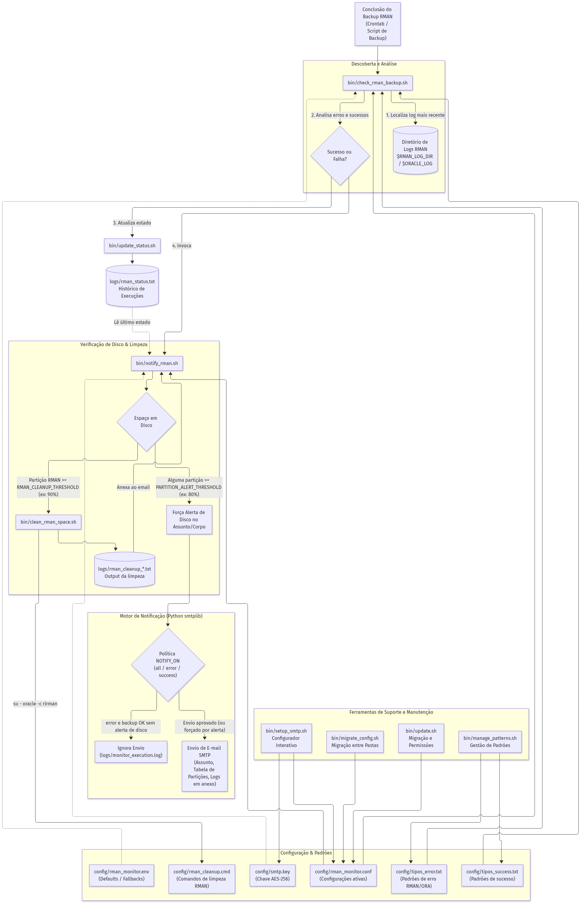
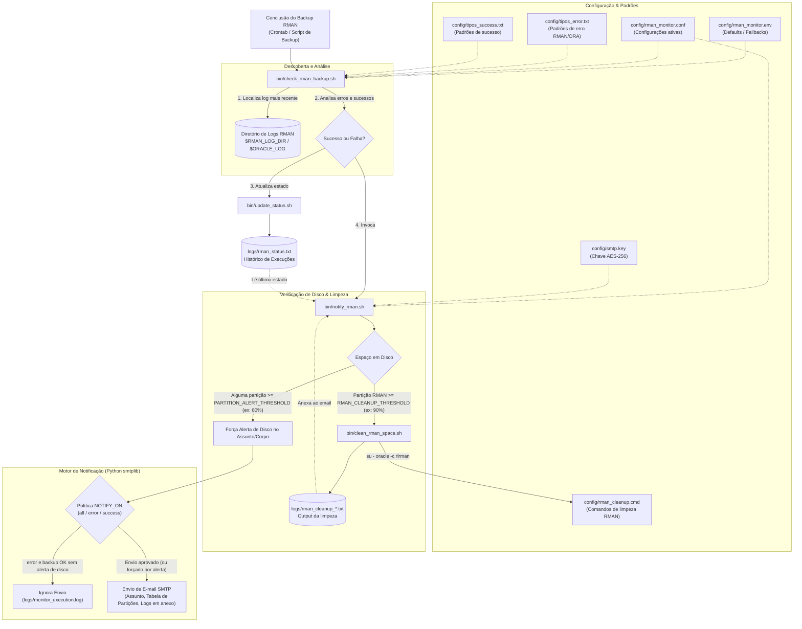

# Monitor Pós-Execução de Backups Oracle RMAN (projeto `monitor`, antes `backup`)

Especificação técnica e manual operacional para o script autónomo de auditoria e validação de backups RMAN em servidores **Oracle Linux**. O script é acionado **imediatamente após a conclusão do script de backup**, inspecionando o ficheiro de log mais recente localizado no diretório indicado pela variável de ambiente `$ORACLE_LOG`. O conteúdo é comparado com uma lista de erros críticos (`tipos_error.txt`) e, caso sejam detetadas falhas, um alerta é enviado por e-mail via **SMTP**. Quando o backup termina com sucesso (`Recovery Manager complete`), é também enviada uma notificação de sucesso. O resultado de cada execução fica registado numa tabela de estado e a password SMTP é guardada cifrada (ver secção 8).

---

## 1. Visão Geral da Arquitetura

- **Sistema Operativo:** Oracle Linux 7 / 8 / 9 (RHEL compatível).
- **Linguagem Principal:** Bash (POSIX shell com utilitários GNU `grep`) integrado com Python 3 (`smtplib`) para envio seguro e fiável de mensagens SMTP sem dependência de MTA local complexo.
- **Momento de Execução:** Pós-backup imediato (chamado no final do script orquestrador de backup ou encadeado via `;` / `&&`).
- **Diretório de Logs:** Lido a partir da variável de ambiente **`$ORACLE_LOG`** (com fallback configurável no `.env`).
- **Padrões de Nomes de Ficheiro Monitorizados:**
  - `FAPrmanINCU-*` (Incremental Cumulativo / Atual)
  - `FAPSTrman_arch*` (Standby Archives)
  - `FAPDBrman_arch*` (Database Archive Logs)
  - `FAPrmanFULL*` (Backup Full)
  - `FAPrmanINCR1*` (Incremental Nível 1)
- **Base de Erros:** `config/tipos_error.txt` (expressões e códigos de erro por linha).
- **Notificação:** E-mail SMTP de **erro** (servidor, ficheiro verificado, horário e excerto) e de **sucesso** (hostname, `ORACLE_SID` e dia do backup), com o log opcionalmente em anexo.
- **Tabela de Estado:** `logs/rman_status.txt`, atualizada a cada execução e usada para decidir a notificação.
- **Segredos:** password SMTP cifrada em `config/rman_monitor.conf` com a chave `config/smtp.key`.

### 1.1 Esquema e Fluxo de Execução

Consulte também o documento [DIAGRAMA.md](DIAGRAMA.md) com a discriminação exaustiva e objetivos de cada ficheiro do sistema.





---

## 2. Estrutura de Diretórios Recomendada

```text
/opt/oracle/rman_monitor/
├── VERSION                      # Versão do projeto (usada por bin/update.sh)
├── bin/
│   ├── check_rman_backup.sh     # Script principal de validação (erro e sucesso)
│   ├── setup_smtp.sh            # Configuração interativa (ORACLE_SID, diretório de logs, SMTP)
│   ├── manage_patterns.sh       # Ver/acrescentar padrões de erro e de sucesso
│   ├── update.sh                # Atualiza a estrutura após nova versão do projeto
│   ├── migrate_config.sh        # Copia a pasta config de um monitor antigo para o novo
│   ├── update_status.sh         # Atualiza a tabela de estado
│   └── notify_rman.sh           # Envia o e-mail de sucesso/erro com o log em anexo
├── config/
│   ├── rman_monitor.env         # Parâmetros de fallback, SMTP e destinatários
│   ├── rman_monitor.conf        # Gerado por setup_smtp.sh (ORACLE_SID, SMTP, password cifrada)
│   ├── smtp.key                 # Chave de cifra da password (chmod 600, não versionar)
│   ├── tipos_error.txt          # Padrões de erro (RMAN-*, ORA-*, etc.)
│   └── tipos_success.txt        # Padrões de sucesso (ex.: Recovery Manager complete)
├── logs/
│   ├── monitor_execution.log    # Histórico de execuções do script monitor
│   └── rman_status.txt          # Tabela de estado (data|host|SID|estado|log|detalhe)
└── README.md                    # Documentação e especificações
```

---

## 3. Especificação do Ficheiro de Erros (`config/tipos_error.txt`)

O ficheiro contém termos ou códigos de erro padrão Oracle/RMAN. Se qualquer uma destas linhas for encontrada no log analisado, o backup é classificado como falhado:

```text
RMAN-00571
RMAN-03002
RMAN-03015
RMAN-06059
ORA-19502
ORA-19504
ORA-27037
ORA-00600
ORA-07445
error occurred in stored script
FAILED
```

---

## 4. Requisitos e Fluxo Funcional (`check_rman_backup.sh`)

### 4.1 Resolução do Diretório e Descoberta do Log
1. **Leitura da Variável `$ORACLE_LOG`:**
   - O script valida se a variável `$ORACLE_LOG` está definida e se aponta para um diretório existente.
   - Caso não esteja definida na sessão, carrega o valor padrão configurado em `config/rman_monitor.env`.
   - Se o diretório não existir ou estiver inacessível, aborta e gera alerta de configuração.
2. **Seleção do Ficheiro Mais Recente:**
   - No diretório `$ORACLE_LOG`, procura ficheiros correspondentes aos prefixos definidos:
     `FAPrmanINCU-*`, `FAPSTrman_arch*`, `FAPDBrman_arch*`, `FAPrmanFULL*`, `FAPrmanINCR1*`.
   - Identifica o ficheiro com a data de modificação mais recente.
   - Se nenhum ficheiro for encontrado ou se o ficheiro mais recente tiver sido modificado há mais de 12 horas (indicando que o backup sequer criou o log), dispara notificação de anomalia.

### 4.2 Análise de Erros
1. Carrega os padrões de busca a partir de `config/tipos_error.txt`.
2. Executa a correspondência de erros (ex.: `grep -F -f config/tipos_error.txt "$LOG_FILE"`).
3. Se forem encontrados padrões de erro:
   - Extrai as linhas do erro com contexto adicional (`grep -B 1 -A 2`).
   - Define o estado da execução como `FAILED`.

### 4.3 Notificação via SMTP
1. Caso seja detetado erro no log:
   - Monta o corpo do e-mail com:
     - **Servidor (Hostname):** `hostname -f`
     - **Diretório `$ORACLE_LOG`:** Caminho resolvido
     - **Ficheiro de Log Analisado:** Nome e caminho completo do log
     - **Data/Hora da Execução:** Formato ISO/legível
     - **Trecho do Erro:** Linhas capturadas no grep
   - **Assunto:** `[ALERTA RMAN FALHA] Falha no Backup RMAN em $(hostname -s) - Log: $(basename "$LOG_FILE")`
2. Caso o backup termine com sucesso (sem erros críticos e com `Recovery Manager complete` no log):
   - **Assunto:** `<hostname> - Backup RMAN OK`; corpo com hostname, `ORACLE_SID` e "o backup de rman do dia X correu com sucesso".
   - Nos erros, o assunto passa a ser `<hostname> - ERRO no Backup RMAN` (ver secção 8).
3. O envio é realizado via script inline Python 3 (`smtplib`), garantindo suporte a servidores SMTP internos ou autenticados sem necessidade de configurar um Postfix local.

---

## 5. Ficheiro de Configuração (`config/rman_monitor.env`)

```bash
# Fallback caso a variável de ambiente $ORACLE_LOG não esteja exportada
FALLBACK_ORACLE_LOG="/u01/app/oracle/backup/logs"

# Caminhos do monitor
MONITOR_HOME="/opt/oracle/rman_monitor"
ERROR_LIST_FILE="${MONITOR_HOME}/config/tipos_error.txt"
EXEC_LOG="${MONITOR_HOME}/logs/monitor_execution.log"

# Configuração de E-mail / SMTP
SMTP_SERVER="smtp.emfa.pt"
SMTP_PORT=25
SMTP_USE_TLS=false
MAIL_FROM="oracle-backup@fap-teste.emfa.pt"
MAIL_TO="dba-team@emfa.pt,suporte-sistemas@emfa.pt"
```

---

## 6. Integração Pós-Backup

No script que dispara o backup do RMAN (ex.: `run_backup.sh`), adicione a chamada do monitor no final:

```bash
#!/bin/bash
# Exemplo de chamada no script de backup existente

# 1. Garante que ORACLE_LOG está exportado
export ORACLE_LOG="/u01/app/oracle/backup/logs"

# 2. Execução do backup RMAN existente
# ... comandos rman ...

# 3. Chamada imediata do monitor pós-execução
/bin/bash /opt/oracle/rman_monitor/bin/check_rman_backup.sh
```

Em alternativa, via linha de comandos ou crontab concatenado:

```bash
0 2 * * * /u01/app/oracle/scripts/backup_database.sh && /opt/oracle/rman_monitor/bin/check_rman_backup.sh >> /opt/oracle/rman_monitor/logs/monitor_execution.log 2>&1
```

---

## 7. Instruções para o Agente de Código

1. Crie o ficheiro `bin/check_rman_backup.sh` com:
   - Resolução da variável `$ORACLE_LOG` com fallback para `FALLBACK_ORACLE_LOG`.
   - Seleção do ficheiro mais recente respeitando os prefixos exigidos.
   - Leitura de `config/tipos_error.txt` e busca de correspondências.
   - Bloco em Python 3 para envio do e-mail formatado via SMTP.
2. Crie o ficheiro `config/tipos_error.txt` com os códigos de erro listados na secção 3.
3. Crie o ficheiro `config/rman_monitor.env` com as definições de ambiente.
4. Conceda permissão de execução aos scripts (`chmod +x bin/*.sh`) e execute `bin/setup_smtp.sh` para configurar o SMTP.

---

## 8. Notificações SMTP (sucesso e erro) e tabela de estado

Scripts em `bin/`:

| `setup_smtp.sh` | Interativo: pede `ORACLE_SID`, o **diretório dos logs do backup RMAN** (`RMAN_LOG_DIR`, tem prioridade sobre `$ORACLE_LOG`), SMTP, STARTTLS, **validação de certificado TLS** (`SMTP_TLS_VERIFY`, predefinição: `false`), remetente, destinatários, **condição de envio de notificação** (`NOTIFY_ON`), **partições de disco a reportar** (`MONITORED_PARTITIONS`) e password; grava `config/rman_monitor.conf` (chmod 600). A password é cifrada (AES-256-CBC, PBKDF2) com a chave `config/smtp.key` (criada se não existir, chmod 600). |
| `update_status.sh ESTADO LOG DETALHE` | Acrescenta uma linha à tabela `logs/rman_status.txt`: `data_hora\|hostname\|ORACLE_SID\|SUCCESS/FAILED\|log\|detalhe`. |
| `notify_rman.sh` | Lê a última linha da tabela e envia o email respeitando `NOTIFY_ON`: assunto `<hostname> - Backup RMAN OK` ou `<hostname> - ERRO no Backup RMAN`; corpo com hostname, `ORACLE_SID`, detalhe, tabela de partições e "o backup de rman do dia X correu com sucesso/falhou"; log em anexo se `ATTACH_LOG=true`. |

`check_rman_backup.sh` considera sucesso apenas se o log não tiver erros críticos **e** contiver pelo menos um padrão de `config/tipos_success.txt` (omissão: `Recovery Manager complete`); depois atualiza a tabela e notifica.
`config/rman_monitor.conf` e `config/smtp.key` não devem ser versionados nem partilhados.

### 8.1 Condição de Notificação por Email (`NOTIFY_ON`)

O parâmetro `NOTIFY_ON` define em que situações é enviado o email de notificação pelo monitor:
- `all` (ou `1`): envia email **tanto em caso de erro como de sucesso** (predefinição).
- `error` (ou `2`): envia email **apenas em caso de erro** / falha no backup.
- `success` (ou `3`): envia email **apenas em caso de sucesso** no backup.

Pode ser configurado interativamente através de `bin/setup_smtp.sh` ou definido em `config/rman_monitor.env` / `config/rman_monitor.conf`. Se a notificação for ignorada por política, o evento é registado em `logs/monitor_execution.log` e a tabela `logs/rman_status.txt` mantém o histórico completo.

- **Exceção de Alerta de Disco (`PARTITION_ALERT_THRESHOLD`):** Se `NOTIFY_ON` estiver definido como `error` (notificar apenas erro), mas qualquer partição monitorizada (`MONITORED_PARTITIONS` ou `RMAN_PARTITION`) estiver com ocupação **$\ge$ 80%** (limiar configurável em `setup_smtp.sh` ou através de `PARTITION_ALERT_THRESHOLD`), o monitor **força na mesma o envio do email** com um alerta explícito no assunto e no corpo da mensagem (ex.: `fap-db01 - Backup RMAN OK - ALERTA: Partição /oracle/backup atingiu 82%`). Defina `PARTITION_ALERT_THRESHOLD=0` se pretender desativar este comportamento.

### 8.2 Monitorização de Espaço em Disco / Partições no Email (`MONITORED_PARTITIONS`)

O assistente `bin/setup_smtp.sh` permite configurar interativamente a quantidade de partições a acompanhar e o respetivo caminho no sistema de ficheiros (ex.: `/u01`, `/oracle/backup`).

No corpo de cada e-mail (seja de sucesso ou de falha), é incluído um resumo direto e simples:
```text
Espaço em Disco / Partições:
Partição             Tamanho    Disponível    Ocupado
-----------------------------------------------------
/u01                100.0 GB       45.0 GB      55.0%
/oracle/backup      500.0 GB      120.0 GB      76.0%
```
- Se indicar `0` no setup, a informação de espaço em disco não é incluída.
- Os caminhos são guardados em `config/rman_monitor.conf` (e `config/rman_monitor.env`) na variável `MONITORED_PARTITIONS`.

### 8.3 Limpeza Automática da Partição RMAN (`RMAN_CLEANUP_THRESHOLD`)

Quando a partição onde reside o RMAN atinge uma ocupação percentual superior ao limiar configurado (por omissão **90%**, personalizável em `bin/setup_smtp.sh` ou através de `RMAN_CLEANUP_THRESHOLD`):
1. O script `bin/clean_rman_space.sh` deteta a capacidade e executa a rotina de limpeza com o utilizador `oracle` via `rlrman` (`rlrman target / catalog /@ADMINDB`).
2. Os comandos RMAN submetidos encontram-se definidos em `config/rman_cleanup.cmd`:
   ```sql
   CROSSCHECK BACKUP;
   DELETE NOPROMPT BACKUP COMPLETED BEFORE 'SYSDATE-7';
   CROSSCHECK ARCHIVELOG ALL;
   DELETE NOPROMPT EXPIRED ARCHIVELOG ALL;
   DELETE NOPROMPT ARCHIVELOG ALL COMPLETED BEFORE 'sysdate-7';
   EXIT;
   ```
3. O output integral da execução é guardado num ficheiro de texto em `logs/rman_cleanup_YYYYMMDD_HHMMSS.txt`.
4. O email de notificação (`bin/notify_rman.sh`) apresenta no corpo a informação explícita de que a partição excedeu o limite e a limpeza foi executada, **anexando o ficheiro de texto (.txt) com o output completo do comando rlrman**.
5. Para desativar a limpeza automática, defina `RMAN_CLEANUP_THRESHOLD=0` em `config/rman_monitor.conf`.

### 8.4 Listas de erro e de sucesso (`bin/manage_patterns.sh`)

Existem dois ficheiros: `config/tipos_error.txt` (padrões que indicam erro) e `config/tipos_success.txt` (padrões que indicam sucesso). O script pergunta qual lista se pretende ver (erro ou sem erro), mostra o conteúdo numerado e permite acrescentar um novo padrão (sem duplicados).

### 8.5 Atualização do projeto (`bin/update.sh`)

Após atualizar o código (ex.: `git pull`), execute `bin/update.sh`: cria pastas e listas em falta (incluindo `config/rman_cleanup.cmd`), migra o `.conf` (adiciona `RMAN_CLEANUP_THRESHOLD="90"` e `RMAN_PARTITION=""`), acerta permissões (`*.sh` executáveis, `.conf` e `smtp.key` a 600) e regista a versão em `config/.installed_version`. Não apaga dados nem a chave.

### 8.6 Nomes de log e autenticação SMTP

- Os nomes de log monitorizados são definidos por `LOG_FILE_PATTERNS` (globs separados por espaço, em `config/rman_monitor.env`). Por omissão inclui os prefixos `FAP*` e também `*rman*` (ex.: `ORACLEDBrman_arch_delete-*.log`).
- **Validação de certificado TLS (`SMTP_TLS_VERIFY`):** Por predefinição é `false` (configurável em `setup_smtp.sh`), garantindo compatibilidade com servidores SMTP internos ou corporativos com certificados emitidos por CAs privadas/locais. Se a validação falhar (`CERTIFICATE_VERIFY_FAILED`), o script efetua automaticamente fallback com aviso para garantir a entrega da mensagem.
- Se houver utilizador SMTP mas o servidor não anunciar `AUTH` (ex.: porta 25 sem STARTTLS), o envio prossegue sem autenticação com um aviso, em vez de falhar. Para autenticar, ative STARTTLS (`SMTP_USE_TLS=true`, porta 587) via `bin/setup_smtp.sh`.
- Se o servidor anunciar `AUTH` apenas com mecanismos que o Python não suporta (só `PLAIN`, `LOGIN` e `CRAM-MD5`), o login falha; o aviso indica os mecanismos anunciados e o envio é tentado sem autenticação (válido para relays internos). Caso contrário, limpe o utilizador no `setup_smtp.sh`.

### 8.7 Migrar a configuração para uma nova versão (`bin/migrate_config.sh`)

Ao instalar uma nova versão noutra pasta (ex.: `monitor_old` -> `monitor_new`), execute `bin/migrate_config.sh`. O script pede o caminho do monitor antigo e do novo (ou recebe-os como `$1 $2`), pede confirmação, guarda o `config` existente no destino em `config.bak-<data>`, copia a pasta `config` do antigo (`.conf`, `smtp.key`, listas de erro/sucesso, `.env`), reaplica permissões 600 ao `.conf` e à chave, oferece copiar `logs/rman_status.txt` e executa o `update.sh` do novo.
- Com utilizador SMTP definido, o `notify_rman.sh` usa **STARTTLS automaticamente** se o servidor o oferecer (muitos servidores, ex. Exchange, só anunciam `PLAIN`/`LOGIN` depois de TLS; em texto simples anunciam só `GSSAPI`/`NTLM`, não suportados). Se o certificado for de uma CA interna não reconhecida, defina `SMTP_TLS_VERIFY=false` em `config/rman_monitor.env`. O erro `530 5.7.57 ... not authenticated` indica que o servidor exige autenticação; use a porta 587 se a 25 não oferecer STARTTLS.
